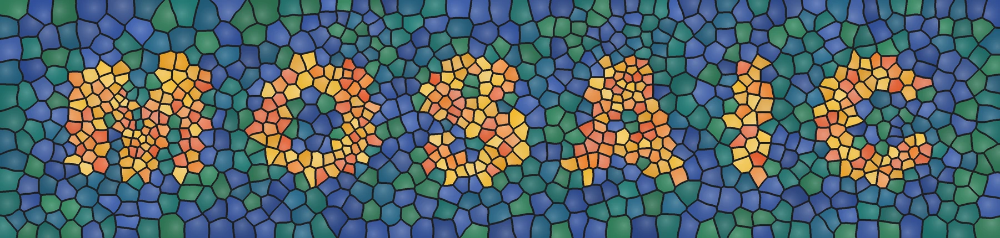

<p align="center">
  
</p>

# Mosaic

**A benchmark suite and reusable collection of differentiable physics solvers.**

This snapshot of Mosaic accompanies the NeurIPS 2026 paper. For the current version of Mosaic, its documentation, the latest benchmark results, and how to contribute, see the [`main` branch](https://github.com/pasteurlabs/mosaic).

## Reproduce the paper

The paper's results were computed on one NVIDIA A100 80 GB with the code and solver environments of the [`v0.3+paper-repro`](https://github.com/pasteurlabs/mosaic/tree/v0.3+paper-repro) tag. Two paths, from fastest to most thorough:

### Regenerate figures and tables from the published results (no Docker, no GPU)

```bash
git clone --branch v0.3+paper-repro https://github.com/pasteurlabs/mosaic && cd mosaic

# Download the paper's results from the release (~1.2 GB)
wget -qO- 'https://github.com/pasteurlabs/mosaic/releases/download/v0.3%2Bpaper-repro/mosaic-paper-a100-results.tar.gz' | tar xz
export MOSAIC_RESULTS_DIR=$PWD/mosaic-paper-a100-results/results

uv run paper/make_figures.py                                # figures -> paper/figures/
uv run paper/make_tables.py --extra-results "$MOSAIC_RESULTS_DIR"   # tables -> paper/tables/
uv run studies/kolmogorov-sil/summarize.py "$MOSAIC_RESULTS_DIR" mosaic-paper-a100-results/results-sil-stability/*
```

The archive's `README.md` describes the hardware and what each part of the archive holds. The table comparing with 16 GB GPUs also needs the results of two runs on 16 GB GPUs; [`paper/README.md`](paper/README.md) describes the extra flags.

### Re-run the experiments

Requires x86-64 Linux with Docker Engine and an NVIDIA GPU with the [NVIDIA Container Toolkit](https://docs.nvidia.com/datacenter/cloud-native/container-toolkit/install-guide.html).

```bash
git clone --branch v0.3+paper-repro https://github.com/pasteurlabs/mosaic && cd mosaic

# The harness environment of the paper's run
cp production.uv.lock uv.lock && uv sync --frozen

# Build every solver image and run every experiment; rerun the same command to resume
MOSAIC_TESSERACT_TIMEOUT=7200 uv run mosaic run --gpus 0 -o results --continue
```

On an A100 80 GB, the full run takes about two days. Run nothing else on the host meanwhile, since the cost experiments time each solver. On a GPU with less memory, some of the largest configurations run out of memory and are recorded as failed. To compare the solver images you built with the paper's, see the package lists in the archive's `environment/packages/`.

## Citation

If you use Mosaic in your research, please cite the paper ([arXiv:2606.27895](https://arxiv.org/abs/2606.27895)):

```bibtex
@inproceedings{rehmann2026mosaic,
  title     = {Mosaic: A Benchmark Suite for Differentiable Physics Solvers},
  author    = {Rehmann, Andrin and Zimmermann, Heiko and H{\"a}fner, Dion},
  booktitle = {Advances in Neural Information Processing Systems (NeurIPS), Track on Evaluations and Datasets},
  year      = {2026}
}
```
