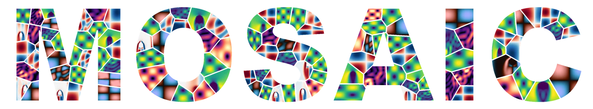
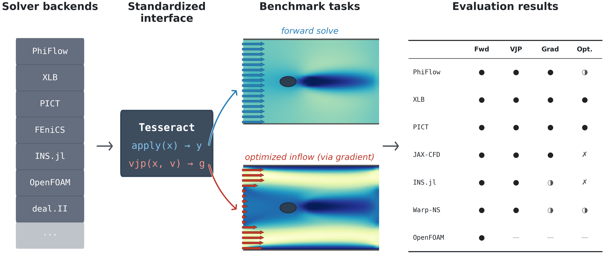

<p align="center">
  
</p>

# Mosaic

Mosaic benchmarks differentiable physics solvers on accuracy, gradient quality and cost, in compute and in development effort.

<a href="https://docs.pasteurlabs.ai/projects/mosaic/stable/results/"></a>
<a href="#run-the-benchmark"></a>
<a href="#use-solvers-in-your-own-code"></a>
<a href="#contribute"></a>
<a href="https://docs.pasteurlabs.ai/projects/mosaic/stable/"></a>
<a href="https://arxiv.org/abs/2606.27895"></a>
<a href="LICENSE"></a>



## What Mosaic measures

If you optimize or train _through_ a simulation, the solver has to return a correct forward prediction and a usable gradient (the vector–Jacobian product, VJP). Mosaic checks both. For every solver and setup, it reports:

- **Forward accuracy**
  - error against analytic solutions, literature values and converged high-resolution runs, across resolution and viscosity
  - physical laws such as a divergence-free velocity field
  - agreement with the other solvers
- **Gradient quality**
  - agreement with finite differences, in direction and magnitude, and with analytic gradients where they exist
  - how accuracy holds up as the rollout lengthens, and through a chain of solver calls
  - the conditioning of the Jacobian, from its singular values
  - whether a gradient-based optimizer makes progress through the solver, and how many iterations it needs
- **Compute cost**
  - wall-clock time of the forward and VJP calls, across problem size and rollout length
  - peak memory
  - how large a problem or how long a rollout a solver handles before it runs out of memory or time
- **Development cost**
  - the effort it took to make the solver run each setup, from L0 (nothing beyond expected tweaks) to L3 (changing the solver itself)
  - the reason and evidence for every intervention
  - deviations, where a solver runs a substitute for part of the prescribed setup, and their effect on the results

Each solver is packaged as a [Tesseract](https://github.com/pasteurlabs/tesseract-core) container with a uniform `apply` / `vjp` interface, so a single harness can compare solvers across languages and AD frameworks (JAX, PyTorch, Julia, hand-written C++ adjoints). The [solver reference](https://docs.pasteurlabs.ai/projects/mosaic/stable/solvers.html) lists every solver with its numerics and its intervention record.

## 📊 Results

**[Browse the benchmark results →](https://docs.pasteurlabs.ai/projects/mosaic/stable/results/)**

The results overview, refreshed on each release, shows the checks, cost, effort and deviations of every solver on every setup. Each setup has its own page with every plot. For findings drawn from these results, see the [paper](https://arxiv.org/abs/2606.27895).

## 📖 Documentation

Two versions are published. You most likely want [stable](https://docs.pasteurlabs.ai/projects/mosaic/stable/), which tracks the latest release and shows results from a single run of all solvers. [Latest](https://docs.pasteurlabs.ai/projects/mosaic/latest/) tracks the `main` branch and may combine results from different runs.

- [Overview](https://docs.pasteurlabs.ai/projects/mosaic/stable/)
- [Results](https://docs.pasteurlabs.ai/projects/mosaic/stable/results/)
- [Solvers](https://docs.pasteurlabs.ai/projects/mosaic/stable/solvers.html)
- [Run the benchmark](https://docs.pasteurlabs.ai/projects/mosaic/stable/getting-started.html)
- [Use a solver in your code](https://docs.pasteurlabs.ai/projects/mosaic/stable/standalone.html)
- [Contributing guide](https://docs.pasteurlabs.ai/projects/mosaic/stable/contributing.html)
- [Paper](https://arxiv.org/abs/2606.27895)

> [!TIP]
> **Reproducing our paper?** See the [`v0.3+paper-repro`](https://github.com/pasteurlabs/mosaic/tree/v0.3+paper-repro) tag for figure-generation code, pinned dependencies, and step-by-step instructions, and [its release](https://github.com/pasteurlabs/mosaic/releases/tag/v0.3%2Bpaper-repro) for the paper's results.

---

## Run the benchmark

Mosaic needs Python ≥ 3.11 and Docker. To run every solver, you need Linux with Docker Engine, an NVIDIA GPU and the [NVIDIA Container Toolkit](https://docs.nvidia.com/datacenter/cloud-native/container-toolkit/install-guide.html). Without a GPU, `--gpus none` restricts a run to the CPU-only solvers. macOS and Windows are not supported ([why](https://docs.pasteurlabs.ai/projects/mosaic/stable/getting-started.html#requirements)).

```bash
git clone https://github.com/pasteurlabs/mosaic && cd mosaic
uv sync && source .venv/bin/activate   # or: pip install -e .
mosaic run -p thermal-mesh --suites forward --gpus none --debug
```

The last command builds the CPU-only heat-transfer solvers and runs a reduced forward check, which works without a GPU. [Run the benchmark](https://docs.pasteurlabs.ai/projects/mosaic/stable/getting-started.html) covers the full run, choosing what runs, resuming, reading the output and troubleshooting.

## Use solvers in your own code

Every solver is a standalone Tesseract that you can call from your own JAX or PyTorch code without the benchmark harness. Build the image once, then differentiate through it with [tesseract-jax](https://github.com/pasteurlabs/tesseract-jax):

```bash
pip install -e mosaic/mosaic_shared tesseract-jax
tesseract build mosaic/tesseracts/navier-stokes-grid/exponax
```

```python
import jax
import jax.numpy as jnp
from tesseract_core import Tesseract
from tesseract_jax import apply_tesseract
from mosaic_shared.problems.navier_stokes_grid.schemas import make_vortex_ic

inputs = {"v0": make_vortex_ic(N=64, seed=42), "viscosity": jnp.array([0.01]), "steps": 50}

with Tesseract.from_image("exponax_navier_stokes_grid:latest") as t:
    def loss(v0):
        return jnp.mean(apply_tesseract(t, {**inputs, "v0": v0})["result"] ** 2)

    grad_v0 = jax.grad(loss)(inputs["v0"])
```

[Use a solver in your code](https://docs.pasteurlabs.ai/projects/mosaic/stable/standalone.html) covers the inputs and outputs, PyTorch, running without Docker, mesh solvers and GPUs.

## Contribute

Mosaic is designed to grow with its community. There are three main ways to contribute, roughly in order of scope:

- **Tune an existing solver** and record what you changed in its intervention record. See [tuning an existing solver](https://docs.pasteurlabs.ai/projects/mosaic/stable/contributing.html#tuning-an-existing-solver).
- **Add a solver** to an existing domain, with three files under `mosaic/tesseracts/<domain>/<solver-name>/`. See [Add a solver](https://docs.pasteurlabs.ai/projects/mosaic/stable/add-solver.html).
- **Add a problem** for new physics, scaffolded with `mosaic new-domain <name> --from-template <template>`. See [Add a problem](https://docs.pasteurlabs.ai/projects/mosaic/stable/add-problem.html).

The [contributing guide](https://docs.pasteurlabs.ai/projects/mosaic/stable/contributing.html) covers the development setup, the pull request workflow and the conventions. [CONTRIBUTING.md](CONTRIBUTING.md) has the contributor license agreement and the code of conduct. For questions, [open an issue](https://github.com/pasteurlabs/mosaic/issues) or visit the [Tesseract Forum](https://si-tesseract.discourse.group/).

## Project structure

```
mosaic/
  benchmarks/             # evaluation harness (Python package: mosaic.benchmarks)
    cli/                  # command-line interface, one module per subcommand
    core/                 # runner, config, hardware detection, solver discovery, intervention records
    problems/             # one package per problem (ns-grid, ns-3d-grid, structural-mesh, thermal-mesh)
      shared/             # suite kernels shared across problems (forward, gradient, cost, optimization, ics)
        plots/            # plotting infrastructure
  mosaic_shared/          # canonical schemas and shared types for the solvers (also pip-installable)
  templates/              # templates for scaffolding new domains
  tesseracts/             # solvers, one Tesseract per directory
    navier-stokes-grid/   # incompressible flow on grids, 2D and 3D
    structural-mesh/      # linear elasticity on hexahedral meshes
    thermal-mesh/         # steady heat conduction on hexahedral meshes
tests/                    # unit and integration tests (run with pytest)
docs/                     # Quarto documentation site (_quarto.yml)
  *.qmd                   # the pages: overview, guides, solver reference
  results/                # results overview and one page per setup
  figures/                # images shown on the pages
  assets/                 # theme and page scripts
  scripts/                # generators for the results pages and the solver reference, figure scripts
  Makefile                # builds the site (cd docs && make html)
```

## Citation

If you use Mosaic in your research, please cite the paper ([arXiv:2606.27895](https://arxiv.org/abs/2606.27895)):

```bibtex
@inproceedings{rehmann2026mosaic,
  title     = {Mosaic: A Benchmark Suite for Differentiable Physics Solvers},
  author    = {Rehmann, Andrin and Zimmermann, Heiko and H{\"a}fner, Dion},
  booktitle = {Advances in Neural Information Processing Systems (NeurIPS), Track on Evaluations and Datasets},
  year      = {2026}
}
```

## License

Apache 2.0. Individual solvers retain their upstream licenses, documented per solver in the repository.
