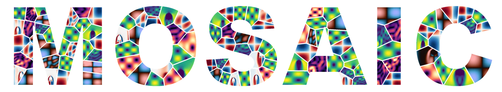
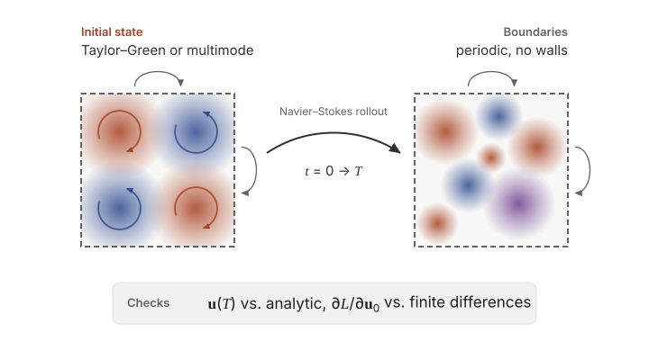
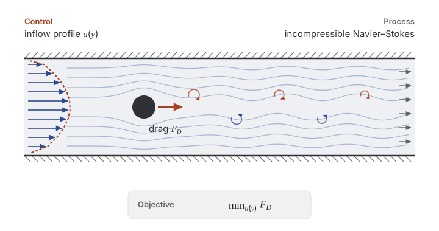
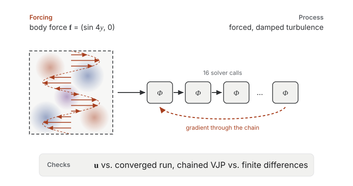
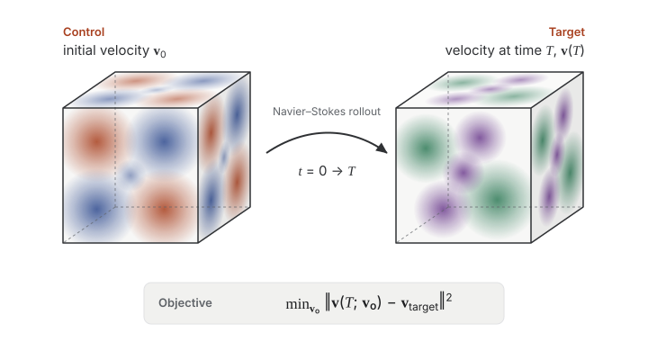
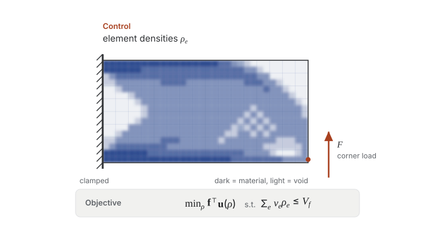
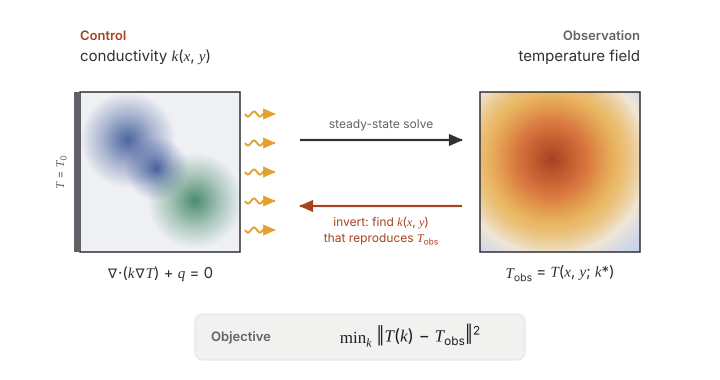

::: {.hero}
::: {.hero-body}
{.hero-wordmark .nolightbox fig-alt="Mosaic, written in tiles that show solution fields from the benchmark"}

[Mosaic benchmarks differentiable physics solvers on accuracy, gradient quality and cost, in compute and in development effort.]{.hero-lede}

::: {.hero-actions}
[Results](results/index.qmd){.btn-m .primary} [Run the benchmark](getting-started.qmd){.btn-m} [Solvers](solvers.qmd){.btn-m}
:::
:::
:::

## What Mosaic measures {#what-mosaic-measures}

If you train a model or run an optimizer through a simulation, the solver has to return a correct prediction (the *forward* pass) and a usable gradient of that prediction with respect to your inputs (the vector–Jacobian product, VJP). A solver that predicts accurately is of little use for gradient-based work if its VJP is wrong, noisy or ill-conditioned, so Mosaic checks both. The [results](results/index.qmd) answer two questions for every solver on every setup:

::: {.axis-row}
::: {.axis-card style="--tile: var(--m-indigo)"}
[Is the solver accurate, and are its gradients usable?]{.axis-q}

Forward accuracy against a reference, gradients against finite differences, and whether an optimizer makes progress through the solver.
:::
::: {.axis-card style="--tile: var(--m-accent)"}
[At what compute and development cost?]{.axis-q}

Wall-clock time and peak memory of the forward and VJP calls, and the effort it took to make the solver run the setup.
:::
:::

::: {.callout-note title="Development effort"}
Comparisons of solvers rarely report what it took to make each one run a problem, from setting a documented option to patching the library. Mosaic records every such intervention, with its reason and evidence, and rates each solver's effort per setup from L0 (the public API with documented options) to L3 (changes to the solver itself). The [solver reference](solvers.qmd#effort-levels) defines the levels and lists every intervention.
:::

## Setups {#setups}

Results are reported per setup, meaning one problem statement with its own experiments and checks. A solver that handles one setup need not handle another, so Mosaic never averages across setups. Each card links to the setup's results page, and its chips link to the solvers that run it. The badge names the physics, as in the paper: heat transfer (H), structural mechanics (S), and incompressible flow in 2D (F2) and 3D (F3).

::: {.domain-grid}
::: {.domain-card}
::: {.domain-thumb}
{.nolightbox fig-alt="Schematic of the periodic box: four Taylor–Green vortices in a box with periodic edges evolve into a mixed field over a Navier–Stokes rollout."}
:::
::: {.domain-card-body}
[[F2]{.domain-id .d-F2} [Periodic box](results/ns-2d-periodic.qmd)]{.domain-card-title}

Decaying 2D flow without walls. Forward accuracy against the analytic Taylor–Green solution, and how gradients hold up as the rollout lengthens and the flow becomes chaotic.

[Problem `ns-grid`, suites forward, gradient, cost]{.domain-meta}

::: {.backend-chips}
[Exponax](solvers.qmd#navier-stokes-grid-exponax) [INS.jl](solvers.qmd#navier-stokes-grid-ins-jl) [JAX-CFD](solvers.qmd#navier-stokes-grid-jax-cfd) [OpenFOAM](solvers.qmd#navier-stokes-grid-openfoam) [PhiFlow](solvers.qmd#navier-stokes-grid-phiflow) [PICT](solvers.qmd#navier-stokes-grid-pict) [Warp-NS](solvers.qmd#navier-stokes-grid-warp-ns) [XLB](solvers.qmd#navier-stokes-grid-xlb)
:::
:::
:::

::: {.domain-card}
::: {.domain-thumb}
{.nolightbox fig-alt="Schematic of the channel: a parabolic inflow profile on the left, a cylinder with a drag arrow, and a vortex street downstream between two walls."}
:::
::: {.domain-card-body}
[[F2]{.domain-id .d-F2} [Channel flow past a cylinder](results/ns-2d-cylinder.qmd)]{.domain-card-title}

The Schäfer–Turek DFG 2D-1 channel at $Re = 20$, with walls, an obstacle, an inflow and an outflow. Drag against the literature value, and drag minimization over the inflow profile.

[Problem `ns-grid`, suites forward, optimization]{.domain-meta}

::: {.backend-chips}
[INS.jl](solvers.qmd#navier-stokes-grid-ins-jl) [OpenFOAM](solvers.qmd#navier-stokes-grid-openfoam) [PhiFlow](solvers.qmd#navier-stokes-grid-phiflow) [PICT](solvers.qmd#navier-stokes-grid-pict) [Warp-NS](solvers.qmd#navier-stokes-grid-warp-ns) [XLB](solvers.qmd#navier-stokes-grid-xlb)
:::
:::
:::

::: {.domain-card}
::: {.domain-thumb}
{.nolightbox fig-alt="Schematic of Kolmogorov flow: a sinusoidal body force drives a turbulent field, which passes through a chain of solver calls with the gradient flowing back through the chain."}
:::
::: {.domain-card-body}
[[F2]{.domain-id .d-F2} [Forced Kolmogorov flow](results/ns-2d-kolmogorov.qmd)]{.domain-card-title}

Forced 2D turbulence that settles into a statistically steady state. Forward accuracy against a converged high-resolution run, and gradients through a chain of solver calls, as in training a model through a solver.

[Problem `ns-grid`, suites forward, gradient]{.domain-meta}

::: {.backend-chips}
[Exponax](solvers.qmd#navier-stokes-grid-exponax) [INS.jl](solvers.qmd#navier-stokes-grid-ins-jl) [JAX-CFD](solvers.qmd#navier-stokes-grid-jax-cfd) [PhiFlow](solvers.qmd#navier-stokes-grid-phiflow) [PICT](solvers.qmd#navier-stokes-grid-pict) [Warp-NS](solvers.qmd#navier-stokes-grid-warp-ns) [XLB](solvers.qmd#navier-stokes-grid-xlb)
:::
:::
:::

::: {.domain-card}
::: {.domain-thumb}
{.nolightbox fig-alt="Schematic of the 3D task: an initial velocity field in a cube evolves into a later snapshot, and the optimizer recovers the initial field from that snapshot."}
:::
::: {.domain-card-body}
[[F3]{.domain-id .d-F3} [Triply periodic box](results/ns-3d.qmd)]{.domain-card-title}

Recover the initial velocity field of a 3D flow from a later snapshot, with one control per velocity component and cell of a $16^3$ grid (12,288 values). Also measures how far each solver's gradient stays usable as the rollout lengthens.

[Problem `ns-3d-grid`, suites forward, gradient, cost, optimization]{.domain-meta}

::: {.backend-chips}
[Exponax](solvers.qmd#navier-stokes-grid-exponax) [INS.jl](solvers.qmd#navier-stokes-grid-ins-jl) [JAX-CFD](solvers.qmd#navier-stokes-grid-jax-cfd) [OpenFOAM](solvers.qmd#navier-stokes-grid-openfoam) [PhiFlow](solvers.qmd#navier-stokes-grid-phiflow) [PICT](solvers.qmd#navier-stokes-grid-pict) [Warp-NS](solvers.qmd#navier-stokes-grid-warp-ns) [XLB](solvers.qmd#navier-stokes-grid-xlb)
:::
:::
:::

::: {.domain-card}
::: {.domain-thumb}
{.nolightbox fig-alt="Schematic of the cantilever: a beam clamped on the left with a load at its tip, filled with a truss-like material layout."}
:::
::: {.domain-card-body}
[[S]{.domain-id .d-S} [Linear-elastic cantilever](results/structural.qmd)]{.domain-card-title}

Place a fixed budget of material in a clamped 3D beam, two cells thick, to make it as stiff as possible. The control is one density per cell of a $16\times2\times8$ mesh (256 values).

[Problem `structural-mesh`, suites forward, gradient, cost, optimization]{.domain-meta}

::: {.backend-chips}
[deal.II](solvers.qmd#structural-mesh-dealii-structural) [FEniCS](solvers.qmd#structural-mesh-fenics-structural) [Firedrake](solvers.qmd#structural-mesh-firedrake-structural) [JAX-FEM](solvers.qmd#structural-mesh-jax-fem) [TopOpt.jl](solvers.qmd#structural-mesh-topopt-jl) [torch-fem](solvers.qmd#structural-mesh-torch-fem-structural)
:::
:::
:::

::: {.domain-card}
::: {.domain-thumb}
{.nolightbox fig-alt="Schematic of the slab: a conductivity field on the left produces a temperature field on the right through a steady solve, and the inversion recovers the conductivity from the temperature."}
:::
::: {.domain-card-body}
[[H]{.domain-id .d-H} [Steady conduction in a slab](results/heat.qmd)]{.domain-card-title}

Invert for the conductivity field of a slab from its temperature, with one conductivity per cell of a $16\times8\times1$ mesh (128 values). Also checks gradients with respect to the heat source.

[Problem `thermal-mesh`, suites forward, gradient, cost, optimization]{.domain-meta}

::: {.backend-chips}
[deal.II](solvers.qmd#thermal-mesh-dealii-heat) [FEniCS](solvers.qmd#thermal-mesh-fenics-heat) [Firedrake](solvers.qmd#thermal-mesh-firedrake-heat) [JAX-FEM](solvers.qmd#thermal-mesh-jax-fem) [torch-fem](solvers.qmd#thermal-mesh-torch-fem-thermal)
:::
:::
:::
:::

## Terminology {#terminology}

The results and the rest of these docs use five terms with a fixed meaning.

Domain
: A family of solvers that share one canonical schema and one directory under `mosaic/tesseracts/`. There are three: `navier-stokes-grid`, `structural-mesh` and `thermal-mesh`.

Problem
: The benchmark package selected with `mosaic run -p`, which registers experiments and their settings. There are four: `ns-grid`, `ns-3d-grid`, `structural-mesh` and `thermal-mesh`. Both Navier–Stokes problems use the `navier-stokes-grid` domain. You only need this term to run the benchmark or contribute to it.

Setup
: A problem statement that results are reported for, such as channel flow past a cylinder. There are six, shown [above](#setups). A problem can have several setups, and every experiment belongs to exactly one. Checks, effort and deviations are reported per setup.

Solver
: One Tesseract under a domain directory, wrapping one library. A solver can serve several problems and setups. The `navier-stokes-grid` solvers serve both Navier–Stokes problems.

Backend
: The runtime or AD framework a solver is built on, such as JAX or PyTorch, as recorded in its `metadata.mosaic.backend`.

## Solvers as Tesseracts {#tesseracts}

Each solver is wrapped in a Docker container by [tesseract-core](https://github.com/pasteurlabs/tesseract-core), which exposes a uniform `apply` / `vjp` interface. The harness calls those containers as JAX functions through [tesseract-jax](https://github.com/pasteurlabs/tesseract-jax) and never inspects how a solver computes its gradient, so it can compare solvers built on JAX, PyTorch, Julia or hand-written C++ adjoints without a shared dependency. The same containers work outside the benchmark: [Use a solver in your code](standalone.qmd) shows how to call one from JAX or PyTorch.

## Benchmark suites {#suites}

Experiments are grouped into suites, which you select with `mosaic run --suites`. The settings of every experiment (grid sizes, sweep ranges, finite-difference steps, iteration caps and pass criteria) live next to it in the problem configurations under [`mosaic/benchmarks/problems/`](https://github.com/pasteurlabs/mosaic/tree/main/mosaic/benchmarks/problems), and each [results page](results/index.qmd) describes the experiments of its setup.

**Forward accuracy (`forward`).** Resolution sweeps against a reference: an analytic solution where one exists (the 2D Taylor–Green vortex, the laminar Kolmogorov shear flow), the Schäfer–Turek literature value for the cylinder, converged high-resolution spectral runs for the 3D Taylor–Green vortex and the turbulent Kolmogorov flow, and for the mesh setups the trimmed mean of all solvers, stored as a precomputed reference. Where it applies, the suite also checks physical laws such as a divergence-free velocity field.

**Gradient accuracy (`gradient`).** Central finite differences through the Tesseract interface are the solver-agnostic ground truth. Along random directions $v_k$, the harness compares the VJP's directional derivatives $d^\text{ad}_k = \langle g, v_k \rangle$ of a scalar loss with finite-difference estimates $d^\text{fd}_k$, at the step size $\varepsilon$ that fits best, and reports:

- *direction agreement*, the cosine similarity of $d^\text{ad}$ and $d^\text{fd}$ ($1$ is identical);
- *magnitude agreement*, the median of $|d^\text{ad}_k - d^\text{fd}_k| / \max(|d^\text{ad}_k|, |d^\text{fd}_k|)$ ($0$ is exact).

Depending on the setup, the suite also compares against analytic gradients, follows the gradient error as the rollout lengthens, differentiates through a chain of solver calls, and inspects the singular values of the Jacobian, whose spread shows how ill-conditioned the gradient is.

**Optimization (`optimization`).** A gradient-based optimizer (L-BFGS or Adam, depending on the setup) runs through the solver up to an iteration cap. The check passes when the objective falls below a set fraction of its initial value, and drag minimization also requires the final drag to land close to the other solvers' median. This catches solvers whose gradients pass the finite-difference check but still fail to drive a full optimization.

**Cost (`cost`).** Forward and VJP wall-clock time and peak memory, swept over problem size and rollout length on each solver's hardware target. Each sweep point starts with an untimed warm-up call, which covers compilation, followed by repeated timed trials.

**Initial conditions (`ics`).** Generates and plots the initial conditions, without running a solver.

A run writes metrics as JSON, fields as NPZ, and plots as PNG with a Vega-Lite `.vl.json` spec next to each, under `mosaic-results/<problem>/<suite>/<experiment>/`. [Reading the output](getting-started.qmd#reading-the-output) explains the layout.

::: {.next-steps}
::: {}
To run the benchmark yourself, start with **[Run the benchmark](getting-started.qmd)**, which covers installation, a first run and the CLI.
:::
::: {}
To call a Mosaic solver from your own JAX or PyTorch code without the harness, see **[Use a solver in your code](standalone.qmd)**.
:::
::: {}
For questions and support, visit the **[Tesseract Forum](https://si-tesseract.discourse.group/)** or [open an issue](https://github.com/pasteurlabs/mosaic/issues).
:::
:::
