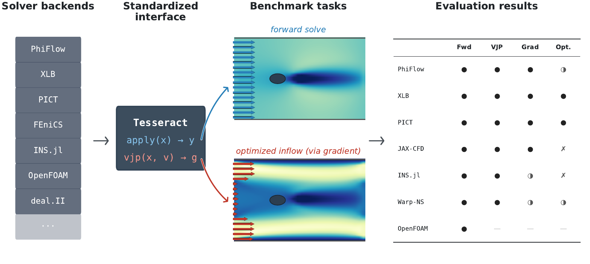
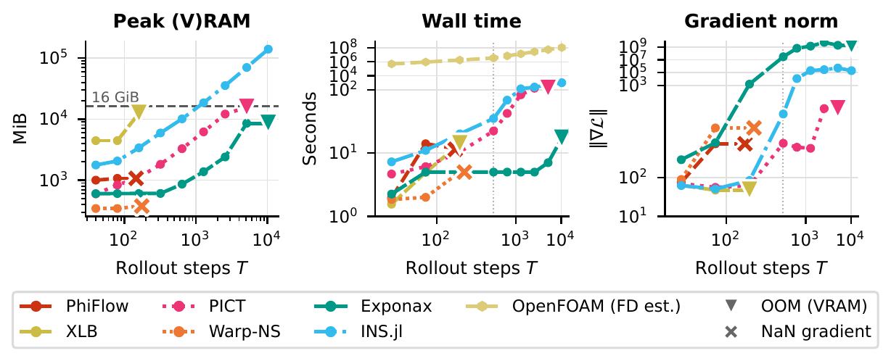
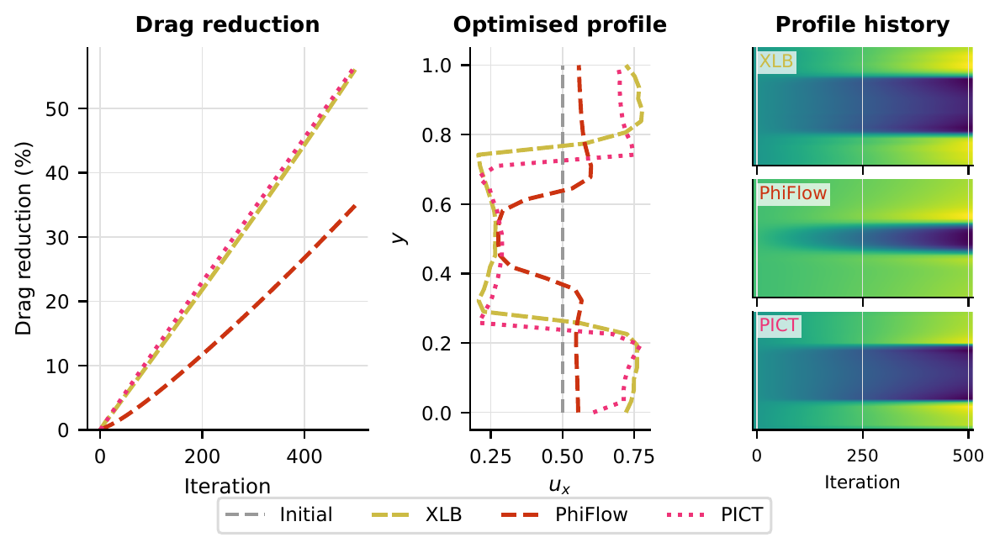

Andrin Rehmann, Heiko Zimmermann and Dion Häfner, Pasteur Labs. [Preprint on arXiv](https://arxiv.org/abs/2606.27895).

The paper asks what it costs to obtain usable gradients from differentiable PDE solvers, and which properties of a solver decide whether a gradient-based workflow succeeds. It evaluates 14 solvers across fluid dynamics, structural mechanics and heat transfer. Because every solver runs the same tasks under the same protocol, the paper can relate properties such as the discretization and the AD strategy to gradient cost, conditioning and optimization outcomes. This page summarizes its findings and the evidence behind them.

::: {.callout-note}
## Date and provenance

- The arXiv preprint (v1) is from June 2026. This page follows the paper's revision of November 2026, which adds checks on forced Kolmogorov flow, a solver-in-the-loop study and an audit of the intervention records.
- The main results were measured on release [`v0.1+paper-repro`](https://github.com/pasteurlabs/mosaic/tree/v0.1+paper-repro) on a single NVIDIA A100, and the results behind the paper's figures are archived on [Zenodo](https://zenodo.org/records/20067888). The Kolmogorov-flow results and the intervention audit come from later code, as described under [reproducing the paper](#reproduce).
- Figures and numbers on this page are copied from the paper. The pages under Results re-render on every release, on different hardware, and may have changed since the paper.
:::

{#fig-overview .lightbox fig-alt="Diagram in four columns. A list of solvers (PhiFlow, XLB, PICT, FEniCS, INS.jl, OpenFOAM, deal.II) feeds into a Tesseract box that exposes apply and vjp. Two panels show flow past a cylinder, once as a forward solve and once with an inflow profile optimized via the gradient. A table marks for seven fluid solvers whether they pass the forward, VJP, gradient and optimization stages."}

## Why gradients from PDE solvers need a benchmark {#motivation}

Differentiable solvers make it possible to backpropagate through a numerical simulation. This enables topology optimization, aerodynamic shape optimization, optimal control and solver-in-the-loop training of machine learning models. A growing number of PDE solvers advertise gradient support, across many languages, automatic differentiation (AD) frameworks and numerical methods. The practical cost of obtaining correct, usable gradients from a given solver on a given problem is largely undocumented, however. Integration effort, computational cost, gradient accuracy and numerical conditioning vary widely between solvers, and constraints such as periodic-only boundary conditions or stability limits often surface only after a practitioner has committed to a solver.

Mosaic packages each solver as a container (a [Tesseract](https://github.com/pasteurlabs/tesseract-core)) with the same forward and gradient interface, regardless of its language or AD strategy. The benchmark tasks contain no learned components. Finite differences through each solver's own forward pass therefore provide a reference, and the solver's gradient mechanism is the only variable under test.

## What was measured {#what-was-measured}

The paper evaluates the solvers on four benchmark tasks, chosen to form a difficulty progression. Each task is a small optimization problem that needs gradients to be solved efficiently. The tasks are intentionally simpler than state-of-the-art challenges, so that a failure can be attributed to the solver's gradient mechanism rather than to an ill-posed problem. The paper labels them H, S, F2 and F3. The table maps them to the setups of the live benchmark, whose current results may differ from the paper.

| Paper | Domain | Optimization task | Setups in the live benchmark |
|:--|:--|:--|:--|
| H | Heat transfer in a slab | Conductivity inversion | [Steady conduction in a slab](results_heat.qmd) |
| S | Structural mechanics, cantilever beam | Compliance minimization (SIMP) | [Linear-elastic cantilever](results_structural.qmd) |
| F2 | Incompressible flow in 2D | Inflow optimization for drag minimization around a cylinder at Re = 20 | [Periodic box (2D)](results_ns_2d_periodic.qmd), [channel flow past a cylinder](results_ns_2d_cylinder.qmd), [forced Kolmogorov flow](results_ns_2d_kolmogorov.qmd) |
| F3 | 3D Navier–Stokes, periodic box | Initial condition recovery | [Triply periodic box (3D)](results_ns_3d.qmd) |

: Benchmark tasks in the paper and the corresponding setups in the live benchmark. {#tbl-tasks}

The heat task also serves as a negative control. Its forward problem is smooth and elliptic, so a gradient failure there points to an AD bug rather than to chaotic dynamics. Forced Kolmogorov flow, part of F2, has no optimization task and hosts checks for turbulent flow and for chained solver calls.

Every solver goes through the same protocol, which uses only the forward and VJP interface and never inspects solver internals:

- **Setup compatibility**: whether the solver produces a gradient, fails numerically, or cannot represent the task at all.
- **Gradient accuracy**: agreement with central finite differences along random directions, and for the fluid tasks the singular value spectrum of the full Jacobian.
- **Performance**: forward and VJP wall time and peak memory across problem sizes.
- **Forward accuracy**: agreement with a reference solver, and with analytical solutions where they exist.
- **Optimization convergence**: convergence curves and final objective, with the same hyperparameters and iteration budget for every solver on a task.

The [Overview](index.qmd#evaluation-protocol) describes the protocol as the benchmark runs it today.

All experiments ran on one Azure Standard_NC24ads_A100_v4 instance with an NVIDIA A100 80 GB PCIe GPU and 24 vCPUs of an AMD EPYC 7V13. CPU-only solvers ran on the same instance's CPU. The results reflect the solver configurations of the pinned release.

## Findings {#findings}

The paper summarizes its evaluation as follows. The benchmark surfaces order-of-magnitude variation in computational cost and Jacobian conditioning, alongside structural incompatibilities that eliminate solvers from realistic tasks entirely. Despite this variation, all solvers that produce gradients converge to similar optima, which indicates that the practical barriers are memory limits, numerical stability and setup compatibility rather than gradient accuracy alone. These observations rest on four deliberately simple tasks, and the paper discusses what they do not cover under [limitations](#limitations).

### Gradient accuracy and conditioning {#gradient-quality}

All differentiable solvers reach a cosine similarity above 0.999 between AD and central finite-difference gradients at their optimal perturbation size $\varepsilon$, which the paper takes as confirmation that their AD is correct. The optimal $\varepsilon$ shifts by orders of magnitude across solvers, and with rollout length and viscosity, so a fixed finite-difference step used for validation can give misleading results at longer rollouts.

{#fig-fd-check .lightbox fig-alt="Two log-log line plots against perturbation size epsilon from 1e-4 to about 5, for JAX-CFD, PhiFlow, INS.jl, XLB, PICT and Warp-NS. Both the relative finite-difference error and one minus the cosine similarity trace U-shaped curves, with minima at different epsilon for different solvers."}

Single-call checks can miss defects that only appear when calls are chained, as they are in a training pipeline. PICT's adjoint linear solves stopped at an absolute residual tolerance, which is harmless for the $O(1)$ cotangents of a single call. At the end of a 16-call chain on Kolmogorov flow, cotangents are about $10^{-4}$ per entry, the solves stopped early, and the chained check measured a median relative error of 0.89 at a cosine of 0.51. Rescaling the cotangent in the wrapper fixed it.

Conditioning is far less uniform. On the 3D periodic task, Jacobian spectra differ sharply between solvers at the same resolution, reflecting the numerical method rather than the AD strategy. The same governing equations discretized with lattice Boltzmann and with pressure projection yield very different spectra. The paper attributes the sharp drop-off in projection-based solvers to singular vectors associated with non-solenoidal velocity modes, which incompressible flow forbids by construction, and notes that these modes are correspondingly less relevant for gradient-based optimization.

{#fig-conditioning .lightbox fig-alt="Six panels, one per solver (Exponax, PhiFlow, XLB, INS.jl, Warp-NS, PICT), each plotting normalized singular values on a log scale against mode index for four combinations of viscosity and rollout length. Exponax stays near one, XLB drops off only at the highest modes, and PhiFlow, INS.jl, Warp-NS and PICT fall by several orders of magnitude after roughly mode 1000."}

### Rollout length is the critical scaling parameter {#rollout-length}

Jacobian conditioning degrades with rollout length across all solvers, with projection-based solvers deteriorating faster than lattice Boltzmann or spectral methods. Memory grows with rollout length as well. Several solvers exceed the 16 GB GPU memory limit marked in the figure and fail to produce gradients entirely, before gradient accuracy becomes the limiting factor.

{#fig-rollout .lightbox fig-alt="Three log-log panels against rollout steps for seven solvers. Peak memory rises with rollout length, and several solvers reach a dashed 16 GiB line and stop with an out-of-memory marker. Wall time rises with rollout length. Gradient norms grow by orders of magnitude for some solvers, and PhiFlow and Warp-NS end with non-finite gradients."}

### Cost varies by orders of magnitude {#cost}

Absolute cost varies by orders of magnitude between solvers at the same resolution, but speed and generality are entangled. The fastest solvers (Exponax, JAX-CFD) support only periodic boundaries and no solid obstacles, while the solvers that handle the full drag task (XLB, PICT) are up to about 200 times slower. The paper concludes that cost comparisons are meaningful only within the set of solvers that can represent a given task.

Among the solvers that stay within the memory budget, the cost of a gradient depends on the AD strategy. Source-transformation AD in the JAX-based solvers keeps a nearly constant VJP-to-forward ratio across problem sizes, while the tape-based adjoints of FEniCS and Firedrake scale more steeply at the largest sizes. The paper calls the AD strategy a first-order predictor of gradient cost at scale. All timings come from one A100, and relative rankings may differ on other hardware, particularly between GPU and CPU solvers. The wall times at one problem size per task are listed under [measurements on an A100](#a100).

{#fig-scaling-ns .lightbox fig-alt="Six log-log panels against degrees of freedom for the fluid solvers. Forward and VJP times span about three orders of magnitude between solvers at the same size, with JAX-CFD and Exponax fastest and OpenFOAM slowest. The VJP-to-forward ratio stays roughly flat with problem size, between about 2 and 10 for most solvers and far higher for OpenFOAM."}

{#fig-scaling-fem .lightbox fig-alt="Six log-log panels against degrees of freedom for the finite-element solvers. Forward and VJP times grow with mesh size for all solvers. The VJP-to-forward ratio stays nearly flat for JAX-FEM and varies with size for FEniCS, Firedrake, TopOpt.jl and torch-fem."}

### Setup compatibility thins the field {#setup-compatibility}

The 2D drag minimization is the hardest deployment test, and the task where structural incompatibilities remove the most solvers. In the paper's solver set, only three of seven fluid solvers support its non-periodic, obstacle-laden setup. The channel needs non-periodic pressure boundary conditions, which exclude solvers with spectral pressure solves, and Brinkman penalization of the cylinder is incompatible with LU-factored Poisson projections. Of the three, XLB and PICT converge to consistent drag reductions of around 60%, and PhiFlow reduces drag by about 35% before stalling. In the paper's words, on the most practically demanding task, solver selection is constrained by setup compatibility before gradient quality enters the picture.

The solver set and its wrappers have changed since the paper. The [current results for channel flow past a cylinder](results_ns_2d_cylinder.qmd) show which solvers run drag minimization today.

{#fig-drag .lightbox fig-alt="Left, drag reduction in percent against iteration up to 500. XLB and PICT reach about 56 percent and PhiFlow about 35 percent. Center, optimized inflow velocity profiles against height, starting from a uniform profile. XLB and PICT push flow toward the walls and away from the cylinder at mid-height. Right, heat maps of the inflow profile over iterations for each solver."}

### Optimization outcomes {#optimization}

All solvers share the same hyperparameters and iteration budget per task, so the paper attributes differences in convergence to the solver's gradient. On the structural task, all solvers converge to the same optimum. On the heat task, every solver drives the temperature misfit down by orders of magnitude, but the poorly conditioned inversion leaves the recovered conductivity dependent on the optimizer's path within the iteration budget.

On 3D initial condition recovery, the paper reports the relative distance between the recovered and true initial states alongside the loss. Adam stagnates above 40% error in the recovered initial condition for all solvers. Its loss decreases, but the recovered initial condition differs noticeably from the target. L-BFGS converges to a substantially lower loss and below 6% error in fewer iterations. Projecting the gradient onto the divergence-free subspace before each L-BFGS update brings the error below 0.5%, because the projection keeps non-solenoidal components from corrupting the curvature model.

{#fig-recovery .lightbox fig-alt="Three log-log panels against gradient evaluations for PICT, INS.jl and XLB. Recovery error stays highest with Adam, is lower with L-BFGS, and is lowest with projected L-BFGS, reaching about 1e-3 for PICT. Divergence of the recovered initial condition grows with Adam and stays flat with the other two. The loss falls fastest with both L-BFGS variants."}

Across the tasks, the paper observes that on every task where they can run, all solvers that produce gradients converge to equivalent optima despite order-of-magnitude differences in accuracy and conditioning. More complex tasks may reveal cases where gradient quality becomes limiting. On these benchmarks, the pattern suggests that conditioning is likely a better predictor of the stability of an optimization or training procedure than pointwise gradient accuracy. Training a corrector through the solvers on Kolmogorov flow showed the same pattern (see the [solver-in-the-loop study](#solver-in-the-loop)).

On the negative-control tasks (heat and structural mechanics), all solvers produce equivalent results regardless of AD strategy or numerical method. Because gradient quality does not differentiate the solvers there, the paper reduces the selection criterion on these tasks to forward-solve speed and integration effort. Both tasks are linear and steady, which the paper's limitations address.

### Integration effort {#integration-effort}

The paper uses bespoke lines of code as a coarse proxy for integration effort, which it describes as imperfect but able to capture order-of-magnitude differences. Solvers built on modern AD frameworks (JAX, PyTorch) need no extra lines per differentiable input, while hand-written adjoints carry substantially more. Warp-NS, which the Mosaic team built from NVIDIA Warp kernels, needs over 800 bespoke lines for the initial-condition VJP alone. The boundary is not always sharp. INS.jl uses Zygote reverse-mode AD and still needs over 470 lines of gradient-specific code, so AD framework support does not guarantee turnkey gradients.

Hand-derived adjoints can be faster than the forward solve, but each new control variable or objective requires more implementation work. The paper concludes that reverse-mode AD through modern frameworks offers the best tradeoff between effort and capability, since it produces gradients accurate enough for optimization at a fraction of the implementation cost.

Lines of code do not show what kind of work they contain. The paper therefore also audits the intervention records, which log every departure from a solver's default usage with a level for its mechanism. The audit covered all 19 solver wrappers in the repository as of October 2026, after the pinned release, and found 92 interventions, 39 at L0, 22 at L1, 23 at L2 and 8 at L3. The same need can land at very different levels. Running the adjoint solve with the direct solver MUMPS takes a monkeypatch of dolfin-adjoint (L3) in FEniCS and nothing in Firedrake, where the adjoint inherits the forward solver's settings. Only 8 of the 92 reasons were backed by a test, a measurement or an upstream issue, and 34 had no reason recorded. Resolving the audit's findings changed several solvers after the pinned release. Those changes appear in the live results, while the paper's tables reflect the pinned release. The [solver reference](solvers.qmd) shows the current intervention records, which may have changed since the paper.

## Limitations {#limitations}

The paper names three assumptions behind its evaluation. Central finite differences at the optimal perturbation size are taken to be a reliable gradient reference, the recorded solver configurations to reflect competent use, and standalone optimization tasks to be a meaningful proxy for gradient quality in broader pipelines. The [solver-in-the-loop study](#solver-in-the-loop) supports the last assumption on one setup.

The optimization tasks are intentionally low-complexity (laminar flow, linear elasticity), and the paper cautions that its results should not be extrapolated to turbulent, long-horizon or nonlinear regimes without further validation. All timings come from a single A100 machine, and rankings may shift on other hardware. Tuning effort differs between solvers. The intervention records make the difference visible, and further expert tuning could narrow the observed performance gaps. Apart from one solver-in-the-loop study on a periodic flow, the paper benchmarks solver gradients without learned components, so other hybrid pipelines may introduce failure modes not captured here. Results are pinned to specific solver versions, and upstream updates may change gradient behavior.

## Results beyond the live benchmark {#beyond-the-live-benchmark}

Two parts of the paper have no counterpart in the live results, namely the measurements on an A100 and the solver-in-the-loop study. The Kolmogorov-flow checks are part of the live benchmark, and the paper reports them from runs on the A100.

### Measurements on an A100 {#a100}

The live results are regenerated by continuous integration on GitHub-hosted runners with an NVIDIA T4 GPU or with CPUs only, so their absolute times differ from the ones in the paper. The table lists the paper's forward and VJP wall times, each the mean of three runs after one warmup call. A VJP time is the cost of one gradient from scratch, a forward plus an adjoint pass. TopOpt.jl's compliance gradient is self-adjoint and needs no second solve. The problem sizes are a 64 × 64 periodic grid for F2, a 16³ grid for F3, a 128 × 2 × 64 mesh for S and a 256 × 128 × 1 mesh for H. The [current results](results.qmd) may differ from these numbers.

| Task | Solver | Device | Forward | VJP |
|:--|:--|:--|--:|--:|
| F2 | JAX-CFD | GPU | 11 ms | 108 ms |
| F2 | XLB | GPU | 19 ms | 5,200 ms |
| F2 | INS.jl | CPU | 343 ms | 2,800 ms |
| F2 | Warp-NS | GPU | 428 ms | 1,400 ms |
| F2 | PhiFlow | GPU | 713 ms | 2,200 ms |
| F2 | OpenFOAM | CPU | 1,300 ms | n/a |
| F2 | PICT | GPU | 2,200 ms | 7,200 ms |
| F3 | Exponax | GPU | 22 ms | 177 ms |
| F3 | XLB | GPU | 43 ms | 48,000 ms |
| F3 | Warp-NS | GPU | 486 ms | 1,500 ms |
| F3 | PhiFlow | GPU | 627 ms | 1,900 ms |
| F3 | PICT | GPU | 767 ms | 3,300 ms |
| F3 | INS.jl | CPU | 2,500 ms | 17,000 ms |
| F3 | OpenFOAM | CPU | 4,400 ms | n/a |
| S | Firedrake | CPU | 7 s | 17 s |
| S | JAX-FEM | GPU | 28 s | 65 s |
| S | TopOpt.jl | CPU | 78 s | 15 s |
| S | FEniCS | CPU | 140 s | 86 s |
| S | deal.II | CPU | 166 s | n/a |
| H | JAX-FEM | GPU | 4.5 s | 9.8 s |
| H | deal.II | CPU | 9.4 s | n/a |
| H | Firedrake | CPU | 10 s | 20 s |
| H | torch-fem | GPU | 33 s | 11 s |
| H | FEniCS | CPU | 60 s | 47 s |

: Forward and VJP wall times in the paper, on one A100 instance, sorted by forward time within each task. OpenFOAM and deal.II are forward-only references. {#tbl-a100}

### Forced Kolmogorov flow {#kolmogorov}

Forced Kolmogorov flow is forced turbulence on the 2D periodic box. A sinusoidal body force and a linear drag let the flow settle into a chaotic, statistically steady state. The ground truth is an Exponax run at $1024^2$. Three checks score each solver:

- **Laminar forcing**: from rest at a higher viscosity, the flow stays a shear flow with an exact solution, which tests how the solver applies the force.
- **Turbulent forward accuracy**: the observed refinement order from $64^2$ to $256^2$ against the ground truth, and no divergence from $64^2$ up.
- **Chained gradients**: the gradient of a training-style loss through 16 consecutive solver calls, compared with central finite differences. Each call in such a chain receives a far smaller cotangent than in a single-call check.

Every solver passes the laminar check. On the turbulent flow, every solver passes both remaining checks except PhiFlow, which fails both. Its $256^2$ run turns non-finite between $t = 3$ and $t = 4$ from two of the three test states, and its finite differences on the chain change erratically with $\varepsilon$. The paper has not established the cause of either failure. Warp-NS is excluded from the turbulent checks because its explicit Euler scheme with central differences is linearly unstable on this flow unless the time step stays below a bound that does not shrink with the grid. OpenFOAM's icoFoam has no momentum source term, and OpenFOAM has no VJP. JAX-CFD and INS.jl, which share a discretization, agree to every printed digit on both forward checks.

| Solver | Laminar error, $N = 64$ | Turbulent error, $64^2$ | Observed order | Chained error / cosine |
|:--|--:|--:|--:|--:|
| Exponax | 3.5e-5 | 0.039 | 1.89 | 1.8e-3 / 1.000 |
| JAX-CFD | 7.4e-3 | 0.086 | 1.73 | 2.4e-4 / 1.000 |
| INS.jl | 7.4e-3 | 0.086 | 1.73 | 2.0e-4 / 1.000 |
| XLB | 1.9e-2 | 0.032 | 1.66 | 9.8e-5 / 1.000 |
| PICT | 7.1e-3 | 0.092 | 1.46 | 1.4e-3 / 1.000 |
| PhiFlow | 7.4e-3 | 0.082 | diverged at $256^2$ | 5.0e-2 / 0.997 |
| Warp-NS | 7.7e-3 | excluded | excluded | excluded |

: Kolmogorov-flow checks in the paper, on the A100 and with PICT's cotangent rescaling. Laminar: relative error against the exact solution at $t = 2$. Turbulent: median relative error against the ground truth at $t = 1$, and the observed order from $64^2$ to $256^2$. Chained: median relative error and cosine of the VJP at the best $\varepsilon$. {#tbl-kolmogorov}

The [current results for forced Kolmogorov flow](results_ns_2d_kolmogorov.qmd) may have changed since the paper.

### Solver-in-the-loop training {#solver-in-the-loop}

To test whether the standalone checks predict how a solver behaves inside a training loop, the paper trains a small periodic CNN to correct each solver's coarse Kolmogorov flow ($64^2$) every 0.1 time units, against that solver's own $256^2$ run. Three arms share their training windows, updates and initialization:

- **Supervised**: one-interval pairs, with no solver in the training graph.
- **Stopped**: a 16-interval rollout with the gradient stopped at every solver call.
- **Solver-in-the-loop (SIL)**: the same rollout, differentiated through the solver.

Each solver first had to pass three gates. Its $256^2$ reference had to be accurate enough, chained calls had to reproduce one long call, and the gradient of the training loss through 16 intervals had to match central finite differences. All five solvers that run the flow stably passed every gate. Warp-NS and PhiFlow are not part of the study, for the reasons given [above](#kolmogorov).

All 45 trainings completed, and none of the 270 long rollouts turned non-finite. Averaged over three seeds, supervised training reached the lowest test error on every solver except Exponax, where the stopped arm was lower. Differentiating through the solver never beat stopping the gradient on average, although it did on individual seeds. Training through the solver therefore did not separate the solvers beyond their cost, which ranged from 1 s (JAX-CFD) to 27 s (PICT) per update.

| Solver | Supervised | Stopped | SIL | Uncorrected | s per update, stopped / SIL |
|:--|:--|:--|:--|--:|--:|
| JAX-CFD | 0.117, 0.100, 0.108 | 0.151, 0.161, 0.167 | 0.193, 0.151, 0.189 | 0.243 | 0.69 / 1.00 |
| INS.jl | 0.117, 0.100, 0.108 | 0.151, 0.161, 0.167 | 0.193, 0.151, 0.189 | 0.243 | 0.87 / 2.35 |
| Exponax | 0.068, 0.075, 0.067 | 0.063, 0.061, 0.065 | 0.076, 0.068, 0.063 | 0.091 | 0.75 / 1.02 |
| XLB | 0.069, 0.061, 0.063 | 0.078, 0.085, 0.068 | 0.084, 0.073, 0.102 | 0.086 | 0.85 / 1.38 |
| PICT | 0.145, 0.143, 0.147 | 0.186, 0.169, 0.150 | 0.228, 0.161, 0.192 | 0.277 | 4.73 / 26.8 |

: Solver-in-the-loop results in the paper. Mean relative test error over 40 intervals for each of the three network seeds, the uncorrected solver's error, and the wall time per training update at a 16-interval rollout. The runs partly shared the GPU with other jobs, so the times are rough. {#tbl-sil}

Chaining does expose the interface. Restarting JAX-CFD or INS.jl from the cell-centered velocity at every call drifts 13% from an unbroken run after 16 calls, so the study passes each solver's native state (face velocities or lattice populations) between calls. The one defect the study surfaced, PICT's adjoint tolerance, is caught as well by the chained gradient check, which needs neither a network nor native state. On this setup, the standalone checks predicted whether a solver can be trained through, so the study is not part of the benchmark.

## Reproducing the paper {#reproduce}

The tag [`v0.1+paper-repro`](https://github.com/pasteurlabs/mosaic/tree/v0.1+paper-repro) contains the code, solver wrappers, plotting scripts and pinned dependency lockfile behind the main results. Its [README](https://github.com/pasteurlabs/mosaic/tree/v0.1+paper-repro#reproduce-paper-results) describes two paths. The paper's figures can be regenerated from the [result archive on Zenodo](https://zenodo.org/records/20067888) without re-running any solver. Alternatively, the full suite can be re-run, which requires Docker and, for the GPU solvers, an NVIDIA GPU with the NVIDIA Container Toolkit.

The Kolmogorov-flow checks and the solver-in-the-loop study are not part of the tag. The checks entered the benchmark in [pull request #272](https://github.com/pasteurlabs/mosaic/pull/272), and the code of the study is on the `paper` branch ([pull request #316](https://github.com/pasteurlabs/mosaic/pull/316)).

## Cite {#cite}

If you use Mosaic in your research, please cite the paper:

```bibtex
@misc{rehmann2026mosaic,
  title         = {Mosaic: A Benchmark Suite for Differentiable Physics Solvers},
  author        = {Rehmann, Andrin and Zimmermann, Heiko and H{\"a}fner, Dion},
  year          = {2026},
  eprint        = {2606.27895},
  archivePrefix = {arXiv},
  primaryClass  = {physics.comp-ph},
  url           = {https://arxiv.org/abs/2606.27895}
}
```
