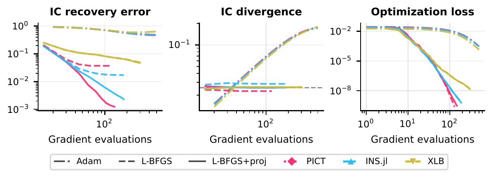
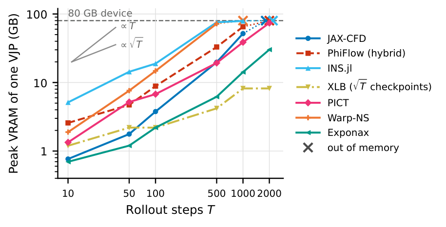

<!--
Paper page, served at /paper.html. Numbers and wording follow the camera-ready
(paper/ on the paper branch, tag v0.3+paper-repro). Keep them in sync with the
paper rather than with the live results pages, which track the current benchmark.
-->

::: {.hero}
::: {.hero-body}
[NeurIPS 2026 · Evaluations and Datasets track]{.paper-venue}

# Mosaic: A Benchmark Suite for Differentiable Physics Solvers {.paper-title}

[Andrin Rehmann, Heiko Zimmermann, Dion Häfner]{.paper-authors}
[Pasteur Labs]{.paper-affil}

::: {.hero-actions}
[Paper](https://arxiv.org/abs/2606.27895){.btn-m .primary} [PDF](https://arxiv.org/pdf/2606.27895){.btn-m} [Code](https://github.com/pasteurlabs/mosaic){.btn-m} [BibTeX](#citation){.btn-m}
:::
:::
:::

<!-- Animations: add further <figure> blocks to .paper-media; the grid takes one or two more. -->
```{=html}
<div class="paper-media">
<figure>
<video src="figures/paper/inflow_optimization.mp4" autoplay muted loop playsinline controls preload="metadata" aria-label="Inflow optimization in the DFG 2D-1 channel: five solvers' flow fields, drag and inlet profiles over Adam iterations"></video>
<figcaption><strong>Inflow optimization, DFG 2D-1 channel.</strong> Five solvers optimize the inlet profile at fixed flow rate with the same objective, and each lowers the cylinder's drag to 0.52–0.54 of its starting value. A re-run of the drag-optimization task made for this animation, not the paper's data.</figcaption>
</figure>
</div>
```

## Abstract {#abstract}

Differentiable partial differential equation (PDE) solvers underpin solver-in-the-loop ML training, gradient-based optimal control, and inverse problems, yet the practical cost of obtaining correct, usable gradients from a given solver on a given problem is largely undocumented. Integration effort, computational cost, memory, gradient accuracy, and numerical stability vary widely across solvers and are discoverable only by trial and error.

We introduce *Mosaic*, an extensible benchmarking framework for differentiable PDE solvers that standardizes access to solver gradients. Each solver is packaged as a containerized component (*Tesseract*) exposing a uniform gradient API regardless of language or automatic differentiation (AD) strategy, enabling researchers to evaluate, compare, and build on non-trivial physical solvers.

Our evaluation of 14 solvers across fluid dynamics, structural mechanics, and heat transfer demonstrates that the benchmark surfaces practically relevant differences: order-of-magnitude variation in computational cost and memory, alongside setup incompatibilities and instabilities that rule out solvers for specific tasks. Despite this variation, all solvers that produce gradients converge to similar optima on our tasks, indicating that the practical barriers are memory limits, numerical stability, and setup compatibility rather than gradient accuracy alone.

## Findings {#findings}

The paper's discussion draws five observations for practitioners from the benchmark tasks.

::: {.axis-row}
::: {.axis-card style="--tile: var(--m-accent)"}
[Gradient quality is often good enough]{.axis-q}

On every task they can run, the solvers that produce gradients reach comparable optima, although their gradient accuracy differs by orders of magnitude. Solvers failed because they could not express the task, turned unstable over long rollouts, or ran out of memory.
:::
::: {.axis-card style="--tile: var(--m-indigo)"}
[Rollout length is the critical scaling parameter]{.axis-q}

Without checkpointing, memory limits most F3 solvers to a few thousand steps on a 48³ grid, and three of seven return non-finite gradients after a few hundred steps.
:::
::: {.axis-card style="--tile: var(--m-accent)"}
[On steady linear problems, pick the fastest solver]{.axis-q}

On the heat and structural tasks, all solvers give equivalent results regardless of AD strategy or numerical method. The choice comes down to forward speed and integration effort.
:::
::: {.axis-card style="--tile: var(--m-indigo)"}
[Reverse-mode AD has the best effort-to-capability tradeoff]{.axis-q}

Hand-derived adjoints can be cheap but need new derivations for each control or objective. At the sizes of the main table, AD gradients cost 1.4 to 5.3 times the forward time.
:::
::: {.axis-card style="--tile: var(--m-accent)"}
[Measure rather than predict]{.axis-q}

Solvers of the same numerical family and AD strategy ended up on both sides of the stability limit, and gradient defects and the largest cost outliers came mostly from how a solver was built or wrapped. Test candidate solvers on your own task.
:::
:::

## Figures from the paper {#figures}

### The optimizer matters more than the solver {#fig-recovery}

On F3 initial-condition recovery, L-BFGS recovers the initial state an order of magnitude more accurately than Adam, in a fraction of the gradient evaluations. Projecting the gradient onto divergence-free fields before each L-BFGS update improves the recovery on every solver.

{fig-alt="IC error against gradient evaluations for several 3D Navier–Stokes solvers with Adam, L-BFGS and L-BFGS with gradient projection."}

### Jacobian spectra reflect how a solver treats divergence {#fig-spectra}

The spectra fall into three shapes, which mostly reflect how each solver treats initial perturbations that are not divergence-free. Solvers that project those out exactly have singular values at round-off. No shape predicts which solvers stay stable over long rollouts, since each occurs among stable and unstable solvers alike.

{fig-alt="Normalized singular value spectra of the F3 solver Jacobians at several rollout lengths and viscosities, one line per solver."}

### Memory follows the differentiation strategy {#fig-memory}

Reverse-mode AD through a time loop stores every state, so memory grows linearly with the number of steps. Checkpointing, used here only by XLB, reduces this to the square root. Without it, the stored trajectory limits a 48³ rollout to a few thousand steps, even with 80 GB.

{fig-alt="Peak GPU memory of one VJP against rollout steps for the 3D Navier–Stokes solvers, with linear and square-root reference slopes."}

### Long rollouts end in memory limits or non-finite gradients {#fig-horizon}

Memory is not always the first limit. Extending the F3 rollout to 81,920 steps, PhiFlow and Warp-NS return non-finite gradients after 160 steps and XLB after 320, while INS.jl, JAX-CFD and PICT stay stable until they run out of memory. Exponax completes every horizon.

{fig-alt="Peak memory, wall time and gradient norm of one VJP against rollout length, one line per 3D Navier–Stokes solver."}

## Benchmark tasks {#tasks}

The paper evaluates four physical domains. The results pages below show the current benchmark, which may differ from the paper's pinned run.

| Domain | Task | Results |
|---|---|---|
| [H]{.domain-id .d-H} Heat transfer | Conductivity inversion in a slab | [Steady conduction in a slab](results/heat.qmd) |
| [S]{.domain-id .d-S} Structural mechanics | Compliance minimization of a cantilever (SIMP) | [Linear-elastic cantilever](results/structural.qmd) |
| [F2]{.domain-id .d-F2} 2D Navier–Stokes | Inflow optimization for drag reduction | [Channel flow past a cylinder](results/ns-2d-cylinder.qmd), [Periodic box](results/ns-2d-periodic.qmd), [Forced Kolmogorov flow](results/ns-2d-kolmogorov.qmd) |
| [F3]{.domain-id .d-F3} 3D Navier–Stokes | Initial-condition recovery | [Triply periodic box](results/ns-3d.qmd) |

## Reproducing the paper {#reproduce}

The paper's results were computed on one NVIDIA A100 80 GB with the code and solver environments of the [`v0.3+paper-repro`](https://github.com/pasteurlabs/mosaic/tree/v0.3+paper-repro) tag.

**Regenerate figures and tables from the published results** (no Docker, no GPU):

```bash
git clone --branch v0.3+paper-repro https://github.com/pasteurlabs/mosaic && cd mosaic

# Download the paper's results from the release (~1.2 GB)
wget -qO- 'https://github.com/pasteurlabs/mosaic/releases/download/v0.3%2Bpaper-repro/mosaic-paper-a100-results.tar.gz' | tar xz
export MOSAIC_RESULTS_DIR=$PWD/mosaic-paper-a100-results/results

uv run paper/make_figures.py
uv run paper/make_tables.py --extra-results "$MOSAIC_RESULTS_DIR"
```

**Re-run the experiments** (x86-64 Linux, Docker Engine, an NVIDIA GPU with the NVIDIA Container Toolkit):

```bash
git clone --branch v0.3+paper-repro https://github.com/pasteurlabs/mosaic && cd mosaic
cp production.uv.lock uv.lock && uv sync --frozen
MOSAIC_TESSERACT_TIMEOUT=7200 uv run mosaic run --gpus 0 -o results --continue
```

On an A100 80 GB the full run takes about two days. The repository [README](https://github.com/pasteurlabs/mosaic/tree/v0.3+paper-repro#reproduce-the-paper) has the details, including the solver-in-the-loop study and the runs on 16 GB GPUs.

## Citation {#citation}

```bibtex
@inproceedings{rehmann2026mosaic,
  title     = {Mosaic: A Benchmark Suite for Differentiable Physics Solvers},
  author    = {Rehmann, Andrin and Zimmermann, Heiko and H{\"a}fner, Dion},
  booktitle = {Advances in Neural Information Processing Systems},
  note      = {Evaluations and Datasets Track},
  year      = {2026},
  eprint    = {2606.27895},
  archivePrefix = {arXiv}
}
```
