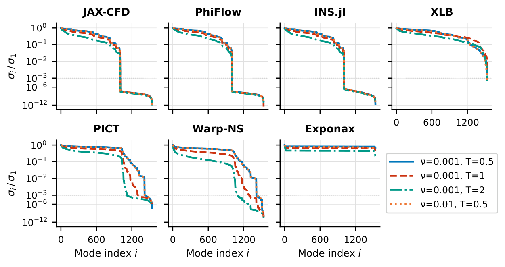

::: {.hero .paper-hero .column-page}
::: {.paper-hero-text}
[Mosaic: A Benchmark Suite for Differentiable Physics Solvers]{.paper-title}

[Andrin Rehmann, Heiko Zimmermann and Dion Häfner, Pasteur Labs]{.paper-authors}

[Differentiable solvers let you backpropagate through a simulation. We put 14 of them behind one interface to find out whether their gradients work, and what they cost.]{.hero-lede}

::: {.hero-actions}
[Read the paper](https://arxiv.org/abs/2606.27895){.btn-m .primary} [Run the benchmark](getting-started.qmd){.btn-m} [Browse the results](results/index.qmd){.btn-m} [Cite](#cite){.btn-m}
:::
:::

::: {.paper-hero-media}
```{=html}
<video class="paper-video" src="figures/kolmogorov.mp4" poster="figures/kolmogorov.jpg"
       autoplay muted loop playsinline aria-label="Vorticity of a forced, turbulent two-dimensional flow, swirling and merging over time"></video>
<script>
  // Hold the animation still for readers who prefer reduced motion.
  if (window.matchMedia("(prefers-reduced-motion: reduce)").matches) {
    document.querySelectorAll(".paper-video").forEach((v) => {
      v.removeAttribute("autoplay");
      v.pause();
    });
  }
</script>
```
[Forced Kolmogorov flow, one of the benchmark's setups, simulated with Exponax.]{.paper-media-caption}
:::
:::

## Why gradients from solvers need a benchmark {#motivation}

Backpropagating through a simulation enables topology optimization, aerodynamic shape optimization, optimal control, and training machine learning models with a solver in the loop. A growing number of PDE solvers advertise gradient support, across many languages, AD frameworks and numerical methods. Whether a given solver returns a usable gradient for a given problem, and how much compute and engineering that takes, is largely undocumented.

Mosaic packages each solver as a container with the same forward and gradient interface (a [Tesseract](https://github.com/pasteurlabs/tesseract-core)) and runs all of them through the same tasks. The tasks contain no learned components, so finite differences through each solver's own forward pass provide a reference, and the solver's gradient mechanism is the only variable under test.

{.lightbox fig-alt="Diagram in four columns. A list of solvers (PhiFlow, XLB, PICT, FEniCS, INS.jl, OpenFOAM, deal.II) feeds into a Tesseract box that exposes apply and vjp. Two panels show flow past a cylinder, once as a forward solve and once with an inflow profile optimized via the gradient. A table marks for seven fluid solvers whether they pass the forward, gradient and optimization checks."}

## What we found {#findings}

::: {.finding-row}
::: {.finding}
[> 0.999]{.finding-number}

Cosine similarity between AD and finite-difference gradients, for every differentiable solver at its best finite-difference step.
:::
::: {.finding}
[~200×]{.finding-number}

The largest slowdown of the solvers that handle the full drag task (XLB, PICT) against the fastest solvers, which support only periodic boxes.
:::
::: {.finding}
[3 of 7]{.finding-number}

Fluid solvers in the paper that could run 2D drag minimization, with its walls, obstacle, inflow and outflow.
:::
::: {.finding}
[92]{.finding-number}

Interventions recorded across 19 solver integrations, from documented options (L0) to patches of the solver itself (L3).
:::
:::

Cost and Jacobian conditioning varied by orders of magnitude between solvers, and some solvers could not express the harder tasks at all. Yet every solver that produced gradients converged to a similar optimum wherever it could run. The paper concludes that the practical barriers are memory limits, numerical stability and setup compatibility rather than gradient accuracy alone, and that conditioning is likely a better predictor of a stable optimization than pointwise gradient accuracy. The tasks are deliberately simple (laminar flow, linear elasticity), and the paper cautions against extrapolating to turbulent, long-horizon or nonlinear regimes without further validation.

## Explore the cost {#cost}

Forward and VJP wall times of every solver in the paper, measured on one NVIDIA A100 instance, with CPU-only solvers on its CPU. Each VJP time includes the forward pass that the solver recomputes inside the request. Problem sizes differ between tasks, so compare solvers within a task. Hover over a point for its numbers.

```{=html}
<figure class="m-chart paper-chart" data-spec="figures/paper/a100_timings.vl.json"></figure>
```

::: {.callout-note collapse="true" appearance="simple" title="The same numbers as a table"}
::: {.sortable-table}
| Task | Solver | Device | Forward | VJP |
|:--|:--|:--|--:|--:|
| F2 | JAX-CFD | GPU | 11 ms | 108 ms |
| F2 | XLB | GPU | 19 ms | 5,200 ms |
| F2 | INS.jl | CPU | 343 ms | 2,800 ms |
| F2 | Warp-NS | GPU | 428 ms | 1,400 ms |
| F2 | PhiFlow | GPU | 713 ms | 2,200 ms |
| F2 | OpenFOAM | CPU | 1,300 ms | n/a |
| F2 | PICT | GPU | 2,200 ms | 7,200 ms |
| F3 | Exponax | GPU | 22 ms | 177 ms |
| F3 | XLB | GPU | 43 ms | 48,000 ms |
| F3 | Warp-NS | GPU | 486 ms | 1,500 ms |
| F3 | PhiFlow | GPU | 627 ms | 1,900 ms |
| F3 | PICT | GPU | 767 ms | 3,300 ms |
| F3 | INS.jl | CPU | 2,500 ms | 17,000 ms |
| F3 | OpenFOAM | CPU | 4,400 ms | n/a |
| S | Firedrake | CPU | 7 s | 17 s |
| S | JAX-FEM | GPU | 28 s | 65 s |
| S | TopOpt.jl | CPU | 78 s | 15 s |
| S | FEniCS | CPU | 140 s | 86 s |
| S | deal.II | CPU | 166 s | n/a |
| H | JAX-FEM | GPU | 4.5 s | 9.8 s |
| H | deal.II | CPU | 9.4 s | n/a |
| H | Firedrake | CPU | 10 s | 20 s |
| H | torch-fem | GPU | 33 s | 11 s |
| H | FEniCS | CPU | 60 s | 47 s |
:::

The problem sizes are a $64 \times 64$ periodic grid for F2, a $16^3$ grid for F3, a $128 \times 2 \times 64$ mesh for S and a $256 \times 128 \times 1$ mesh for H. OpenFOAM and deal.II are forward-only references, and TopOpt.jl's compliance gradient is self-adjoint, so it needs no second solve.
:::

## From the paper {#figures}

::: {.paper-figures}
{.lightbox fig-alt="Six panels, one per solver, each plotting normalized singular values on a log scale against mode index for four combinations of viscosity and rollout length. Exponax and XLB stay comparatively flat, while INS.jl and PhiFlow fall off steeply."}

{.lightbox fig-alt="Left, drag reduction in percent against iteration up to 500, with XLB and PICT reaching about 56 percent and PhiFlow about 35 percent. Center, optimized inflow profiles that push flow toward the walls. Right, heat maps of the inflow profile over the iterations for each solver."}
:::

The paper also covers rollout length as the critical scaling parameter, initial-condition recovery in 3D, chained gradients and a solver-in-the-loop training study on Kolmogorov flow, and an audit of the intervention records. [Read it on arXiv](https://arxiv.org/abs/2606.27895).

## Use Mosaic {#use-mosaic}

::: {.paper-use}
::: {}
**[Run the benchmark](getting-started.qmd)** on your own hardware. A first run of the CPU-only heat-transfer solvers takes a few commands:

```bash
git clone https://github.com/pasteurlabs/mosaic && cd mosaic
pip install -e .
mosaic run -p thermal-mesh --suites forward --gpus none --debug
```
:::
::: {}
**[Call a solver from your code](standalone.qmd)**. Every solver is a Tesseract that works with `jax.grad`:

```python
with Tesseract.from_image("exponax_navier_stokes_grid:latest") as t:
    def loss(v0):
        out = apply_tesseract(t, {**inputs, "v0": v0})
        return jnp.mean(out["result"] ** 2)

    grad_v0 = jax.grad(loss)(inputs["v0"])
```
:::
:::

To see how your own solver compares, [add it to Mosaic](add-solver.qmd). The [results](results/index.qmd) re-render on every release, so a new solver or a better configuration shows up there.

## Reproduce the paper {#reproduce}

The main results were measured on release [`v0.1+paper-repro`](https://github.com/pasteurlabs/mosaic/tree/v0.1+paper-repro), whose [README](https://github.com/pasteurlabs/mosaic/tree/v0.1+paper-repro#reproduce-paper-results) explains how to regenerate the figures from the [result archive on Zenodo](https://zenodo.org/records/20067888) or re-run the full suite. The Kolmogorov-flow checks entered the benchmark later, in [pull request #272](https://github.com/pasteurlabs/mosaic/pull/272), and the solver-in-the-loop study lives on the `paper` branch ([pull request #316](https://github.com/pasteurlabs/mosaic/pull/316)). Numbers on this page come from the paper's November 2026 revision. The [results pages](results/index.qmd) re-render on every release, on different hardware, and may have changed since.

## Cite {#cite}

If you use Mosaic in your research, please cite the paper:

```bibtex
@misc{rehmann2026mosaic,
  title         = {Mosaic: A Benchmark Suite for Differentiable Physics Solvers},
  author        = {Rehmann, Andrin and Zimmermann, Heiko and H{\"a}fner, Dion},
  year          = {2026},
  eprint        = {2606.27895},
  archivePrefix = {arXiv},
  primaryClass  = {physics.comp-ph},
  url           = {https://arxiv.org/abs/2606.27895}
}
```
