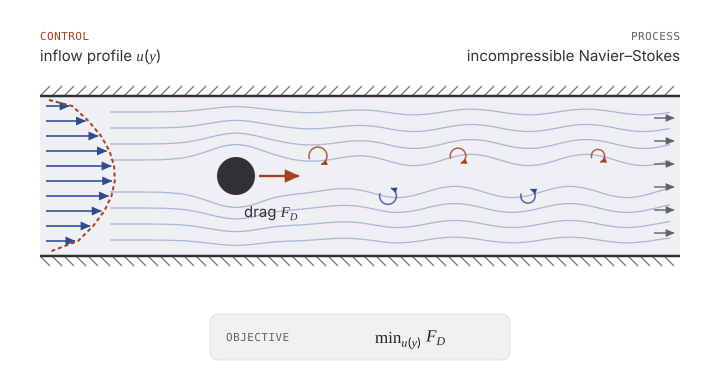
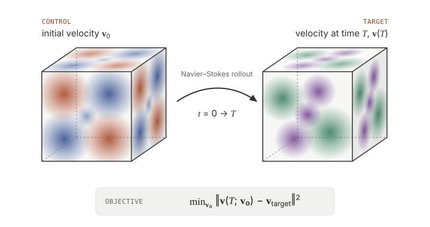
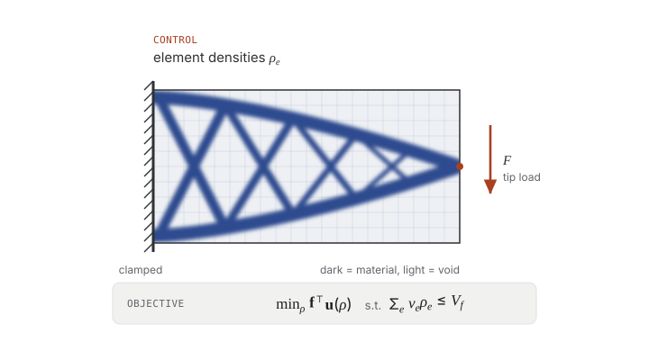
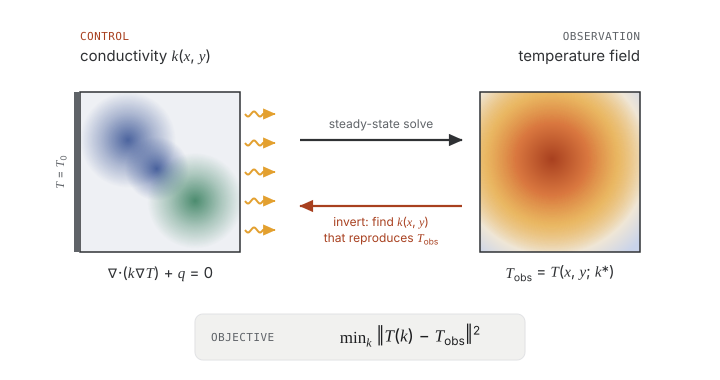

What each solver in Mosaic can do on each benchmark setup: whether its
forward solution, gradient and optimization results are good enough for the
task, what it costs relative to its peers, and how much of the campaign ran
cleanly. Mosaic does not rank solvers or combine these into a single score.

::: {.callout-tip appearance="simple"}
These are **example results**, produced automatically on GitHub Actions runners
and refreshed on every release. Accuracy and gradient metrics are
hardware-independent and reproducible; wall-clock numbers reflect commodity
cloud hardware and are best read as relative scaling between solvers. For
numbers that reflect *your* setup, [run the benchmarks
yourself](getting-started.qmd) on your target hardware.
:::

::: {.callout-warning appearance="simple" title="Results reflect the current implementations, not the libraries"}
Each solver is wrapped in a Tesseract by the Mosaic team or its contributors,
and some wrappers have had far more tuning than others: solver settings,
preconditioners, time steps and resolutions. A flag or a slow time here says
how *this implementation* behaves on *this setup*, not how good the underlying
software is. Solvers also differ a lot in how much work a setup takes: some
provide the geometry, boundary conditions and adjoints out of the box, others
need them written by hand. Before committing to one, try the alternatives
that pass on your kind of problem.

If you maintain or use one of these solvers and can improve its
configuration, [contributions are welcome](https://github.com/pasteurlabs/mosaic/blob/main/CONTRIBUTING.md).
:::

## How to read the checks {#reading}

Results are grouped by **setup**: one concrete problem statement, such as
periodic Taylor–Green flow or channel flow past a cylinder. Setups of the same
physics are not averaged, because a solver that handles one need not handle
the other.

For each setup, each solver gets:

- **Forward, gradient and optimization checks.** Every experiment carries pass
  criteria set in its problem configuration (`status_check`): for example an
  error bound against the reference, a finite-difference agreement bound for
  the gradient, or the fraction of the objective an optimizer must remove. A
  check combines the setup's *gate* experiments for that suite (see the table
  of states below). Hover a check for the reasons; the list under each table
  spells them out.
- **Cost**, forward and VJP: wall-clock time as a multiple of the fastest
  solver *on the same kind of device*, at the largest problem size every
  solver in that group completed. GPU and CPU solvers ran on different
  machines, so they are compared within their group only. The per-suite
  tables on each results page give the absolute times.
- **Reliability**: how many of the setup's experiments ran cleanly, out of
  those the solver supports, with flagged, failed and not-run experiments
  counted separately. This includes diagnostic experiments that are not gates
  (Jacobian spectra, horizon sweeps, cost sweeps). A cost run flagged only for
  being slow counts as clean here; its speed shows in the cost columns.

::: {.ck-legend}
| State | Meaning |
|---|---|
| [✓ Pass]{.ck .ck-pass} | Every gate experiment met its criteria. |
| [✓ Pass, with note]{.ck .ck-note} | A gate was flagged, but the cause is documented and is typically a property of the comparison rather than the solver. |
| [! Borderline]{.ck .ck-borderline} | A gate was flagged: it ran, but missed its criteria. |
| [✗ Fail]{.ck .ck-fail} | A gate errored or produced no valid result. |
| [— Not supported]{.ck .ck-na} | The method cannot express the experiment, e.g. a forward-only solver has no gradient. |
| [· Not run]{.ck .ck-notrun} | Not run in this campaign yet. |
:::

Within each device group, solvers that pass more checks are listed first, then
faster ones. That ordering is a reading aid, not a ranking: a solver that
passes everything is not "better" than one that is flagged on a check your
application does not need.

::: {.callout-note collapse="true" title="Gate experiments per setup"}


The thresholds behind each check are provisional and will be refined with the
solver maintainers; they live next to each experiment in
`mosaic/benchmarks/problems/<domain>/config.py`.
:::

## Checks by setup {#checks}

::: {.column-page}

:::

## Domains

Each domain page collects the setups of one physics problem and reports, per
suite: **forward** (output against a trusted reference, and an analytic
solution where one exists), **gradient** (AD or adjoint gradient against a
finite-difference ground truth, in magnitude and direction), **cost** (forward
and VJP wall-clock scaling with problem size) and **optimization** (end-to-end
convergence using each solver's own gradients). See the
[Overview](index.qmd#evaluation-protocol) for the full evaluation protocol.

::: {.domain-grid .column-page}
::: {.domain-card}
::: {.domain-thumb}
{.nolightbox fig-alt="Navier–Stokes 2D task schematic"}
:::
::: {.domain-card-body}
[F2]{.domain-id .d-F2}

[[Navier–Stokes (2D)](results_ns_grid.qmd)]{.domain-card-title}

Optimize the inflow of a 2D channel flow to minimize drag on a cylinder,
differentiating through an incompressible fluid solver. Covers JAX-CFD,
PhiFlow, INS.jl, XLB, PICT, Warp-NS, and OpenFOAM across spectral,
finite-difference, finite-volume, and LBM schemes.
:::
:::

::: {.domain-card}
::: {.domain-thumb}
{.nolightbox fig-alt="Navier–Stokes 3D task schematic"}
:::
::: {.domain-card-body}
[F3]{.domain-id .d-F3}

[[Navier–Stokes (3D)](results_ns_3d_grid.qmd)]{.domain-card-title}

Recover the initial velocity field of a 3D turbulent flow from a later snapshot,
differentiating through the Navier–Stokes rollout. Covers PhiFlow, XLB, PICT,
Warp-NS, Exponax, INS.jl, and OpenFOAM on a triply periodic Taylor–Green vortex.
:::
:::

::: {.domain-card}
::: {.domain-thumb}
{.nolightbox fig-alt="Structural mechanics task schematic"}
:::
::: {.domain-card-body}
[S]{.domain-id .d-S}

[[Structural mechanics](results_structural_mesh.qmd)]{.domain-card-title}

Place a fixed budget of material in a clamped beam to make it as stiff as
possible, differentiating through a finite-element solve. Covers deal.II,
FEniCS, Firedrake, JAX-FEM, and TopOpt.jl on 2D cantilever compliance
minimization with SIMP penalization.
:::
:::

::: {.domain-card}
::: {.domain-thumb}
{.nolightbox fig-alt="Heat transfer task schematic"}
:::
::: {.domain-card-body}
[H]{.domain-id .d-H}

[[Heat transfer](results_thermal_mesh.qmd)]{.domain-card-title}

Invert for the conductivity field of a slab from its temperature,
differentiating through a steady heat-conduction solve. Covers deal.II, FEniCS,
Firedrake, JAX-FEM, and torch-fem on 2D steady-state heat conduction.
:::
:::
:::

## Experiment explorer {#explorer}

Every experiment across all domains. Search or filter, then click a card to see
its plots.

::: {.column-page}

:::
