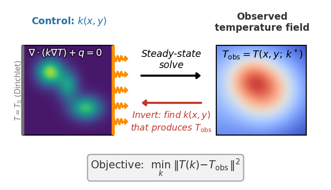

> Auto-generated 2026-10-13 13:54 UTC &nbsp;·&nbsp; 12 plots

{width=100% style="max-width:560px; display:block; margin:0 auto 0.5rem;"}

*Invert for the conductivity field of a slab from its temperature, differentiating through a steady heat-conduction solve.*

**Inferring conductivity from temperature.** Given the temperature field of a heated slab, where is the material conductive? We answer this inverse problem by differentiating through a steady heat-conduction solve.

The conductivity of a quasi-2D slab follows the SIMP law ($p=3$) $k_\text{eff}(\rho) = k_\min + (k_\max - k_\min)\,\rho^3$ in the element density $\rho$. The optimization experiment recovers a two-Gaussian density field from the temperature it produces, starting from a uniform field and minimizing $\lVert T(\rho) - T_\text{target} \rVert^2$ with L-BFGS. The forward and gradient experiments compare solvers on the thermal compliance $C = \oint_\Gamma q_n\,T\,d\Gamma$, the work done by the heat flux on the temperature field, and on its sensitivity to $\rho$. Two further gradient experiments check the derivative of a temperature misfit with respect to a volumetric heat source $f(\mathbf{x})$.

::: {.callout-tip title='How these results were produced' collapse='true'}

These are **example results**, produced automatically on GitHub Actions runners and refreshed on every release. Each solver runs on its intended device: GPU-capable solvers on a Tesla T4 GPU node, CPU-only solvers (OpenFOAM, deal.II, FEniCS, Firedrake, TopOpt.jl) on a separate CPU node, whose processor model can differ between runs. Accuracy and gradient metrics are hardware-independent and reproducible. Wall-clock numbers reflect commodity cloud hardware and can vary by 10–15% between runs, so read them for relative scaling between solvers rather than as absolute timings. For numbers that reflect *your* setup, [run the benchmarks yourself](getting-started.qmd) on your target hardware.

:::

::: {.callout-note title='Boundary conditions'}

Quasi-2D heated slab on domain $[0,2]\times[0,1]$ (a single HEX8 layer, $n_z=1$). The slab thickness $L_z$ scales with the in-plane element size ($L_z = L_x/n_x$) so the elements stay roughly cubic under refinement, keeping the linear system well-conditioned; $Q_\text{total}$ is thus a flux per unit slab depth. Dirichlet: all nodes at $x=0$ held at $T=0$ (fixed temperature). Neumann (uniform): uniform heat flux $Q_\text{total}$ over the right face ($x=2$). Neumann (hot-spot): flux concentrated on the central $1/3$ stripe in $y$ ($L_y/3 \le y \le 2L_y/3$) at the right face, used by the physical-laws check.

:::

## Initial Conditions

Visualisation of each initial condition (the starting field a run is launched from) available for this problem. IC plots are generated without running any solver.


::: {.callout-note collapse='true' title='Settings'}

**Gaussian Source**

```json
{
  "nx": 16,
  "ny": 8,
  "nz": 1,
  "amplitude": 1.0,
  "cx": 0.5,
  "cy": 0.5,
  "sigma": 0.2
}
```

**Random**

```json
{
  "rho_0": 0.5,
  "noise": 0.3,
  "nx": 16,
  "ny": 8,
  "nz": 1,
  "seed": 0
}
```

**Two Gaussians**

```json
{
  "nx": 16,
  "ny": 8,
  "nz": 1
}
```

**Uniform**

```json
{
  "rho_0": 0.5,
  "nx": 16,
  "ny": 8,
  "nz": 1
}
```

**Zero Source**

```json
{
  "nx": 16,
  "ny": 8,
  "nz": 1
}
```

:::

```{=html}
<figure class="m-chart" data-spec="../mosaic-results/thermal-mesh/ics/ics.vl.json"></figure>
```

## Forward

**Is the prediction right?** Forward-pass benchmarks check each solver's output against a trusted reference (and an analytic solution where one exists): inter-solver agreement, field-level diagnostics, and long-run stability.

### Agreement

Thermal compliance $C$ vs uniform element density $\rho_0$ at fixed $N$; compares solvers on a log scale.


::: {.callout-note collapse='true' title='Settings'}

Sweeps `rho_0` ∈ {0.05, 0.1, 0.2, 0.4, 0.6, 0.8, 0.95}

```json
{
  "ic": {
    "name": "uniform",
    "seed": 0
  },
  "physics": {
    "nx": 16,
    "ny": 8,
    "nz": 1,
    "Lx": 2.0,
    "Ly": 1.0,
    "Q_total": 1.0,
    "rho_0": 0.05
  },
  "sweep": {
    "key": "rho_0",
    "values": [
      0.05,
      0.1,
      0.2,
      0.4,
      0.6,
      0.8,
      0.95
    ]
  }
}
```

:::

```{=html}
<figure class="m-chart" data-spec="../mosaic-results/thermal-mesh/forward/agreement/curves.vl.json"></figure>
```

### Baseline

Thermal compliance $C$ vs mesh resolution $N$ with random density; compares FV and FEM solvers across refinements.


::: {.callout-note collapse='true' title='Settings'}

Sweeps `N` ∈ {2, 3, 4, 6, 8, 12, 16, 24}

```json
{
  "ic": {
    "name": "random",
    "seed": 0
  },
  "physics": {
    "N": 2,
    "nz": 1,
    "Lx": 2.0,
    "Ly": 1.0,
    "Q_total": 1.0
  },
  "sweep": {
    "key": "N",
    "values": [
      2,
      3,
      4,
      6,
      8,
      12,
      16,
      24
    ]
  }
}
```

:::

```{=html}
<figure class="m-chart" data-spec="../mosaic-results/thermal-mesh/forward/baseline/curves.vl.json"></figure>
```

### Physical Laws

Thermal compliance $C$ vs total heat flux $Q_\mathrm{total}$ at fixed $N$ and $\rho_0$ with a hot-spot BC; shown on log-log axes.


::: {.callout-note collapse='true' title='Settings'}

Sweeps `Q_total` ∈ {0.25, 0.5, 1.0, 2.0, 4.0}

```json
{
  "ic": {
    "name": "uniform",
    "seed": 0
  },
  "physics": {
    "N": 16,
    "nz": 1,
    "Lx": 2.0,
    "Ly": 1.0,
    "rho_0": 0.5,
    "hot_spot": true,
    "Q_total": 0.25
  },
  "sweep": {
    "key": "Q_total",
    "values": [
      0.25,
      0.5,
      1.0,
      2.0,
      4.0
    ]
  },
  "diagnostics": {
    "thermal_compliance": "<callable _get_thermal_compliance>"
  }
}
```

:::

```{=html}
<figure class="m-chart" data-spec="../mosaic-results/thermal-mesh/forward/physical_laws/physical_accuracy.vl.json"></figure>
```

### Source Baseline

Thermal compliance $C$ vs mesh resolution $N$ with a Gaussian source field; compares solvers across refinements.


::: {.callout-note collapse='true' title='Settings'}

Sweeps `N` ∈ {4, 6, 8, 12, 16, 24}

```json
{
  "ic": {
    "name": "gaussian_source"
  },
  "physics": {
    "N": 4,
    "nz": 1,
    "Lx": 2.0,
    "Ly": 1.0,
    "rho_0": 0.5,
    "ic_field": "source"
  },
  "sweep": {
    "key": "N",
    "values": [
      4,
      6,
      8,
      12,
      16,
      24
    ]
  }
}
```

:::

```{=html}
<figure class="m-chart" data-spec="../mosaic-results/thermal-mesh/forward/source_baseline/curves.vl.json"></figure>
```

### Source Linearity

Thermal compliance $C$ vs source amplitude at fixed mesh; compares solvers on log-log axes.


::: {.callout-note collapse='true' title='Settings'}

Sweeps `amplitude` ∈ {0.1, 0.25, 0.5, 1.0, 2.0, 4.0}

```json
{
  "ic": {
    "name": "gaussian_source"
  },
  "physics": {
    "nx": 16,
    "ny": 8,
    "nz": 1,
    "Lx": 2.0,
    "Ly": 1.0,
    "rho_0": 0.5,
    "ic_field": "source",
    "amplitude": 0.1
  },
  "sweep": {
    "key": "amplitude",
    "values": [
      0.1,
      0.25,
      0.5,
      1.0,
      2.0,
      4.0
    ]
  }
}
```

:::

```{=html}
<figure class="m-chart" data-spec="../mosaic-results/thermal-mesh/forward/source_linearity/curves.vl.json"></figure>
```

**Solver ranking**

::: {.sortable-table}
| Solver | Mean rel. error |
|---|---|
| deal.II | 1.74e-08 |
| FEniCS | 1.74e-08 |
| Firedrake | 1.74e-08 |
| JAX-FEM | 1.74e-08 |
| torch-fem | 1.74e-08 |
:::

*Ranked by mean relative error against the reference solution (lower is more accurate).*

## Cost

**What does it cost?** Wall-clock scaling of the forward and VJP passes with problem size $N$ and the number of integration steps. Timings come from dedicated runners with no concurrent workloads; see the reliability note at the top of the page before reading absolute numbers.


::: {.callout-note collapse='true' title='Settings'}

**Spatial Cost**

Sweeps `nx` ∈ {16, 32, 64, 128, 256, 512, 1024}

```json
{
  "physics": {
    "Lx": 2.0,
    "Ly": 1.0,
    "Q_total": 1.0,
    "rho_0": 0.5,
    "steps": 1,
    "nx": 16
  },
  "cost": {
    "n_trials": 3
  },
  "sweep": {
    "key": "nx",
    "values": [
      16,
      32,
      64,
      128,
      256,
      512,
      1024
    ]
  }
}
```

**Temporal Cost**

Sweeps `steps` ∈ {1}

```json
{
  "physics": {
    "Lx": 2.0,
    "Ly": 1.0,
    "Q_total": 1.0,
    "rho_0": 0.5,
    "nx": 64,
    "steps": 1
  },
  "cost": {
    "n_trials": 3
  },
  "sweep": {
    "key": "steps",
    "values": [
      1
    ]
  }
}
```

:::

```{=html}
<figure class="m-chart" data-spec="../mosaic-results/thermal-mesh/cost/cost.vl.json"></figure>
```

**Solver ranking**

::: {.sortable-table}
| Solver | Forward time | VJP time |
|---|---|---|
| torch-fem | 5.97 s @ N=1024 | 14.4 s @ N=1024 |
| FEniCS | 15.7 s @ N=1024 | 48.3 s @ N=1024 |
| deal.II | 52.2 s @ N=1024 | — |
| JAX-FEM | 76.2 s @ N=1024 | 227 s @ N=1024 |
| Firedrake | 88.6 s @ N=1024 | 187 s @ N=1024 |
:::

*Forward and VJP (backward) wall-clock time, each shown at the largest problem size N the solver completed for that pass; ranked by forward time (faster is better). Forward-only solvers have no VJP entry. See the reliability note above before comparing across devices.*

## Gradient

**Is the gradient right?** Gradient benchmarks compare each solver's AD/adjoint gradient against a finite-difference ground truth. We report magnitude error (relative $L^2$) and direction agreement (cosine similarity) across parameter, resolution, and horizon sweeps. The horizon sweep in particular exposes how gradients degrade as the rollout lengthens.

### Finite-Difference Check

FD gradient error vs step size $\varepsilon$ (U-curves), AD/FD direction cosine, and gradient magnitude field panels.


::: {.callout-note collapse='true' title='Settings'}

```json
{
  "ic": {
    "name": "random",
    "seed": 0
  },
  "physics": {
    "nx": 8,
    "ny": 4,
    "nz": 1,
    "Lx": 2.0,
    "Ly": 1.0,
    "Q_total": 1.0
  },
  "fd": {
    "eps_values": [
      1.0,
      0.1,
      0.01,
      0.001,
      0.0001
    ],
    "n_dirs": 6
  }
}
```

:::

```{=html}
<figure class="m-chart" data-spec="../mosaic-results/thermal-mesh/gradient/fd_check/fd_check.vl.json"></figure>
```

### Parameter Sweep

Gradient norm, best-$\varepsilon$ FD error, AD/FD direction cosine, and U-curves vs element density $\rho_0$.


::: {.callout-note collapse='true' title='Settings'}

Sweeps `rho_0` ∈ {0.1, 0.2, 0.4, 0.6, 0.8}

```json
{
  "ic": {
    "name": "uniform",
    "seed": 0
  },
  "physics": {
    "nx": 8,
    "ny": 4,
    "nz": 1,
    "Lx": 2.0,
    "Ly": 1.0,
    "Q_total": 1.0,
    "rho_0": 0.1
  },
  "fd": {
    "eps_values": [
      1.0,
      0.1,
      0.01,
      0.001,
      0.0001
    ],
    "n_dirs": 6
  },
  "sweep": {
    "key": "rho_0",
    "values": [
      0.1,
      0.2,
      0.4,
      0.6,
      0.8
    ]
  }
}
```

:::

```{=html}
<figure class="m-chart" data-spec="../mosaic-results/thermal-mesh/gradient/param_sweep/best_eps_vs_param.vl.json"></figure>
```

### Source Fd Check

FD gradient error vs $\varepsilon$, AD/FD direction cosine, and gradient field panels for d(identification_error)/d(source).


::: {.callout-note collapse='true' title='Settings'}

```json
{
  "ic": {
    "name": "gaussian_source"
  },
  "ic_key": "source",
  "output_key": "identification_error",
  "physics": {
    "nx": 8,
    "ny": 4,
    "nz": 1,
    "Lx": 2.0,
    "Ly": 1.0,
    "rho_0": 0.5,
    "target_from_two_gaussians": true,
    "ic_field": "source"
  },
  "fd": {
    "eps_values": [
      1.0,
      0.1,
      0.01,
      0.001,
      0.0001
    ],
    "n_dirs": 6
  }
}
```

:::

```{=html}
<figure class="m-chart" data-spec="../mosaic-results/thermal-mesh/gradient/source_fd_check/fd_check.vl.json"></figure>
```

### Source Width Sweep

Gradient norm, best-$\varepsilon$ FD error, AD/FD direction cosine, and U-curves vs source width $\sigma$.


::: {.callout-note collapse='true' title='Settings'}

Sweeps `sigma` ∈ {0.05, 0.1, 0.2, 0.3, 0.5}

```json
{
  "ic": {
    "name": "gaussian_source"
  },
  "ic_key": "source",
  "output_key": "identification_error",
  "physics": {
    "nx": 16,
    "ny": 8,
    "nz": 1,
    "rho_0": 0.5,
    "target_from_two_gaussians": true,
    "ic_field": "source"
  },
  "fd": {
    "eps_values": [
      0.1,
      0.01,
      0.001,
      0.0001
    ],
    "n_dirs": 4
  },
  "sweep": {
    "key": "sigma",
    "values": [
      0.05,
      0.1,
      0.2,
      0.3,
      0.5
    ],
    "ic_sweep": true
  }
}
```

:::

```{=html}
<figure class="m-chart" data-spec="../mosaic-results/thermal-mesh/gradient/source_width_sweep/best_eps_vs_param.vl.json"></figure>
```

**Solver ranking**

::: {.sortable-table}
| Solver | Best-ε FD error | 1 − cosine |
|---|---|---|
| FEniCS | 1.83e-05 | 2.21e-10 |
| Firedrake | 1.83e-05 | 2.21e-10 |
| JAX-FEM | 1.83e-05 | 2.21e-10 |
| torch-fem | 1.83e-05 | 2.21e-10 |
:::

*Ranked by the best-ε finite-difference error of the gradient (lower is more trustworthy); direction cosine near 1 confirms the gradient points the right way.*

## Optimization

**Can you optimize through it?** End-to-end optimization benchmarks run a gradient-based optimizer using each solver's own gradients: recovery of initial conditions or physical parameters, topology optimization, and drag minimization. This is the ultimate test, since a gradient can pass the finite-difference check yet still fail to drive a full optimization loop.

### Conductivity Recovery (L-BFGS)

Optimisation traces (loss vs iteration) and recovered conductivity fields vs the two-Gaussian ground truth, using L-BFGS.


::: {.callout-note collapse='true' title='Settings'}

```json
{
  "ic": {
    "name": "uniform",
    "seed": 0
  },
  "physics": {
    "nx": 16,
    "ny": 8,
    "nz": 1,
    "Lx": 2.0,
    "Ly": 1.0,
    "rho_0": 0.5,
    "Q_total": 1.0,
    "compliance_key": "identification_error",
    "penalty_weight": 0.0,
    "x_min": 0.001,
    "snap_interval": 10,
    "target_rho_from_two_gaussians": true
  },
  "optim": {
    "max_iters": 1000
  },
  "optimizer": "bfgs"
}
```

:::

```{=html}
<figure class="m-chart" data-spec="../mosaic-results/thermal-mesh/optimization/conductivity_recovery_bfgs/conductivity_recovery_convergence.vl.json"></figure>
```

**Solver ranking**

::: {.sortable-table}
| Solver | Final error | Converged |
|---|---|---|
| Firedrake | 5.40e+03 | no |
| torch-fem | 5.69e+03 | no |
| JAX-FEM | 5.73e+03 | no |
| FEniCS | 5.73e+03 | no |
:::

*Ranked by the final objective reached within the iteration budget (lower is better).*
