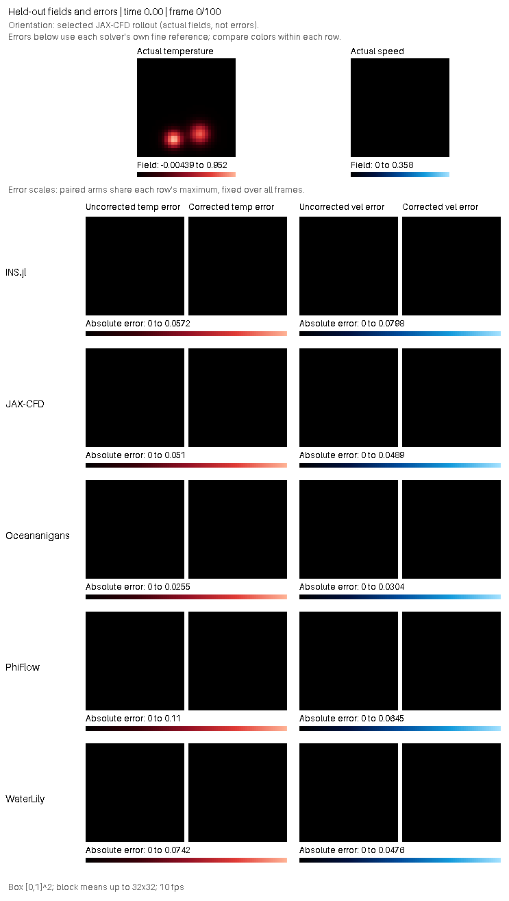
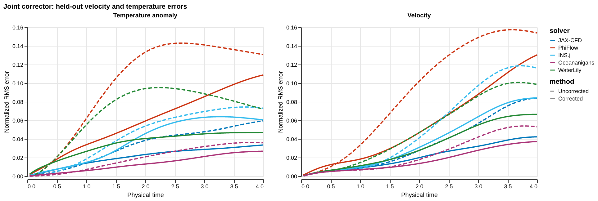
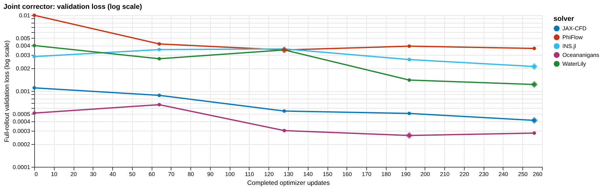

# Main buoyancy benchmark plots with joint correction

These figures replace the PR's main solver-in-the-loop gallery with a shared **joint velocity and temperature corrector** across PhiFlow, JAX-CFD, INS.jl, WaterLily and Oceananigans. This is an explicitly configured native run, not a new canonical container CI result. The public default remains velocity-only.

## Shared experiment

All five use the same width8/954-parameter CNN, raw temperature input, no heat constraint, Adam LR0.001, thermal-readout scale0.1, clip1 and256updates. The four fixed training trajectories, balanced shuffled H8window stream, networkseed0/windowseed0 and original main split are retained: validationIC1 selects among updates0/64/128/192/256; only then is testIC100 evaluated. There is no solver-specific LR or head-scale tuning.

The coarse grid is64² withdt0.005 and eight native steps per correction interval. Each backend supplies its own admitted128² reference with half the timestep;100intervals reachT4. Fixed RMS scales come from each backend's first training trajectory. These normalized errors measure improvement against each solver's own baseline/reference and must not rank absolute accuracy across backends.

Temperature and velocity each receive half the normalized mean-squared-error loss. All models start as the identity correction. Gradients pass through every recurrent solver interval and both learned output heads.

## Results

| Solver | Uncorrected | Joint | Reduction | Selected update |
|---|---:|---:|---:|---:|
| INS.jl | 0.0037033718 | 0.0021390141 | 42.2% | 256 |
| JAX-CFD | 0.0016806775 | 0.00057178992 | 66.0% | 256 |
| Oceananigans | 0.0007356186 | 0.00034284162 | 53.4% | 192 |
| PhiFlow | 0.012132003 | 0.004539077 | 62.6% | 128 |
| WaterLily | 0.0047212497 | 0.0014773335 | 68.7% | 256 |

Mean combined losses average predicted frames1–100. All five complete the256update budget and pass BOTH original fixed-epsilon neural gradient checks (initial and exact synthetic-nonzero model, epsilon0.003, unchanged5% tolerance). Supplementary epsilon convergence profiles are retained separately, not used as public-gate overrides.

JAX-CFD reuses verified immutable checkpoints from an identical256update training stream, then reselects using validationIC1 alone. Its new replay duration is not a fresh training or full-benchmark runtime. The other four are newly trained. Native first-step agreement with cached data, data/source/helper/parameter identities and reuse provenance are in the per-solver records.





The GIF contains all101frames and allfive solver rows. Temperature uses red and velocity blue. Paired arms share each row's physical scale over the full rollout; the top actual fields are the selected JAX-CFD model for orientation, not a shared ground truth. For display, fields are block averaged to at most32². No error/field overlays are blended.

[Canonical linear validation view](plots/validation_loss.png) retains the same data. The extra log view makes the different magnitudes readable; the plot audit confirms identical values in the two views. All2,000rollout points and25validation points were checked against the stored model metrics.

## Physical properties

| Solver | Final heat drift | Temperature undershoot |
|---|---:|---:|
| INS.jl | +0.522% | 0.00186 |
| JAX-CFD | +1.777% | 0.00490 |
| Oceananigans | -0.456% | 0.00152 |
| PhiFlow | -1.508% | 0.01124 |
| WaterLily | +1.739% | 0.00406 |

All selected joint models produce temperature undershoot and nonzero heat drift; none overshoots the initial maximum. The velocity correction remains a discrete curl, with zero stored normal wall values and divergence around4e-7. These are learned-corrector effects, not solver source fixes.

PhiFlow's heat loss is reduced from about8.44% uncorrected to1.51% with this joint model. The other native solvers conserve heat without a thermal correction, while their unconstrained joint heads introduce heat drift. Field error reduction therefore does not imply every physical property improves.

## What this says about solver suitability

The same native gradient implementations now yield relative gains of42–69% under this common joint recipe. Earlier velocity-only results gave WaterLily about26% improvement and INS.jl about57%; here the figures become about69% and42%. Both the output fields and shared learning rate changed, so this is not an isolated architecture ablation.

This is evidence of solver–corrector/recipe compatibility, not an intrinsic gradient-quality ranking. Every backend passes the checked gradients; the earlier conditioning measurements did not reliably predict training benefit. One networkseed and one testIC perbackend do not establish universal behavior. JAX-CFD remains convenient for fast experiments, but runtimes here use different native paths and cached preparation and should not be read as controlled CI speed rankings.

## Reproduction and validation

The benchmark now accepts `temperature_head_scale` for the existing optional `correct_temperature` mode. To use this gallery's configuration, set the training options:

```json
{"correct_temperature": true, "temperature_head_scale": 0.1, "learning_rates": [0.001]}
```

Commit b47beb40b9382e207f91e80b764ed0b6b1c1b724 adds this plumbing without changing the default. It passed67focused tests and exact forward/parameter-pullback parity against the archived research helper at three trained states, plus H8 recurrent loss/gradient parity. Test records are in [source-validation](source-validation).

Numerical workers and unchanged plot code use archived source1c714dd. Solver API hashes match the cached training/reference data and are unaffected by the new option. Julia runtimes/manifests were pinned, including WaterLily's SIMD preference; all jobs ran on RTX cluster nodes, never DGX or the weak local host. Installation, cold runtime bootstrap and shared reference preparation are not consistently included in per-fit timings, so no new canonical CI completion or cold-CI cost is claimed.

The old velocity-only plots remain pinned in the earlier gallery at artifact5685bf817f0c6f1e2093e774e5f649c628ae8cc5/ci-gallery-20261029/buoyancy-grid/optimization/solver_in_loop. Other forward, gradient and cost gallery figures are unchanged.

[Canonical plot data](plots/result.json), [matrix summary](render/matrix-summary.json), [render/data audit](render/plot-data-audit.json), [per-solver training metrics](training), [source test parity](source-validation/parity.json), and [publication hashes](publication-manifest.json). Full NPZ fields, checkpoints and source archives remain at the recorded cluster paths.
