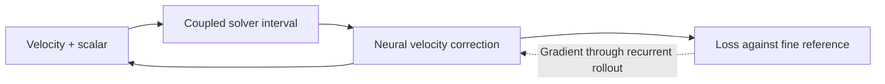

# Supporting investigations for PR #211

Archived from the PR description before integration cleanup on 2026-10-14. Historical experiment sources and artifact links below remain unchanged. These research results are separate from subsequent container/CI validation.

## What this adds

A `buoyancy-grid` domain with **PhiFlow, JAX-CFD, INS.jl, WaterLily, and Oceananigans**, integrated into Mosaic's forward, gradient, cost, and optimization suites.

Two unequal warm plumes rise and form interacting vortices in a closed 2D box. The scalar drives buoyancy, and velocity transports the scalar, so earlier neural corrections affect later flow. Inspired by [Um et al. (2020)](https://arxiv.org/abs/2007.00016).

The benchmark trains **one solver-in-the-loop (SOL) corrector** and measures whether it improves the uncorrected solver on a held-out trajectory. Supervised and stopped-gradient training have been removed. This is an accuracy and training-cost benchmark designed to run within a CI budget; an accuracy improvement is measured, not required to pass.

## Experiment



- Closed unit square, no-slip velocity walls and zero normal scalar gradient. Two seeded Gaussian plumes use resolution-consistent cell averages.
- **64² coarse grid:** time step **0.005**, eight steps per correction interval. **128² reference:** time step **0.0025**, sixteen steps per interval. Each backend uses its own solver for the reference. A separate 128² run with time step **0.00125** checks reference time refinement.
- Viscosity and scalar diffusivity **0.0005**, buoyancy **1**. Each trajectory contains **100 intervals to t=4**.
- A small CNN predicts a streamfunction velocity correction, preserving discrete incompressibility and zero normal wall velocity. The scalar remains solver-driven.
- **Four training trajectories**, seeds **0, 2, 3, 4**. Seed 0, validation seed **1**, and test seed **100** retain their original position jitter **±0.015**, relative width jitter **±5%**, and fixed amplitudes. The added seeds 2–4 use position jitter **±0.04**, relative width jitter **±15%**, and relative amplitude jitter **±15%**. Every training case has its own independently audited fine reference.
- **256 optimizer updates in total: 64 per training case**, not 256 per case. Each four-update round visits every case once in seeded random order; each case has independently shuffled eight-interval windows. Window seed **0**, learning rate **0.003**, eight hidden channels, network seed **0** are unchanged. Normalization remains anchored to the original training case, seed 0, rather than being recomputed over the larger dataset.
- The full 100-interval validation rollout selects the checkpoint and learning-rate candidate; the default has one learning rate. Checkpoints are evaluated at updates **0, 64, 128, 192, and 256**, including the initial zero-correction model. Exact ties favor the earlier checkpoint. All 256 updates still run; only the selected model is evaluated on the test trajectory. Test data do not select the model.
- Evaluation compares **fine reference, uncorrected coarse solver, and SOL**. Only SOL is trained. The loss is normalized squared velocity/scalar error; the shared plot below additionally shows physical spatial-mean errors.

Reference refinement, restart equivalence, finite outputs, end-to-end neural finite differences, and completion of the full training budget guard the measurements. No correctness thresholds were relaxed.

## Validation-selected results and runtime

All five backends completed the four-case, validation-selected, 256-update optimization benchmark and passed its correctness checks on Slurm. The previous one-case result is included to isolate the effect of mixing training trajectories at the same update budget. Mean normalized held-out loss over predicted frames **1–100**, excluding the identical initial state:

| Backend | Uncorrected | One-case SOL | Four-case SOL | Selected update, old → new |
| --- | ---: | ---: | ---: | ---: |
| JAX-CFD | 0.001681 | 0.000777 | 0.000861 | 128 → 192 |
| Oceananigans | 0.000736 | 0.000736 | 0.000369 | 0 → 128 |
| INS.jl | 0.003703 | 0.001024 | 0.001598 | 256 → 256 |
| WaterLily | 0.004721 | 0.003680 | 0.003496 | 256 → 128 |
| PhiFlow | 0.012132 | 0.005508 | 0.005965 | 256 → 256 |

Measured costs for the four-case recipe:

| Backend | Training | Validation | References + audits | Full benchmark |
| --- | ---: | ---: | ---: | ---: |
| JAX-CFD | 113 s | 4 s | 33 s | 167 s |
| Oceananigans | 217 s | 5 s | 111 s | 605 s |
| INS.jl | 376 s | 12 s | 311 s | 756 s |
| WaterLily | 238 s | 6 s | 119 s | 434 s |
| PhiFlow | 381 s | 32 s | 651 s | 1084 s |

Mixing four training cases lowered held-out loss for **Oceananigans, WaterLily**. Mixing four training cases increased held-out loss for **JAX-CFD, INS.jl, PhiFlow**. 

Selected nonzero corrections improve on the uncorrected baseline for **JAX-CFD, Oceananigans, INS.jl, WaterLily, PhiFlow**. 
Lower loss is better. Validation selection can retain an earlier model but does not guarantee improvement on the separate test trajectory. This is one fixed-budget recipe and one network seed, not a claim that corrections always improve a solver. The baseline remains visible when SOL makes the result worse. Each backend has its own reference and normalization, so normalized losses should not rank the solvers against each other.

The paired comparison verifies unchanged normalization scales and held-out reference/baseline states. These are single-network-seed results on one fixed held-out case; adding data is not assumed to help every backend.

Full times include reference generation and audits, compilation within the benchmark call, training, and evaluation; environment installation and container builds are excluded. Runs used CPU except PhiFlow on GPU, so timings indicate feasibility rather than a hardware-controlled speed comparison. **Container execution and GitHub CI remain unverified.**

PhiFlow's native semi-Lagrangian scalar transport remains nonconservative: the earlier seed-0 forward validation of this same flow measured about **4.9% reference and 9.1% coarse scalar mass loss** by t=4.

[Results, correctness checks, timings, and provenance](https://raw.githubusercontent.com/pasteurlabs/mosaic/d334f4d41630df4b965a48267c505a72ff20bf39/data_mix_256/admission_summary.json) · [One-case/four-case comparison and physical errors](https://raw.githubusercontent.com/pasteurlabs/mosaic/d334f4d41630df4b965a48267c505a72ff20bf39/data_mix_256/field_error_curves/recipe_comparison.json)

## Full rollout animations

All **101 actual saved states**, t=0 to t=4, without interpolated frames. Columns are **reference, uncorrected, validation-selected SOL**. Captions identify the selected update, including no correction when update 0 wins. Fine references are restricted from 128² to 64² for comparison.

The underlying scalar and speed are **grayscale**. **Cyan** overlays show absolute scalar error; **magenta** overlays show cell-centered velocity-vector error magnitude against the same solver's reference. Opacity grows linearly with error. Field and error scales are fixed across all solvers, methods, and time; reference panels have no error overlay.


<details>
<summary>JAX-CFD: rollout, final fields, errors, and training cost</summary>

Grayscale scalar with cyan error above; grayscale speed with magenta vector error below.


[Machine-readable results](https://raw.githubusercontent.com/pasteurlabs/mosaic/d334f4d41630df4b965a48267c505a72ff20bf39/data_mix_256/jax-cfd/result.json)

</details>

<details>
<summary>Oceananigans: rollout, final fields, errors, and training cost</summary>

Grayscale scalar with cyan error above; grayscale speed with magenta vector error below.


[Machine-readable results](https://raw.githubusercontent.com/pasteurlabs/mosaic/d334f4d41630df4b965a48267c505a72ff20bf39/data_mix_256/oceananigans/result.json)

</details>

<details>
<summary>INS.jl: rollout, final fields, errors, and training cost</summary>

Grayscale scalar with cyan error above; grayscale speed with magenta vector error below.


[Machine-readable results](https://raw.githubusercontent.com/pasteurlabs/mosaic/d334f4d41630df4b965a48267c505a72ff20bf39/data_mix_256/ins-jl/result.json)

</details>

<details>
<summary>WaterLily: rollout, final fields, errors, and training cost</summary>

Grayscale scalar with cyan error above; grayscale speed with magenta vector error below.


[Machine-readable results](https://raw.githubusercontent.com/pasteurlabs/mosaic/d334f4d41630df4b965a48267c505a72ff20bf39/data_mix_256/waterlily/result.json)

</details>

<details>
<summary>PhiFlow: rollout, final fields, errors, and training cost</summary>

Grayscale scalar with cyan error above; grayscale speed with magenta vector error below.


[Machine-readable results](https://raw.githubusercontent.com/pasteurlabs/mosaic/d334f4d41630df4b965a48267c505a72ff20bf39/data_mix_256/phiflow/result.json)

</details>

[Animation formulas, scales, and provenance](https://raw.githubusercontent.com/pasteurlabs/mosaic/d334f4d41630df4b965a48267c505a72ff20bf39/data_mix_256/animations/animation_receipt.json)

### Average full-field error: solver alone vs SOL

All five solvers share axes and physical units. Color identifies the solver; **dashed lines are uncorrected**, **solid lines are SOL**. The fine reference has zero error against itself. Left: spatial mean absolute scalar error. Right: spatial mean velocity-vector error magnitude after averaging face velocities to cell centers. These average the entire grid at each saved time, without solver-specific normalization; each backend is compared against its own restricted fine reference.


[Vector figure](https://raw.githubusercontent.com/pasteurlabs/mosaic/d334f4d41630df4b965a48267c505a72ff20bf39/data_mix_256/field_error_curves/field_error_base_sol.svg) · [CSV data](https://raw.githubusercontent.com/pasteurlabs/mosaic/d334f4d41630df4b965a48267c505a72ff20bf39/data_mix_256/field_error_curves/field_error_curves.csv) · [Metric definitions and provenance](https://raw.githubusercontent.com/pasteurlabs/mosaic/d334f4d41630df4b965a48267c505a72ff20bf39/data_mix_256/field_error_curves/plot_receipt.json)

### Which spatial scales does SOL correct?

**INS.jl has the largest relative reduction in the combined normalized test loss: 56.8%**, followed by PhiFlow 50.8%, Oceananigans 49.8%, JAX-CFD 48.8%, and WaterLily 26.0%. These compare each corrected solver with its own uncorrected baseline and fine reference.

The spectral diagnostic separates scalar and velocity errors on that same held-out rollout. We transform the **error field against the restricted fine reference**, square the coefficients, and average over predicted frames 1–100. An [orthonormal cosine transform](https://docs.scipy.org/doc/scipy/reference/generated/scipy.fft.dctn.html) gives a closed-box spatial basis without joining opposite walls. Radial mode index **q** increases toward finer scales; the nominal wavelength is **2L/q**, with L=1. This is a descriptive basis decomposition, not a periodic turbulence spectrum or a measurement of the network's transfer function.

The three bands are fixed before interpreting results: **large** 0<q≤4, **medium** 4<q≤16, **small** q>16. These are scale labels, not claimed inertial or dissipation regimes. Numbers in parentheses below show how much of the original error lies in each band.


- **Oceananigans** has the largest scalar error-power reduction in each band: **69%, 57%, 43%**, from large to small scales.
- **PhiFlow** has the largest cell-centered velocity error-power reduction in each band: **66%, 72%, 70%**.
- All five improve the three broad nonzero bands in aggregate, but **some individual modes worsen**, including parts of the finest-scale velocity spectrum. Medium scales contain about **62–83%** of the original error power across these solver/field pairs.
- Mean-field bias (**DC**, q=0) is reported separately: it is negligible except for PhiFlow scalar, where it accounts for **1.08%** of baseline error power and **increases by 13.4%** after correction.

These raw physical powers differ from the combined normalized benchmark loss. Velocity is averaged from faces to cell centers before transformation, which attenuates the highest staggered modes; the two component powers are summed. Consequently this is a cell-centered vector-error diagnostic, not an exact decomposition of the training metric. Only scales resolved on the 64² comparison grid are measured.

**Original versus corrected error power:** dashed lines are uncorrected; solid lines are SOL. Each curve sums squared modal errors within radial shells. Nonzero modes are shown; DC remains in the downloadable data. The vertical scale is logarithmic above 1e-11 and linear below it to display tiny tails without letting them dominate the figure.


**Fraction of error power remaining:** below 1 means improvement; above 1 means worsening. Ratios use time-averaged powers, not averages of instantaneous ratios. Shells with baseline power below 1e-8 of total baseline error are omitted from this ratio plot only; their raw data remain available.


[Shell data](https://raw.githubusercontent.com/pasteurlabs/mosaic/7bd20a718d859eb341860efc76b4dcf06e1c3eec/data_mix_256/spectral_errors/spectral_errors.csv) · [Band data, including DC](https://raw.githubusercontent.com/pasteurlabs/mosaic/7bd20a718d859eb341860efc76b4dcf06e1c3eec/data_mix_256/spectral_errors/spectral_bands.csv) · [Definitions, source hashes, and validation receipt](https://raw.githubusercontent.com/pasteurlabs/mosaic/7bd20a718d859eb341860efc76b4dcf06e1c3eec/data_mix_256/spectral_errors/spectral_receipt.json) · [Analysis script](https://raw.githubusercontent.com/pasteurlabs/mosaic/7bd20a718d859eb341860efc76b4dcf06e1c3eec/data_mix_256/spectral_errors/analyze.py)

Computed from the saved rollouts on Slurm; no new training or source-repository changes. Parseval checks verify that all modal powers, including DC, sum to the corresponding physical MSE for every frame; an analytic single-mode check and zero-error check also pass. Results describe one held-out trajectory, with no uncertainty estimate across trajectories or model seeds.

### Gradient behavior versus correction benefit at each scale

The paired plot below aligns **error removed by the corrector**, **local solver-gradient gain**, and **sampled conditioning** for the same large/medium/small scale bands. Columns separate scalar and cell-centered velocity outputs. The gradient measurements are for the **uncorrected solver**; they do not measure whether the learned corrector changes the solver's gradients.


The common pattern is **small-scale gradient damping**: median gains relative to the zero-duration observation map are about **0.99–1.01 at large scales**, **0.75–0.87 at medium scales**, and **0.14–0.24 at small scales**. These are gradient-norm gains, not error-power ratios. Sampled conditioning changes much less: median ratios κ(H8)/κ(H0) range from about **1.03 to 1.28**. Modest conditioning in these eight sampled directions does not establish good conditioning of the full Jacobian.

Similar gradient behavior does not imply similar correction benefit. For example, **PhiFlow and WaterLily have almost identical scalar gains** (about 0.99, 0.75, 0.14 across the bands), while their scalar error-power reductions are **19/36/33% versus 2/10/9%**. This comparison does not establish a causal link between conditioning and learning success.

<details>
<summary>Direct comparisons: gradient gain and conditioning versus error removed</summary>

Each point is a solver/field/scale-band pair. Horizontal bars show the range across four sampled reference states; they are not confidence intervals. The conditioning plot uses the ratio of two sampled condition numbers, not a preconditioned Jacobian condition number.


</details>

<details>
<summary>Measurement protocol and gradient checks</summary>

- Start from the same held-out trajectory's restricted fine-reference states at **t=0, 0.96, 1.92, and 2.88**. Evolve the coarse solver for **eight correction intervals**, or **0.32 physical time**, matching the training unroll duration. These local probes restart from reference states; the correction-benefit measurement covers the original full held-out rollout.
- For each output field and scale band, use **eight fixed orthonormal random cosine-basis directions**, identical across all states and backends. Pull them backward using the solver's [vector–Jacobian product](https://docs.jax.dev/en/latest/_autosummary/jax.vjp.html).
- Use the benchmark's fixed training-RMS normalization for inputs and outputs. Differentiate output face-to-cell averaging exactly. Project input velocity gradients onto the discrete divergence-free, zero-normal-wall tangent; scalar input variations remain free. This is a state-sensitivity study, not a neural-parameter gradient study: the CNN itself directly changes only velocity.
- Direct SVD of the eight projected gradient vectors gives their singular values. RMS gain is `sqrt(sum(sigma²)/8)`, compared with the **H0 zero-duration** observation/projection map. Sampled conditioning is `max(sigma)/min(sigma)`. Singular values below 1e-6 of the largest would be marked unresolved; none were unresolved here. Eight random directions cannot characterize the full scale-band Jacobian or its worst directions.
- Check the first fixed direction in every field/band/state using centered finite differences at **both predeclared normalized perturbation sizes 0.03 and 0.1**. Keep all **240 checks**, including the initially resting flow, without selecting the best step size. Maximum relative discrepancy: **JAX-CFD 4.95%, WaterLily 0.196%, PhiFlow 0.0061%, Oceananigans 0.0010%, INS.jl 0.0005%**. These checks do not validate every probed direction or establish physical sensitivity accuracy.
- Projection symmetry, idempotence and orthogonality, probe orthonormality, shared basis hashes, and agreement with the original rollout-file hashes were checked. All five jobs completed on Slurm; no retraining or source changes were needed.

</details>

[Summary CSV](https://raw.githubusercontent.com/pasteurlabs/mosaic/9acb2a1589a331f5162bc4555d9fdc69d6bbc017/data_mix_256/gradient_scales/gradient_spectral_summary.csv) · [All directional checks](https://raw.githubusercontent.com/pasteurlabs/mosaic/9acb2a1589a331f5162bc4555d9fdc69d6bbc017/data_mix_256/gradient_scales/gradient_directional_checks.csv) · [Raw singular values and state samples](https://raw.githubusercontent.com/pasteurlabs/mosaic/9acb2a1589a331f5162bc4555d9fdc69d6bbc017/data_mix_256/gradient_scales/gradient_spectral_comparison.json) · [Protocol](https://raw.githubusercontent.com/pasteurlabs/mosaic/9acb2a1589a331f5162bc4555d9fdc69d6bbc017/data_mix_256/gradient_scales/protocol.json) · [Plot receipt](https://raw.githubusercontent.com/pasteurlabs/mosaic/9acb2a1589a331f5162bc4555d9fdc69d6bbc017/data_mix_256/gradient_scales/plot_receipt.json) · [Analysis script](https://raw.githubusercontent.com/pasteurlabs/mosaic/9acb2a1589a331f5162bc4555d9fdc69d6bbc017/data_mix_256/gradient_scales/analyze.py)

### Exploratory correlations across solvers

**Interpretation update:** the native JAX-CFD audit below explains most of its largest FD discrepancy through finite-path slope variation. These FD measurements must not be read as a gradient-accuracy ranking.

Across the five solvers, smaller worst-case fixed-step FD discrepancy accompanies greater overall correction benefit (**Spearman ρ = −0.80; exact two-sided permutation p = 0.133; n = 5**). This is a descriptive association, not established evidence that inaccurate gradients limit training: solver implementations differ in many other ways, and FD discrepancy also includes finite-step, nonsmoothness, and rounding effects.


<details>
<summary>Conditioning and FD agreement within each spatial scale</summary>

The following panels compare the same five solvers separately within each field and band. Conditioning has an inconsistent relationship with benefit, including a sign reversal for small-scale velocity. FD agreement also changes direction between fields/bands. All panels are reported; the p-values are exploratory and **not adjusted for multiple comparisons**. Repeated bands and fields are not independent solver replicates.


</details>

[All correlation coefficients and permutation p-values](https://raw.githubusercontent.com/pasteurlabs/mosaic/ccec1471f05160f6f7ee44052ec96b38c304d92f/data_mix_256/gradient_correlations/correlations.csv) · [Inputs, definitions, and limitations](https://raw.githubusercontent.com/pasteurlabs/mosaic/ccec1471f05160f6f7ee44052ec96b38c304d92f/data_mix_256/gradient_correlations/correlations.json) · [Rendering receipt](https://raw.githubusercontent.com/pasteurlabs/mosaic/ccec1471f05160f6f7ee44052ec96b38c304d92f/data_mix_256/gradient_correlations/receipt.json)

### Native gradient audit (JAX-CFD)

**No native-gradient defect was established.** The earlier 4.95% finite-difference discrepancy is not evidence that JAX-CFD's gradient is 4.95% inaccurate. Automatic differentiation measures a local slope; a finite difference measures the slope across a finite perturbation. This audit finds strong evidence that variation along that perturbation explains most of the discrepancy.

The worst historical probe is the small-scale scalar direction at reference frame 72. Keeping the original forward map and direction, compare its central finite difference with both the center derivative and the average directional derivative along the same path:

| Perturbation size | Center AD versus FD discrepancy | Path-average AD versus FD discrepancy (32 quadrature nodes) |
| --- | ---: | ---: |
| 0.001 | 2.786% | 0.00086% |
| 0.03 | 4.215% | 0.01328% |
| 0.1 | 4.952% | 0.01298% |

All three comparisons improve from 8 to 16 to 32 Gauss–Legendre nodes; every order and node is retained. This supports finite-path derivative variation, without establishing whether limiter transitions or smooth curvature dominate. Because Float32 casts make the literal numerical map discontinuous, this is a consistency diagnostic, not an exact integral-theorem proof.


**The actual neural training gradients agree much more closely with finite differences.** Audit five fixed windows at initialization and at the validation-selected update 192: the actual first scheduled window plus start 24 in each of the four training trajectories. At the common swept step size 0.0003, all ten gradient-direction discrepancies are below **0.009%**. At the benchmark's original step 0.003, they are **0.16–0.70% initially** and **0.085–0.188% after training**. The figure retains all eleven step sizes and both gradient and fixed-random directions; 0.0003 is a reported comparison point, not a newly selected acceptance threshold. These sampled directional checks do not validate every component of the gradient.


Across all **24 state probes and ten neural-loss cases**, direct native differentiation and the public adapter produce bitwise-identical forwards and exactly equal gradients. Forward-mode JVP and reverse-mode VJP checks also agree closely, but use the same AD system and therefore are not an independent reference derivative.

<details>
<summary>Step-size, precision, and reproducibility diagnostics</summary>


All native probes retain central and both one-sided differences for eleven prescribed steps from 1e-5 to 1, along with actual rounded input displacements and unavailable perturbations. Large steps sample changing slopes; very small steps become sensitive to rounding. One-sided asymmetry alone does not establish nonsmoothness. The pinned Van Leer implementation contains sign, upwind and zero-denominator branches, but no stopped-gradient or custom-derivative override in that advection function.


The separately labeled Float64 companion removes the interval-output Float32 cast and uses Float64 state reconstruction, centering and normalization. It is a **different numerical map**, not a reference gradient for the unchanged native forward calculation. Its projected gradient differs from the native gradient by only **1.82e-7 relative L2**, yet finite differences still approach it slowly: about **3.62% discrepancy at 0.01** and **0.186% at 1e-11**. Both prescribed directions and all 18 step sizes are retained, including the five smaller steps added after the initial diagnostic. Float32 output rounding alone therefore does not explain the finite-step gap.

The original runs saved rollout fields but not weights. One unchanged clean seed-0 replay captured checkpoints and exactly reproduced every prior training loss, validation checkpoint, held-out scalar/velocity/loss array, and selection of update 192 before its weights were admitted for this audit. Original probe/input hashes match across diagnostics. All numerical work and rendering ran on Slurm; source remains `a2339b9`. No solver repair or alternative training recipe was introduced.

</details>

**Consequence:** the earlier cross-solver FD plot is a comparison of finite-step discrepancies, not a ranking of native gradient accuracy. This audit does not justify a gradient-repair training experiment or attribute correction-performance differences to inaccurate JAX-CFD gradients. The separate noise sweep tests deliberately corrupted backward passes, which is a different claim.

[Raw state and neural audits](https://raw.githubusercontent.com/pasteurlabs/mosaic/e8031541e1dd16491821f95ab885de93c0acea25/data_mix_256/native_gradient_audit/native_gradient_audit.json) · [Every path node and quadrature order](https://raw.githubusercontent.com/pasteurlabs/mosaic/e8031541e1dd16491821f95ab885de93c0acea25/data_mix_256/native_gradient_audit/path_average_audit.json) · [Full precision diagnostic](https://raw.githubusercontent.com/pasteurlabs/mosaic/e8031541e1dd16491821f95ab885de93c0acea25/data_mix_256/native_gradient_audit/precision_companion.json) · [Protocol, jobs and hashes](https://raw.githubusercontent.com/pasteurlabs/mosaic/e8031541e1dd16491821f95ab885de93c0acea25/data_mix_256/native_gradient_audit/protocol.json) · [Exact replay admission](https://raw.githubusercontent.com/pasteurlabs/mosaic/e8031541e1dd16491821f95ab885de93c0acea25/data_mix_256/native_gradient_audit/replay_admission.json) · [All state gradient-direction sweeps](https://raw.githubusercontent.com/pasteurlabs/mosaic/e8031541e1dd16491821f95ab885de93c0acea25/data_mix_256/native_gradient_audit/state_fd_projected_gradient.png) · [All state random-direction sweeps](https://raw.githubusercontent.com/pasteurlabs/mosaic/e8031541e1dd16491821f95ab885de93c0acea25/data_mix_256/native_gradient_audit/state_fd_fixed_random.png) · [Audit implementation](https://raw.githubusercontent.com/pasteurlabs/mosaic/e8031541e1dd16491821f95ab885de93c0acea25/data_mix_256/native_gradient_audit/native_gradient_audit.py)

### Controlled gradient-noise amplitude sweep (JAX-CFD)

**Very strong backward corruption damages training, but moderate noise has mixed effects.** Keep the forward solver identical and perturb only its training state-input gradients, separately at large, medium, or small spatial scales. Test relative amplitudes **0, 0.03, 0.1, 0.3, 1, and 3**, using five paired seeds: **80 fresh runs**, each with the unchanged 256-update, H8, four-trajectory recipe.

All runs finished: **72 passed; eight hit the native CFL admissibility limit**. These failures are retained and were not retried or rescued by changing the timestep. At amplitude 3 (noise norm three times the clean state-gradient norm):

| Noise scale | Outcome across five seeds |
| --- | --- |
| Large | **5/5 solver CFL rejections** during fitting; no completed test result |
| Medium | **3/5 CFL rejections**; the other two completed but selected update 0 (the uncorrected model). Their final validation losses were over 1,000 times their matched clean runs. |
| Small | **5/5 completed**, but final-update validation error worsened in every seed: **+43% to +95%, mean +65%**. Selected held-out test effects remained mixed because earlier checkpoints could be retained. |

At amplitudes through 1, no band consistently worsens all five seeds on either selected held-out test error or final validation error. The selected-test mean changes below are descriptive paired averages; negative means lower error than clean-gradient training. **No survivor-only means** are reported for groups with failed runs.

| Relative state-gradient noise | Large-scale: mean test-error change | Medium-scale | Small-scale |
| --- | ---: | ---: | ---: |
| 0.03 | −4.5% | +3.4% | +0.04% |
| 0.1 | −0.6% | −6.7% | −2.6% |
| 0.3 | +5.0% | +3.7% | −2.3% |
| 1 | −4.2% | −2.0% | −1.7% |
| 3 | Unavailable: 5 failures | Unavailable: 3 failures | +5.6% |


Final-checkpoint validation tells a different story from validation-selected test performance. Selection can retain a better earlier model or the uncorrected model; the following plot exposes deterioration at update 256. **These are validation errors, not final-checkpoint test errors.** Gaps are unavailable outcomes, detailed in the checkpoint panel below.


The same state-gradient noise budget has a much larger initial effect on the neural parameter gradient at large and medium scales than at small scales. This demonstrates scale-dependent transmission of this intervention. It does not measure intrinsic gradient accuracy or establish that the earlier sampled condition numbers caused the training differences.


<details>
<summary>Checkpoint fallback, precise intervention, and verification</summary>


At each backward solver call, replace the native input-state gradient `g` by `g + a ||g||₂ ξ_band / ||ξ_band||₂`. Apply separate budgets to joint velocity and scalar fields, each using its **full clean field norm**, not only its in-band norm. A zero clean field stays zero. Independent noise draws are keyed by noise seed, optimizer update, and unroll position. Noise seeds are 17000 + network seed; amplitudes and bands share the underlying modal draws within a paired seed.

Scalar noise uses orthonormal cosine modes without the constant mode. Velocity noise uses normalized discrete curl modes with zero divergence and zero normal velocity at walls. These are not componentwise cosine modes or no-slip Stokes eigenmodes. Modal bands are `0 < q ≤ 4`, `4 < q ≤ 16`, and `q > 16`, where `q = sqrt(kx² + ky²)`; raw receipts include the realized centered-field spectra.

Reference generation, native forward computation, clean gradient admission, validation and test evaluation remain unchanged. **The deliberately corrupted backward rule is not the true derivative of the forward solver; clean FD checks do not validate it.** Every run uses the same source/data, training windows, normalization and references, with matched initial networks within each seed. All completed runs perform all 256 updates; checkpoints are selected only using validation at updates 0/64/128/192/256.

The low/high endpoint checks verify perturbation budgets, modal support, wall/divergence constraints, identical forward states/losses, repeatability, and an actual neural-gradient effect. All 12 runs overlapping the earlier three-seed pilot reproduce their uncorrected and corrected loss arrays and selected checkpoints exactly. The analyzer verifies the full 80-cell manifest, paired invariants, per-update VJP records, checkpoint selection, and saved-field agreement with completed-run metrics. Each completed update records seven used state VJPs; the constant initial input needs no derivative.

All eight failed runs contain explicit native CFL-limit rejection evidence. They are solver-admissibility failures during fitting, which includes checkpoint validation, not inferred nonfinite divergence or infrastructure failures. Original failure classifications, messages, partial validation histories and logs are retained. No failed run receives an invented final score. Experiments and plotting ran on Slurm, with at most 12 concurrent jobs; benchmark source remains `a2339b9`.

**Interpretation:** This is controlled evidence that sufficiently strong corruption of the solver backward pass can spoil this neural training setup. It does not establish that the much smaller FD discrepancies observed between native solvers explain their correction performance. Five paired seeds, one solver and one fixed recipe do not establish a universal failure threshold. Noise can also regularize optimization; intermediate amplitudes do not exhibit a monotonic effect. The intervention changes input gradients, whereas the earlier conditioning study restricted output cotangents.

</details>

[All paired results, failures and verified invariants](https://raw.githubusercontent.com/pasteurlabs/mosaic/640175d6c9a6ff3d55bd8e46156804a0560f5193/data_mix_256/gradient_amplitude/amplitude_results.json) · [Frozen protocol and jobs](https://raw.githubusercontent.com/pasteurlabs/mosaic/640175d6c9a6ff3d55bd8e46156804a0560f5193/data_mix_256/gradient_amplitude/protocol.json) · [All 12 exact pilot reproductions](https://raw.githubusercontent.com/pasteurlabs/mosaic/640175d6c9a6ff3d55bd8e46156804a0560f5193/data_mix_256/gradient_amplitude/control_reproduction.json) · [Raw receipts, results and failure logs (27.4 MB)](https://raw.githubusercontent.com/pasteurlabs/mosaic/640175d6c9a6ff3d55bd8e46156804a0560f5193/data_mix_256/gradient_amplitude/raw_receipts.tar.gz) · [Archive manifest and checksum](https://raw.githubusercontent.com/pasteurlabs/mosaic/640175d6c9a6ff3d55bd8e46156804a0560f5193/data_mix_256/gradient_amplitude/archive_manifest.json) · [Analysis receipt](https://raw.githubusercontent.com/pasteurlabs/mosaic/640175d6c9a6ff3d55bd8e46156804a0560f5193/data_mix_256/gradient_amplitude/analysis_receipt.json) · [Intervention implementation](https://raw.githubusercontent.com/pasteurlabs/mosaic/640175d6c9a6ff3d55bd8e46156804a0560f5193/data_mix_256/gradient_amplitude/gradient_noise.py) · [Experiment driver](https://raw.githubusercontent.com/pasteurlabs/mosaic/640175d6c9a6ff3d55bd8e46156804a0560f5193/data_mix_256/gradient_amplitude/gradient_noise_driver.py) · [Analysis script](https://raw.githubusercontent.com/pasteurlabs/mosaic/640175d6c9a6ff3d55bd8e46156804a0560f5193/data_mix_256/gradient_amplitude/analyze.py) · [Earlier three-seed pilot](https://github.com/pasteurlabs/mosaic/tree/74aa0f0a5954517027746406b6d0e3c9408fc25d/data_mix_256/gradient_noise)

## Solver implementations

| Backend | Coupled flow implementation | Differentiable inputs |
| --- | --- | --- |
| PhiFlow | Native semi-Lagrangian transport, diffusion, and pressure projection | State and physics parameters via JAX |
| JAX-CFD | Native Van Leer transport, explicit diffusion, and closed-wall projection | State and physics parameters via JAX |
| INS.jl | Native Boussinesq model, centered transport, RK4, and transform projection | State via Zygote |
| WaterLily | Native momentum and multigrid pressure solve; adapter adds conservative scalar transport and Heun coupling | State and physics parameters via Enzyme |
| Oceananigans | Native buoyancy model, third-order upwind transport, RK3, and equivalent separable Neumann pressure inverse | State via Enzyme |

All adapters expose a Float32 staggered state and use Float64 internally. The Julia adapters run on CPU; PhiFlow and JAX-CFD support CPU/GPU.

The larger flow exposed two forward pressure failures:

- **WaterLily:** native PCG stalled at 128² after hitting its step-size guard. Native multigrid reduced first-interval divergence RMS from about **0.064 to 1.5e-8**. Other grid sizes use native red-black relaxation with explicit convergence checks. Forward, state/parameter gradients, fallback grids, and full rollouts passed.
- **PhiFlow:** Float32 GPU projection diverged during reference refinement. Float64 native simulation and implicit adjoints kept divergence below **6e-7** in that reproduced case. All five input VJPs and nine original contract tests passed.

JAX-CFD uses Float64 to avoid limiter-gradient underflow and applies wall conditions before forming the pressure RHS. Oceananigans uses the same equivalent separable pressure inverse for forward and reverse because its FFTW path lacks Enzyme support; its Julia 1.12.6 pin resolves the observed embedded reverse-compilation failure.

The final schema, training, and status tests pass **79/79**, including balanced per-case sampling, independently shuffled window coverage, disjoint training/held-out cases, per-case reference admission, retention of earlier or zero-correction checkpoints, deterministic ties, and completion of all updates even when the selected checkpoint is earlier. Research drivers and artifacts remain outside the source tree. This benchmark is not a reproduction of the paper's full training campaign.

## Run

```bash
mosaic run -p buoyancy-grid --suites forward,gradient,cost,optimization -s phiflow
mosaic run -p buoyancy-grid --suites forward,gradient,cost,optimization -s jax-cfd
mosaic run -p buoyancy-grid --suites forward,gradient,cost,optimization -s ins-jl
mosaic run -p buoyancy-grid --suites forward,gradient,cost,optimization -s waterlily
mosaic run -p buoyancy-grid --suites forward,gradient,cost,optimization -s oceananigans
```

CI label: **`benchmark:domain`**.
