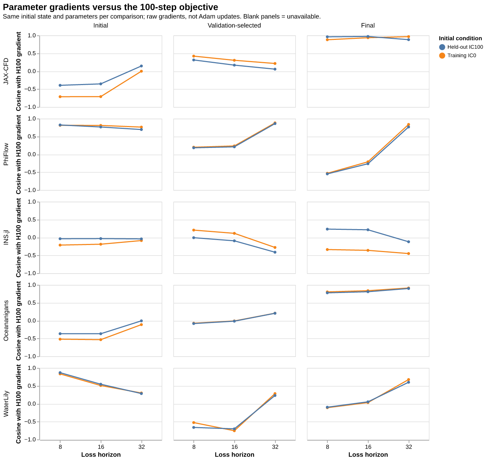
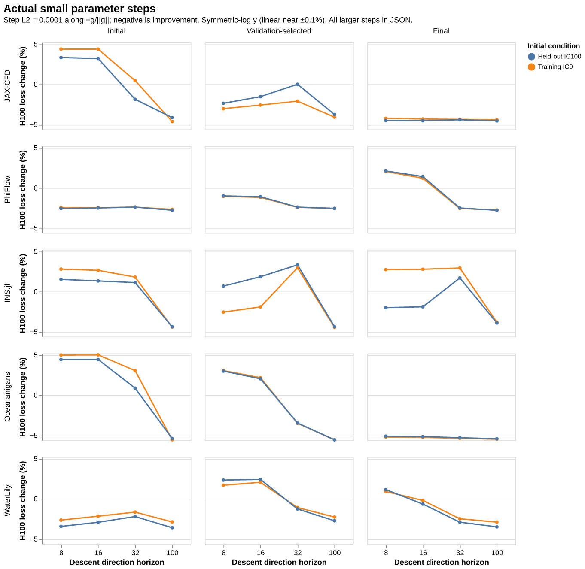
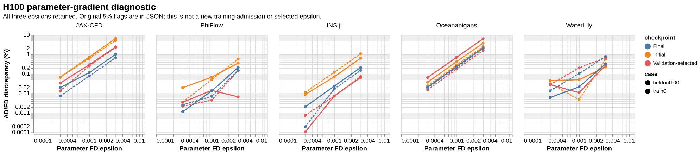
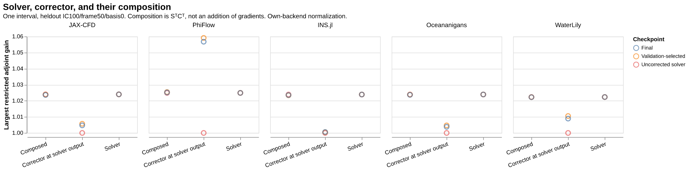
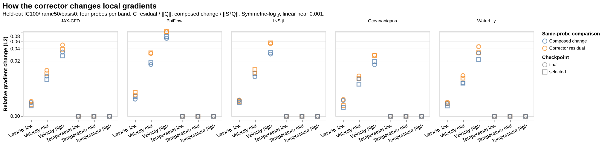
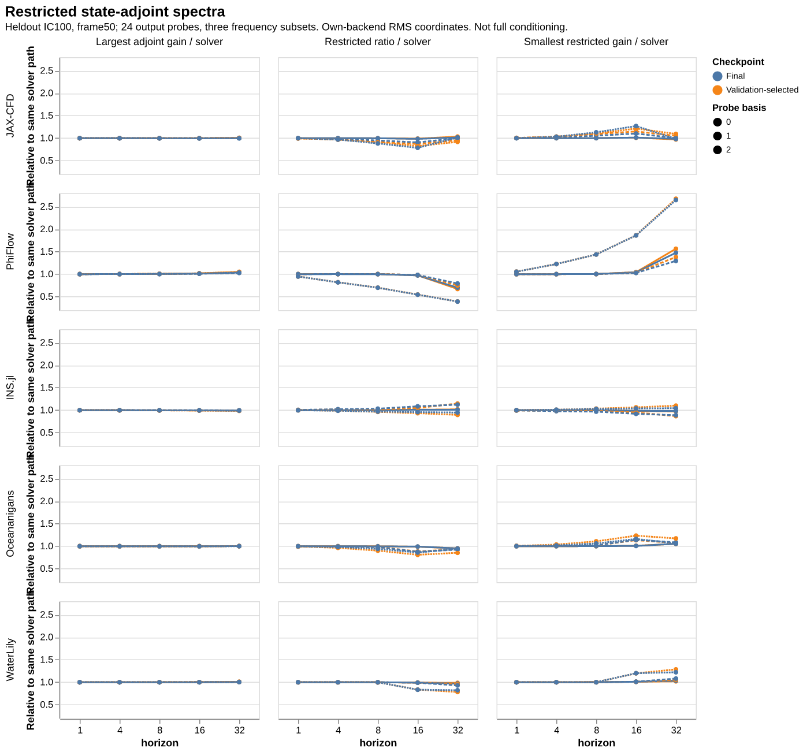
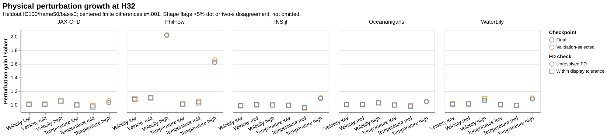
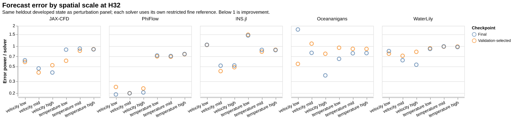
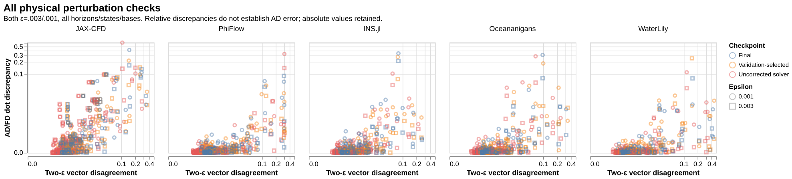
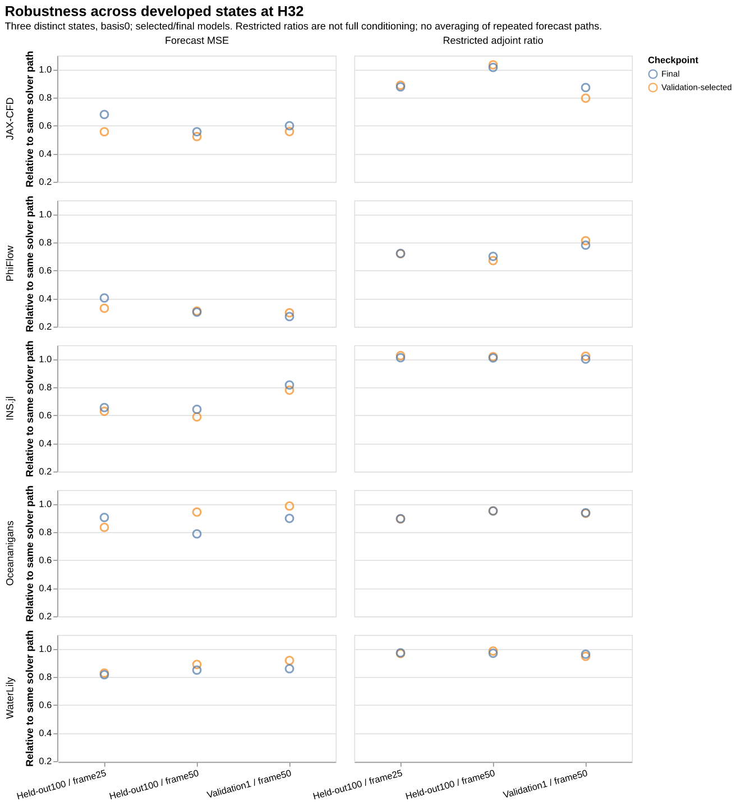

# Four gradient diagnostics across all five differentiable solvers

All five backends completed **30 parameter-gradient contexts and 2,430 operator records**. The ten unified figures below use existing JAX-CFD, PhiFlow, INS.jl, Oceananigans and WaterLily checkpoints. OpenFOAM is forward-only and is outside this gradient study.

Every model used **256 H8 Adam updates at learning rate 0.003, width 8, velocity-only correction and nominal model seed 0**, with the same four training ICs and window schedule. Selection used validation every 16 updates, rather than the public benchmark's cadence 64. Initial, validation-selected and final parameters are retained. Each backend uses its **own fine reference and original training RMS normalization**; no JAX reference was substituted for another solver.

**H16 and H32 here are analysis horizons, not additional trained models.** The earlier JAX-only 60-second H8/H16 pilot remains a separate study. One interval contains eight native timesteps at dt 0.005; H100 reaches physical time 4. These are native Slurm diagnostics, not a new canonical container-CI run.

## What the measurements show

1. **Longer prefixes do not uniformly align better with the long objective.** At the selected checkpoint on held-out IC100, H32/H100 gradient cosine is 0.861 for PhiFlow but −0.412 for INS.jl. Actual parameter steps confirm the distinction: a step of L2 norm 1e−4 along the negative normalized H32 gradient changes H100 loss by −0.541% and +1.284%, respectively. JAX, Oceananigans and WaterLily also show checkpoint-dependent behavior. These controlled prefixes begin at frame 0; they are **not the actual shuffled-window training-gradient distribution or Adam update direction**.
2. **At the primary state, local gradient changes are largest in the higher-frequency velocity probes.** The local comparison uses the same cotangents for the solver, corrector and composed map. It measures `CᵀQ−Q` and `SᵀCᵀQ−SᵀQ`; gradients are not added to obtain the chain rule. The immediate temperature-output derivative stays near identity, as expected for velocity-only correction. Temperature responses can change over subsequent recurrent solver steps.
3. **Better forecasting does not require all measured gains or restricted ratios to decrease.** At the primary developed state, selected-model H32 MSE ratios versus the uncorrected solver are 0.523, 0.311, 0.590, 0.943 and 0.890 (JAX, Phi, INS, Ocean, Water). Largest adjoint gains can increase while error falls. Some individual error bands worsen, and uncertain finite-difference perturbation responses remain marked.
4. **The forecast improvement persists at all three sampled developed states; the conditioning behavior is mixed.** Both selected and final models improve H32 MSE in these cases. The restricted adjoint ratio improves for PhiFlow, Oceananigans and WaterLily, is slightly worse for INS.jl, and depends on the state for JAX-CFD. These are three states from two ICs, not independent population samples. Three probing bases at the primary state reuse the same forecast trajectory and are not averaged as additional ICs.

These observations do not select a new universal horizon or change the public recipe. They also do not establish a native-gradient defect.

## Read the data and limits

- [Full numerical tables, completion ledger and interpretation limits](numerical-report.md)
- [Complete combined scalar report](report.json?raw=1) and [same-probe local decomposition](local_gradient_decomposition.json?raw=1)
- [Common protocol](PROTOCOL.json), [checkpoint/data inventory](inventory.json), [job/attempt manifest](report-input.json), [publication receipt](publication-receipt.json)
- [Slurm accounting](sacct.txt), [component environments and preserved preflight evidence](provenance), [raw outcome JSONs, including failed attempts](raw)
- [Hashes and locations of retained full array archives](retained-array-archives.json); large arrays and checkpoints are not copied into this artifact branch.

The operator spectra describe a **24-dimensional output-cotangent restriction with full canonical input covectors**, not the full physical Jacobian condition number. Normalization and fine references are backend-specific. The forward perturbation measurements are genuine centered finite differences at epsilon 0.003 and 0.001, not JVPs inferred from VJPs. Both values, vector disagreements, AD/FD dot values, absolute discrepancies and denominators are retained. Plot flags use a descriptive 5% threshold, not a retrospective admission rule; ratios are flagged if either the corrected or uncorrected response is unresolved.

Three H100 parameter-FD points exceed 5% at epsilon 0.003 (two initial JAX contexts and one selected Ocean context); their smaller-epsilon results remain visible. Long-horizon state probes also include unresolved responses. These discrepancies alone establish neither incorrect AD nor a rounding explanation. All reported CFL observations are sampled interval/provisional/corrected/perturbed endpoints, not every native microstep.

Scale-energy diagnostics use packed MAC component arrays. Their low band includes DC, while selected probe modes exclude DC; broad energy bands are not the exact finite probing subspaces. Original Phi nested-trace failures and Julia bootstrap/WaterLily preference failures are preserved separately from successful numerical execution. The Water retry restored the original SIMD preference rather than changing the solver equations.

## Unified figures

### Parameter-gradient alignment

### Solver, corrector and composed gradients

### Physical perturbation growth and forecast errors

### Robustness across developed states

