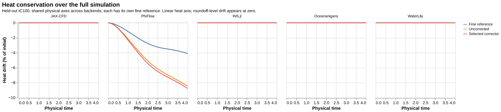
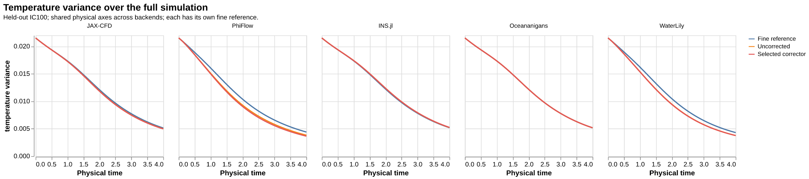
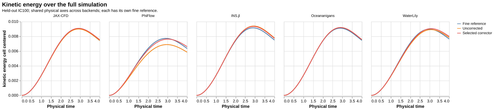
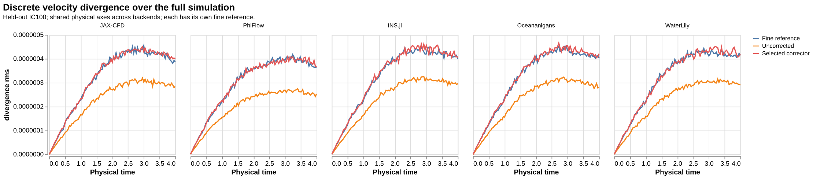
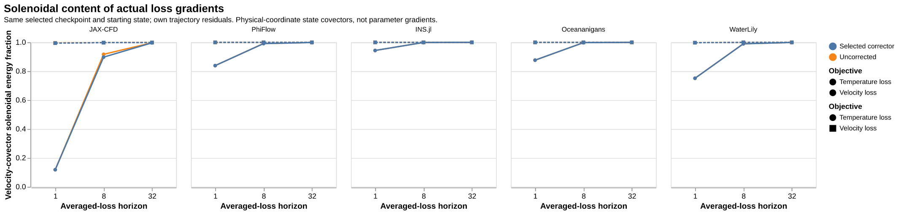
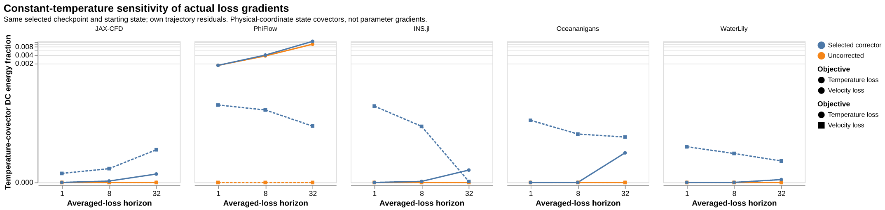
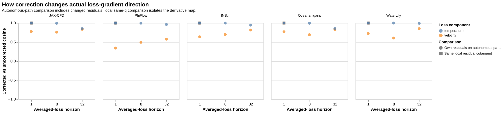
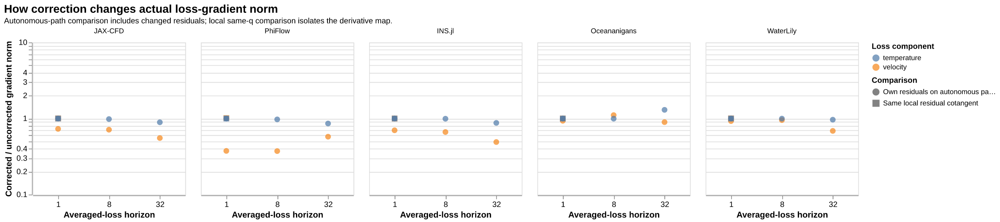
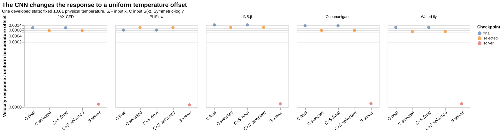
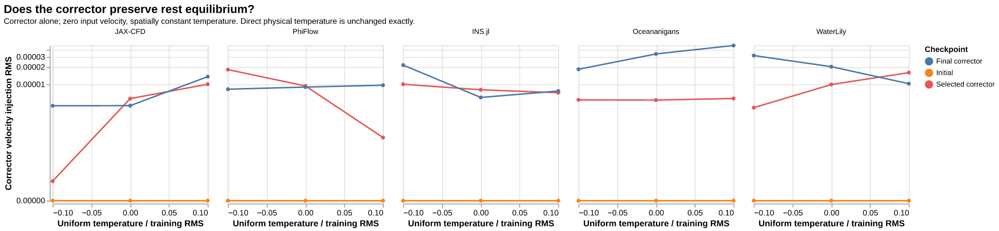

# Physical properties of the solver and learned corrector

This all-five audit reuses the common 256-update, H8, Adam 0.003 velocity-only checkpoints, selected with validation every 16 updates. It introduces **no retraining, production changes or new admission rules**. Every backend uses its own fine reference and training RMS scales. Calculations and rendering ran on Slurm; source, input, model and raw-array identities are retained in the linked JSON.

## Main findings

- Direct physical corrector calls preserve temperature **bitwise**, including all 45 constant-temperature/rest controls. Heat can still change indirectly through later solver steps after velocity changes.
- PhiFlow loses heat in the uncorrected and corrected full runs; correction slightly increases that loss. The other four retain mean heat within roughly 1e-9 absolute at T4. This is a forward discretization property, not evidence of wrong automatic differentiation.
- At H32, the velocity blocks of both actual loss-component gradients are already more than 99.65% in the physical closed-MAC solenoidal subspace for all selected models. Short-horizon temperature-loss gradients can have much larger complements. A state-gradient complement does **not** establish a useful parameter-gradient intervention: the curl output already annihilates velocity gauge directions; the local parameter-pullback projection control changes the gradient by only ~1.1e-6 relative.
- All five solvers approximately respect uniform-temperature hydrostatic offsets at the tested state. The trained CNN introduces a velocity response to that offset. Its raw-temperature input therefore breaks this symmetry without implying an AD defect.
- Trained correctors also inject small velocity at zero-temperature rest (selected RMS 5.35e-6–1.00e-5). Temperature centering alone cannot remove this learned-bias effect. Initial zero-readout models preserve rest exactly.

Full-T4 heat drift, expressed as a percentage of each trajectory's initial integrated heat (unit domain):

| Solver | Uncorrected heat drift | Corrected heat drift |
|---|---:|---:|
| JAX-CFD | -6.13039e-07% | -2.02835e-06% |
| PhiFlow | -8.44229% | -8.76192% |
| INS.jl | 3.1049e-07% | -1.6968e-06% |
| Oceananigans | 1.22825e-06% | 1.10536e-06% |
| WaterLily | 4.94261e-08% | -6.10513e-07% |

[Full absolute values, gradient metrics and controls](physical_summary.json). The table retains roundoff-level drift; it does not suggest those tiny values are physical conservation failures. Phi's restricted fine-reference heat drift is also nonzero and is plotted below.

## Forward properties

Full T4 uses cached uncorrected/selected/reference trajectories. Final-checkpoint trajectories are available only for the 32-interval developed-state comparisons; all their values remain in [the complete cached audit](cached-physical-audit.json). Normal padding, extrema/undershoot/overshoot, scalar variance increments, kinetic energy, interior-corner enstrophy, DCT band powers (DC, 0<q≤4, 4<q≤16, q>16 with q=√(kx²+ky²)), sampled buoyancy work, and local correction budgets are retained there. Velocity divergence is at saved interval endpoints, not every native microstep. Reconstructed closed-face wall flux is zero by convention; packed padding is checked separately. Buoyancy may increase kinetic energy, so no energy-decay condition is imposed. Temperature boundary differences and finite-precision extrema changes are descriptive, not boundary-condition or conservation proofs.

## Actual velocity and temperature loss gradients

For one developed held-out state (IC 100/frame 50), each component loss is averaged over **all** 1, 8 or 32 intermediate outputs. Velocity loss is 0.5 times the mean normalized squared velocity error; temperature loss is 0.5 times the mean normalized squared temperature error. Reverse accumulation includes every intermediate residual. These are **initial-state covectors**, not neural-parameter gradients or the average gradient over the sampled training windows.

Uncorrected and corrected autonomous paths have their own residual cotangents. Their gradient difference therefore combines map changes and residual changes. The separate local same-q control fixes the output cotangent: S and C∘S are differentiated at x, C at S(x). A constant temperature mode is not generally a removable gauge: a heat-mean output has a nonzero constant input-temperature covector. Phi's temperature-loss DC sensitivity is meaningful and must not be erased merely to make the gradient zero-mean.

Physical-coordinate covectors are g_x=g_z/D for z=x/D. We do not silently substitute the volume-weighted Riesz density g_x/h². The projector is the Euclidean orthogonal projector onto the zero-wall MAC curl range; uniform cell-area weighting leaves it unchanged. Its complement includes unused packed boundary coordinates, reported separately. [Original synthetic mode probes](mode-gradient_projection.png) and [their DC sensitivities](mode-gradient_heat_dc.png) are supplementary, distinct from actual loss gradients; near-zero velocity blocks are masked only in the ratio plot, with raw norms and fractions preserved.

## Heat and hydrostatic/rest controls

The fresh heat-mean output cotangent is q_theta=1/N², q_velocity=0. Conservative solvers return constant temperature covectors and zero velocity covectors. Phi's mean-heat adjoint has a 0.55% relative departure from that constant and a nonzero velocity component, consistent with its measured nonconservative map. The fixed ±0.01 physical-temperature offset probes show that native velocity offset sensitivity is tiny, while C and C∘S respond measurably. Direct C preserves physical temperature exactly; tiny differences in normalized/de-normalized cached paths are retained as roundoff, not temperature correction.

Centering the CNN's temperature **input** would constrain the residual's temperature gradient to zero mean while preserving the identity temperature path. The full corrector's mean input-temperature gradient should equal the mean output cotangent, not unconditionally zero. This is a forward/backward architectural constraint, not a repair of native AD. Whether it helps training is a separate controlled experiment; no benefit is claimed here. Centering alone does not ensure a rest fixedpoint.

## Validation and limits

- [Projector controls](projector_checks.json): symmetry, idempotence, divergence and padding; NumPy/JAX agreement and local parameter-pullback null check. [Additional controls](projector_checks_v2.json) are retained separately.
- [JAX whole-H8 direct AD](jax-direct-h8-parity.json) matches explicit reverse accumulation for both component losses exactly. Each backend also passes local one-step composition/accumulation parity, recorded in raw loss outcomes.
- This is one selectedcheckpoint/developedstate per backend for actual losses and mass/offset probes. Synthetic mode probes cover the previous broader cases. No full-Jacobian conditioning, universal physical law, or accuracy-causation claim follows.
- Earlier long-horizon finite-difference ambiguities remain in the previous all-five study; this audit does not replace or relax those checks.
- [Protocol](PHYSICAL_PROTOCOL.json), [authorized component-loss/rest extension](PHYSICAL_EXTENSION.json), [job/input manifest](physical-input.json), [Slurm receipts](sacct.txt), and [publication/source manifest](publication-manifest.json). Raw NPZs remain on cluster at exact recorded paths/hashes; no new field archives or research code were added to the benchmark source branch.
