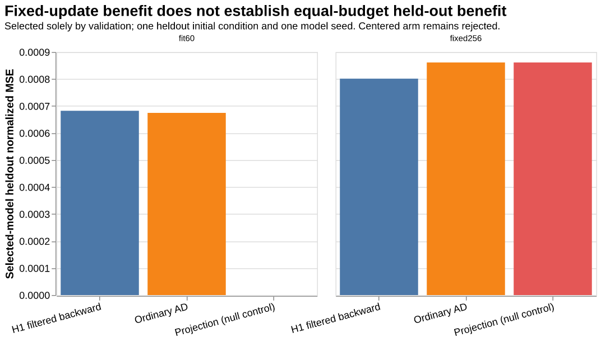
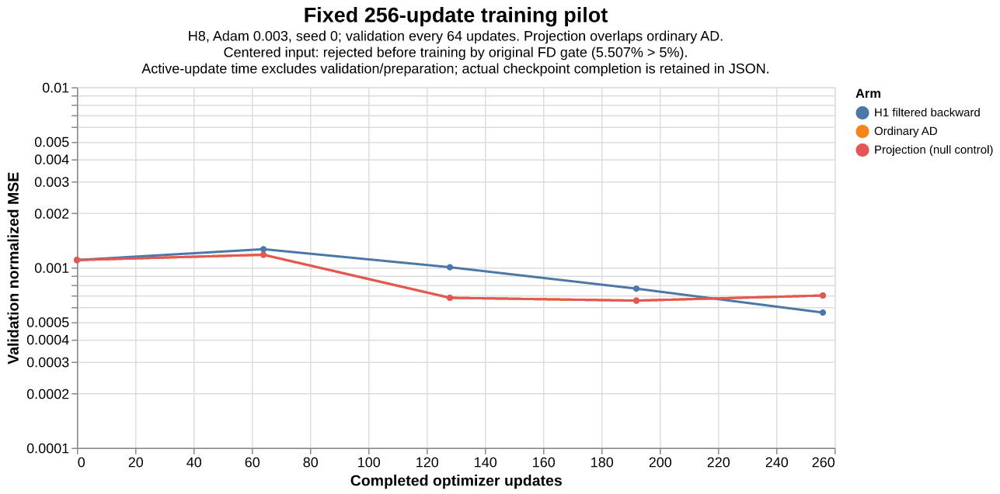
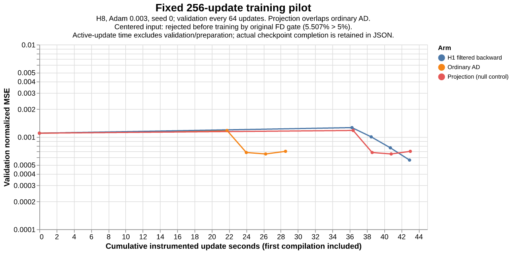
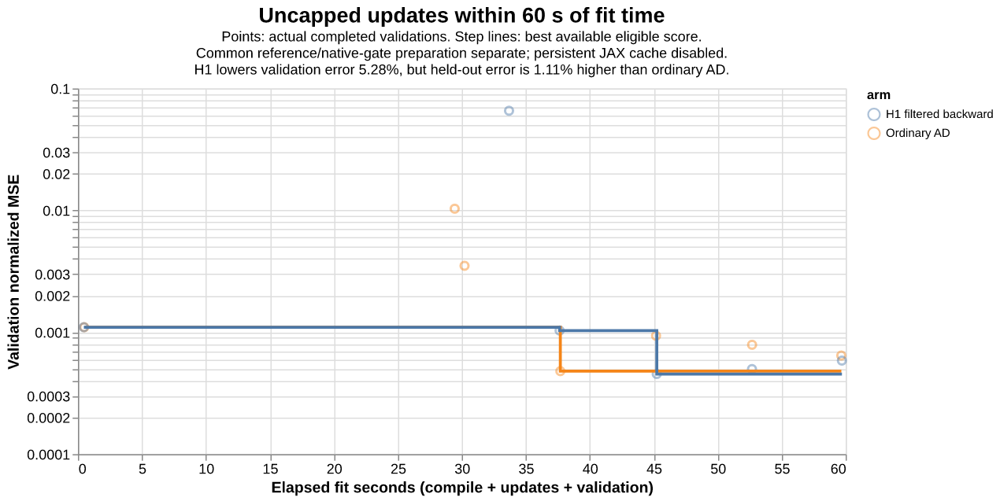

# Physics-gradient training pilot: gains depend on the budget and checkpoint policy

This is a **single-seed JAX-CFD experiment**, using the same four training trajectories, H8, width 8 velocity-only CNN, Adam 0.003, clipped gradient norm 1, and frozen reference/admission data. It does not change the public recipe or CI. Parameters are selected by validation only; the single held-out trajectory is used for reporting.

## Result

At 256 updates, H1-filtered backward directions reduce validation loss by about 14.1% and held-out loss by 7.0%, but instrumented update time increases from 28.56s to 42.94s. Pure velocity projection reproduces ordinary AD to numerical precision and adds overhead, matching the curl-head null-control prediction.

At an equal 60s fit budget, ordinary AD completes 764 updates and H1 completes 674. H1 improves the selected validation loss by 5.28%, but its held-out loss is **1.11% worse**. This is a mixed result, not an equal-budget generalization win. No significance or robust-superiority claim is made from one model seed and one held-out IC.

| Protocol | Arm | Updates / selected | Validation loss | Held-out loss |
|---|---|---:|---:|---:|
| fixed 256 | Ordinary AD | 256 / 192 | 0.000655618554 | 0.000861215347 |
| fixed 256 | H1 filtered backward | 256 / 256 | 0.000562864123 | 0.000801112561 |
| fixed 256 | Projection (null control) | 256 / 192 | 0.000655617507 | 0.000861215172 |
| fit60 | Ordinary AD | 764 / 205 | 0.00048010805 | 0.000674518582 |
| fit60 | H1 filtered backward | 674 / 298 | 0.000454742316 | 0.000682015147 |

## What was changed

- **Projection:** project the physical velocity cotangent into the closed-wall MAC curl range; leave temperature cotangent unchanged. It is placed after every corrected state, before loss and recurrence. It is a null control for this curl-parameterized network, not a new native derivative.
- **H1 filter:** smooth velocity cotangents in the compatible curl basis and temperature cotangents with a mean-preserving Neumann filter (one-cell smoothing length). This deliberately changes the optimization direction; it is **not** claimed to be a more accurate derivative of the unchanged forward objective.
- **Temperature-centered network:** center temperature only in the CNN input, retaining the identity temperature output. This changes the forward model consistently. Its initial true-AD finite-difference check rejected it **before training** under the unchanged epsilon 0.003/5% gate; there are no fabricated validation or held-out scores.

Every successful arm evaluates both the candidate and the true-AD gradient on every update, so these instrumented timings are not production costs. All use the same optimizer, data, initial parameters and window stream; held-out information does not select parameters or settings.

## Checkpoint and timing qualifications

The fixed 256 pilot validates every 64 updates. The budget follow-up instead uses elapsed 7.5s validation milestones, coalescing milestones crossed during indivisible calls. A score is available only at its actual completion time; checkpoints completed after 60s are ineligible. All accepted checkpoints here complete within budget, with zero overshoot. The inherited raw `recipe.validation_interval=64` field is stale for the budget run; [the explicit annotation](raw/budget-metadata-annotation.json) and executed source identify the actual policy without rewriting raw outcomes.

The budget baseline selects update 205, whereas the fixed grid selected 192. [The first 256 window schedules, initial parameter hashes, and scalar update traces match bitwise within each arm](training-prefix-parity.json). This rules out an unseen learning-rate/data change, but **does not prove full parameter-path bitwise identity**: matching parameter snapshots were not retained at every update. In particular, improved baseline selection is partly a checkpoint-policy effect, not solely extra update headroom.

The 60s fit clock includes first-update compilation, both gradient evaluations, optimizer updates, host synchronization, validation and fit-loop overhead. Roughly 13.6–13.8s of common data/native/gate preparation is outside that clock; prior environment provisioning and service startup are also excluded. Persistent JAX compilation caching is disabled in the budget experiment; the fixed pilot may use the persistent cache. Whole-allocation Slurm receipts are separate. These native RTX measurements do not establish fit on the actual CPU-host/T4-container CI pipeline or account for generating fresh references.

## Centered-input diagnostic: original rejection retained

The original centered run failed its **initial** fixed-step test: 5.5073% disagreement at epsilon 0.003, exceeding the unchanged 5% threshold. A separate, preregistered diagnostic finds initial errors 0.6462% at 0.001 and 0.05870% at 0.0003, with 0.5878% mutual disagreement between the two smaller FD slopes. The same criterion is applied to ordinary AD and centered trueAD.

[The completed initial/trained-selected profiles](center-epsilon-initial-selected-diagnostic.json) retain every slope, AD norm and failed check. The trained-selected checkpoint is an **auxiliary probe, not the production synthetic nonzero probe**. The exact production probe replaces only the initial network's final weights with 0.01 times `random.normal(PRNGKey(17), dtype=float32)`; its [separate fixed protocol](center-epsilon-synthetic-protocol.json) is queued on GPU as job 3623885. The complete initial-plus-synthetic criterion is **PENDING** at this publication. A durable metadata watcher will collect it without launching training or changing any gate.

The analytical centered-network control has zero-mean residual temperature gradient while retaining the output cotangent's temperature DC through the identity path. Physical temperature is bitwise unchanged. Smaller-epsilon agreement is useful diagnostic evidence, not automatic readmission, a claim that native AD was broken, or evidence that centering improves training.

## Physical checks and provenance

Successful selected models retain zero packed normal velocity, MAC divergence around float32 rounding, heat drift below 2e-9, and decreasing sampled scalar variance. CFL and physical metrics are evaluated at saved interval endpoints, not every internal microstep or all training states. Buoyancy does not require kinetic energy to decay.

[Complete comparison, raw values and provenance](comparison.json), [raw outcomes and preserved failures](raw), [Slurm accounting](sacct.txt), [training-prefix check](training-prefix-parity.json), and [publication manifest](publication-manifest.json). Earlier four-arm harness failures (mixed dynamic-slice index dtypes) are preserved separately from the scientifically meaningful centered initial FD rejection. Large state/parameter NPZs remain at their recorded cluster paths and hashes. No additional training is launched by this report.
