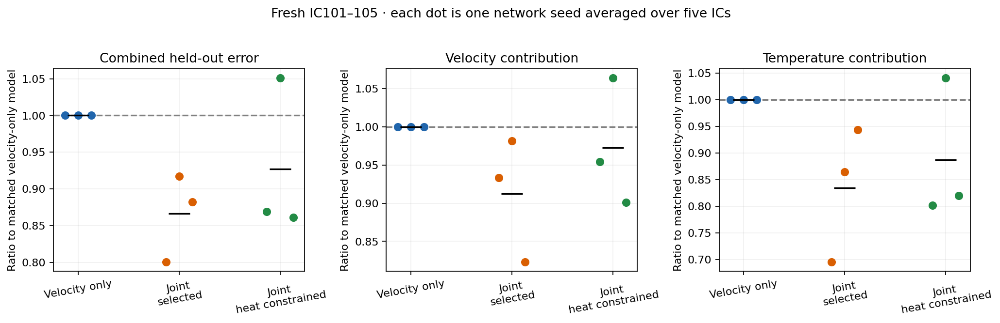
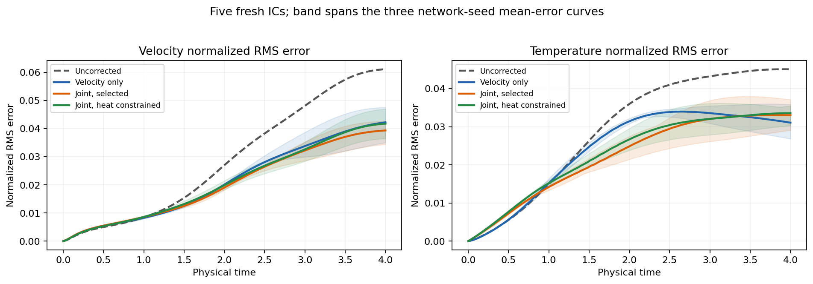
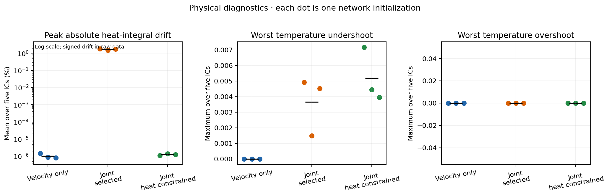
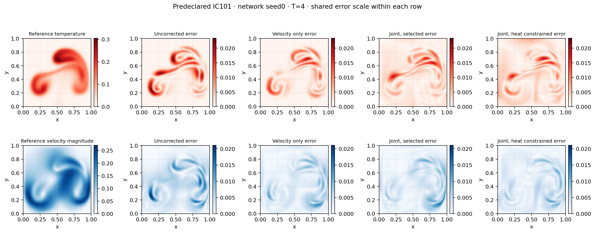
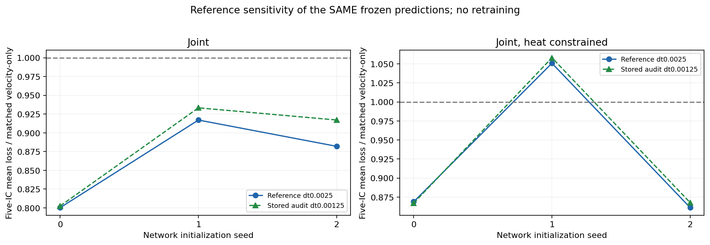

# Fresh evaluation after validation-only selection

Five unseen plume ICs101–105, three network initialization seeds0–2. The recipe/checkpoint choices were frozen before this evaluation.

| Group | Mean combined loss | Mean paired ratio to velocity-only | Three seed ratios |
|---|---:|---:|---|
| Velocity only | 0.0006747178 | 1.0000 | 1.0000, 1.0000, 1.0000 |
| Joint, selected | 0.000587467 | 0.8664 | 0.8003, 0.9170, 0.8820 |
| Joint, heat constrained | 0.000625045 | 0.9270 | 0.8689, 1.0509, 0.8611 |

Each seed ratio compares five-IC mean loss to velocity-only with the same network seed. Black ticks are means of the three seed ratios. These are three model initializations, not fifteen independent model replicates. No significance tests or population claims are made.

The mean-heat diagnostic uses float64 reductions of stored float32 fields. A zero-mean thermal residual preserves integrated heat to floating-point roundoff, not bitwise exactly, and does not guarantee temperature bounds.

The static field example was fixed as IC101/networkseed0/frame100 before fresh evaluation; it was not chosen for visual impact. Reference panels show the restricted fine solution; all error panels share row scales.

## Reference time-step sensitivity

The same frozen predictions were also compared against the preexisting N128/dt0.00125 audit, restricted to N64. No new predictions, model selection or native solver calls were made. This tests temporal-reference sensitivity, not spatial-reference convergence.

- joint: mean paired ratio 0.866420 using the standard reference versus 0.884273 using the finer-time audit. Seed-mean winner flips: 0; individual case winner flips: 1.
- joint_zero_mean: mean paired ratio 0.926967 using the standard reference versus 0.930952 using the finer-time audit. Seed-mean winner flips: 0; individual case winner flips: 0.

Raw joint correction retains its advantage in all three seed means under the finer-time target, although one marginal individual case changes ranking. Heat-constrained correction retains two improved seed means and one worse seed mean. [All audit values and case flips](reference_sensitivity.json).

Heat drift uses an absolute peak and a positive logarithmic axis to display both roundoff and finite heat errors. Signed final heat drift is retained in the raw evaluation outcome. The plot-only polish and audit rescoring leave the primary scalar summary hash unchanged.
