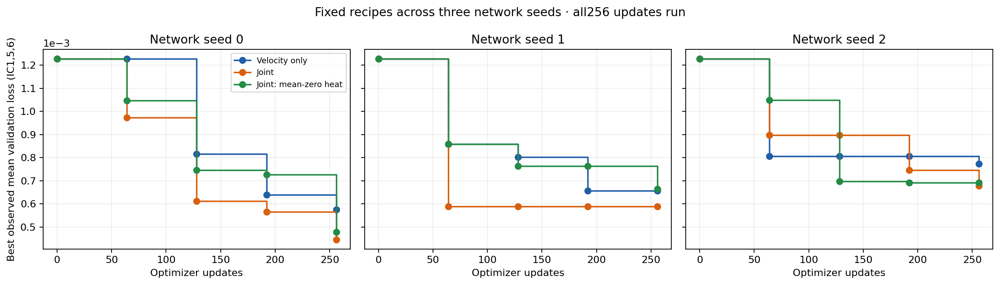
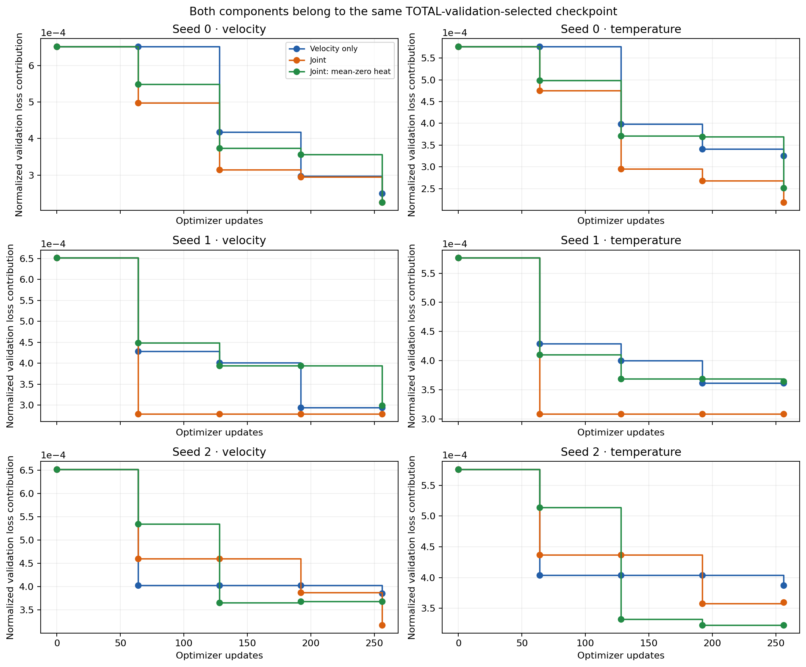
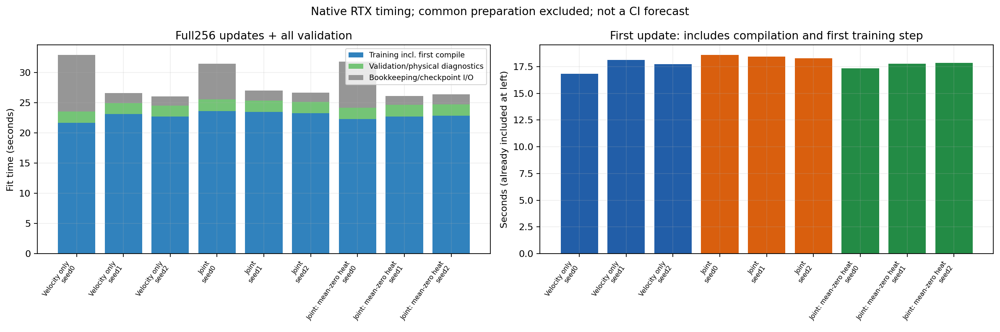
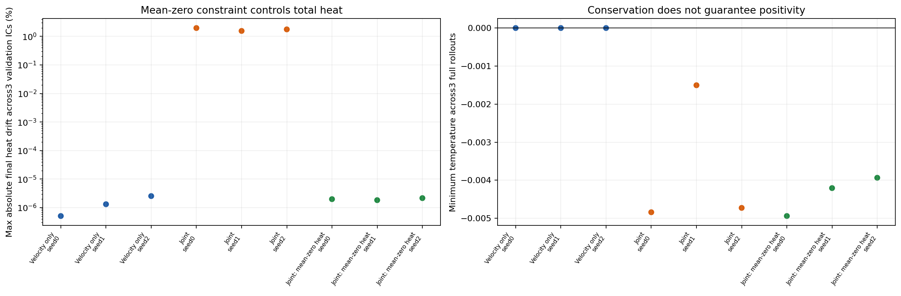

# Joint correction: fixed-recipe confirmation

Three recipes were frozen using only the54-candidate seed0 screen and mean loss on validation IC1,5,6. The exact same hyperparameters were then trained with network seeds1 and2. Everymodel completed256mixed-window H8Adamupdates. No held-out fields or scores were accessed, and no recipe was replaced after confirmation.

| Family | Network seed | Selected update | Validation total | Velocity contribution | Temperature contribution | Fit seconds | First update seconds |
|---|---:|---:|---:|---:|---:|---:|---:|
| Velocity only | 0 | 256 | 0.0005756654 | 0.0002499639 | 0.0003257014 | 32.88 | 16.83 |
| Velocity only | 1 | 192 | 0.000655469 | 0.0002940492 | 0.0003614198 | 26.56 | 18.12 |
| Velocity only | 2 | 256 | 0.0007730614 | 0.0003859978 | 0.0003870636 | 26.04 | 17.74 |
| Joint | 0 | 256 | 0.0004440003 | 0.0002254391 | 0.0002185612 | 31.42 | 18.60 |
| Joint | 1 | 64 | 0.0005880025 | 0.0002791661 | 0.0003088364 | 26.96 | 18.45 |
| Joint | 2 | 256 | 0.0006772553 | 0.0003176267 | 0.0003596286 | 26.61 | 18.27 |
| Joint: mean-zero heat | 0 | 256 | 0.0004771439 | 0.0002256085 | 0.0002515355 | 31.79 | 17.33 |
| Joint: mean-zero heat | 1 | 256 | 0.0006633852 | 0.0002988242 | 0.000364561 | 26.07 | 17.79 |
| Joint: mean-zero heat | 2 | 192 | 0.0006904313 | 0.0003680792 | 0.000322352 | 26.33 | 17.86 |

All models use the same training trajectories, balanced window stream and frozen validation references. Checkpoint selection remains independent per network seed using validation only. The best joint recipe has lower validation loss in all three seeds; the mean-zero recipe is better in two and slightly worse in one. These observations do not establish held-out performance. Fresh-test scoring belongs to a separate locked evaluator.

The training clock includes first-update compilation and all256 optimizer updates. Validation includes full rollouts and physical diagnostics; checkpoint/file bookkeeping is charged to fit time. Common source/reference/native/gate preparation and environment setup are excluded. These are nativeRTX measurements, not container/T4 CI forecasts.

The thermal-mean constraint preserves heat to floating-point roundoff but does not enforce positivity. Original and supplementary finite-difference profiles remain in the raw outcomes. All derivative/admission criteria and benchmark defaults are unchanged. The54-cell search and its asymmetric48joint/6velocity hyperparameter budgets remain explicit.

