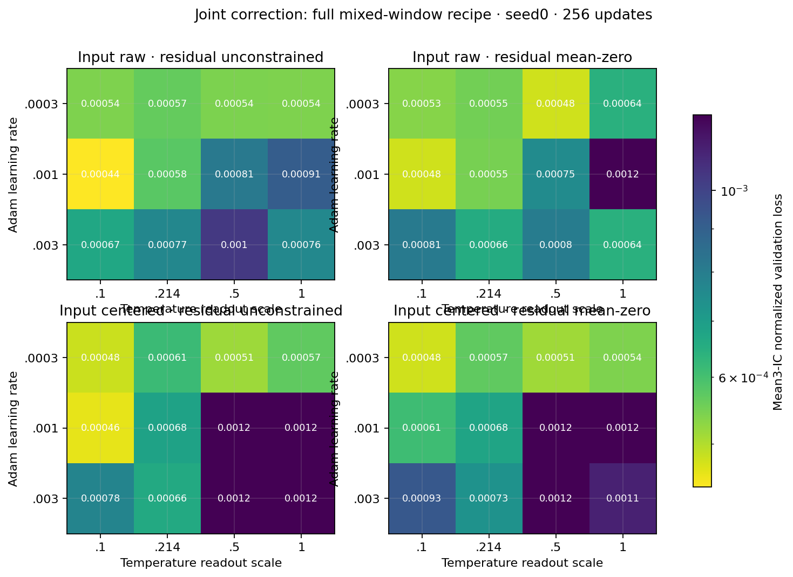
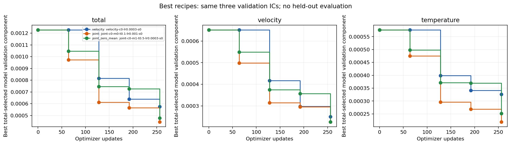
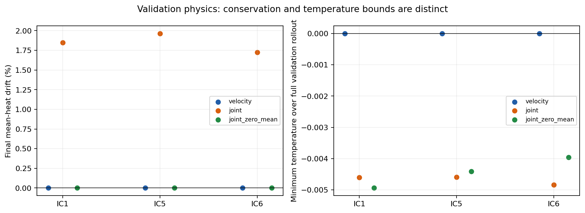

# Joint corrector improvement screen

JAX-CFD; full mixed four-case window stream; 256Adamupdates, H8, width8, modelseed0. Checkpoints and recipes selected by mean normalized loss across validation IC1,5,6 only. No held-out fields were accessed.

Completed 54/54; rejected 0.

| Group | Recipe | Update | Validation total | Velocity component | Temperature component |
|---|---|---:|---:|---:|---:|
| velocity | velocity-c0-lr0.0003-s0 | 256 | 0.0005756654 | 0.0002499639 | 0.0003257014 |
| joint | joint-c0-m0-t0.1-lr0.001-s0 | 256 | 0.0004440003 | 0.0002254391 | 0.0002185612 |
| joint_zero_mean | joint-c0-m1-t0.5-lr0.0003-s0 | 256 | 0.0004771439 | 0.0002256085 | 0.0002515355 |

Velocity6 andjoint48 configurations give unequal hyperparameter-search compute; per-model training budgets are equal. Mean-zero thermal redistribution preserves heat to floating-point roundoff, not a native flux formulation or positivity constraint. OriginalFDfailures and all validationphysics are retained. The same two-point, threeepsilon research gate applies to every model and leaves public admission unchanged.

This freezes seed0 recipes only; root reviews before confirming the chosen2or3 recipes on modelseeds1,2, then evaluating fresh heldoutIC101–105. Repeatedly inspected IC100 is not used.

Timing uses nativeRTX, single fullycompiledtrueAD+Adamwindowupdates. Compile/validation are charged tofit; shared preparation excluded. No CI forecast.

## Numerical controls and preserved attempts

The helper matches the source raw/unconstrained corrector forward map and single-step parameter pullback exactly. The canonical velocity-only H8 loss and parameter gradient match exactly. For scaled joint H8 gradients, applying the fixed readout factor inside each recurrent call versus once outside the full source window changes float32 association: measured relative difference 6.82e-8, maximum absolute difference 1.86e-9. The original bitwise assertion failure (job3631951) is preserved. Measurement job3631976 supports the separately reviewed 1e-6 numerical consistency tolerance for this reparameterization control only. The finite-difference admission criterion is unchanged.

Additional controls verify exact zero-readout identity, the full heat-mean identity pullback, cancellation of the constrained uniform thermal bias, and forward/adjoint uniform-temperature covariance for centered inputs. Mean subtraction uses float64 accumulation with float32 state output, so actual stored heat changes are measured rather than assumed exactly zero.

## Validation physics

The selected unconstrained joint model gains about1.7–2.0% mean heat over its three validation rollouts. The mean-zero joint model keeps absolute mean-heat drift near1e-9, comparable to velocity-only. Both joint variants still produce small negative temperature undershoots (roughly−0.004 to−0.005). Temperature extrema and heat drift are reported, not used to select recipes after test exposure. Finite states and native CFL admissibility are required for selected validation checkpoints.

## Frozen search and confirmation

The original42-candidate protocol is retained as an unlaunched plan. Before any training,12 unscaled-head controls were added, producing the frozen54-candidate protocol. The independent source/forward controls were reviewed before launching training.

All54 candidates completed256 updates, passed the same research gradient criterion, used identical training windows and three frozen validation references, and reported heldout_accessed=false. Network seeds1/2 now confirm the exact three selected recipes using separate manifests. Neither the repeatedly inspected trajectory100 nor fresh heldouts101–105 are accessed by this training driver.

The scalar objective follows source normalized-loss accumulation; auxiliary component diagnostics have separate float32 sums. No whole-training bitwise-parity claim is made. These nativeRTX timings are not container/T4 forecasts. No benchmark source, recipe, label or admission threshold changed.
