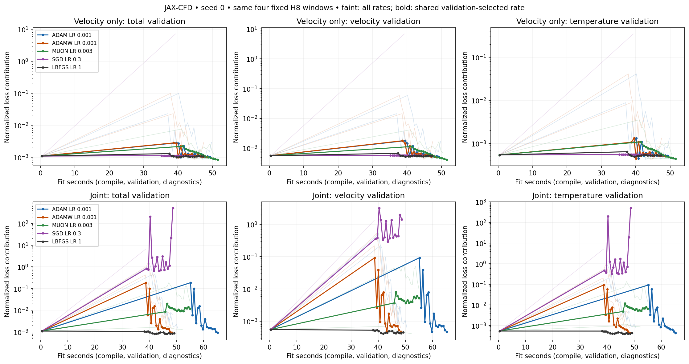
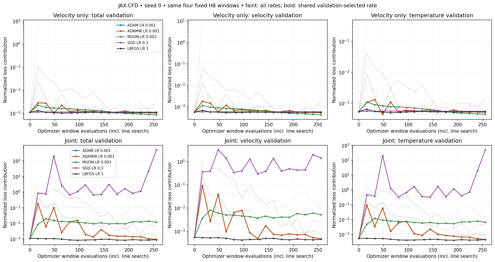
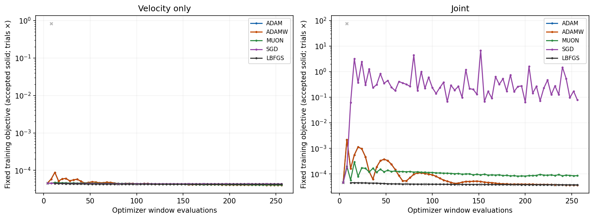
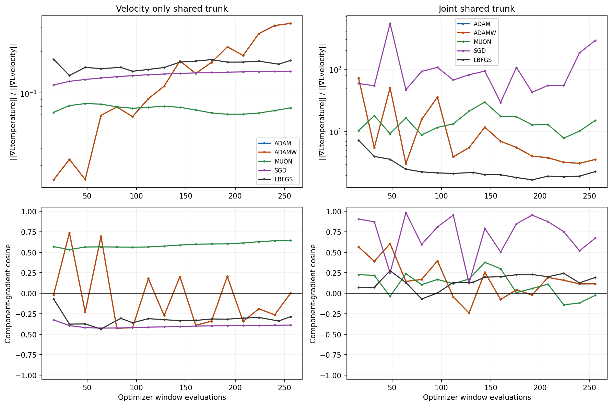
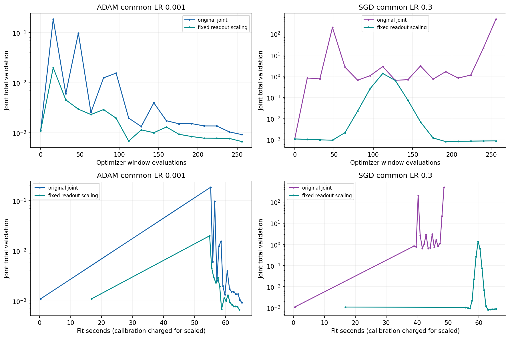
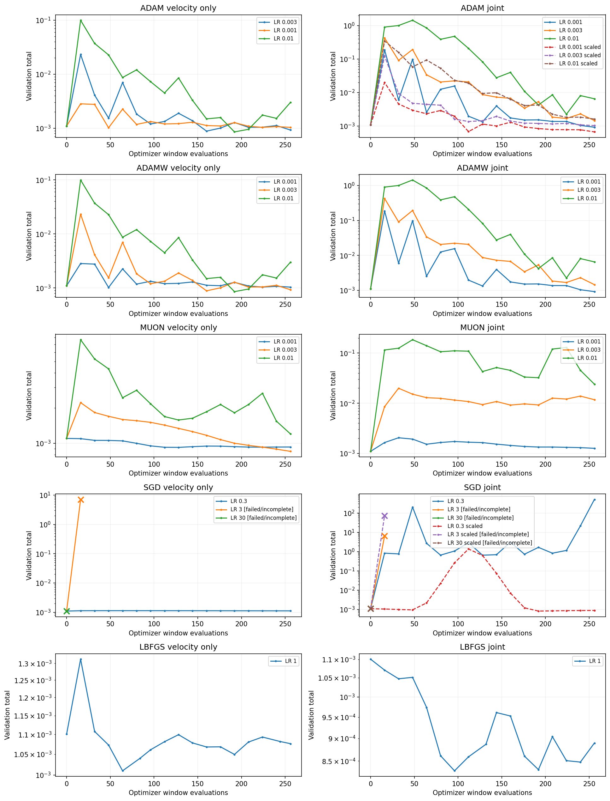

# Optimizer and correction-head screen

JAX-CFD native RTX5090, seed0, same fixed batch of four H8 windows. Velocity-only versus joint velocity/temperature correction; unchanged RMS-normalized physical objective. This differs from the public shuffled-window recipe.

Completed 26/32 cells; explicit failed cells: 6.

| Optimizer | Shared LR | Joint/velocity validation | Joint/velocity heldout |
|---|---:|---:|---:|
| adam | 0.001 | 0.9043 | 0.8854 |
| adamw | 0.001 | 0.9043 | 0.8854 |
| muon | 0.003 | 1.2901 | 1.4962 |
| sgd | 0.3 | 1.0000 | 1.0000 |
| lbfgs | 1 | 0.8208 | 0.9091 |

Ratios below1 favor joint correction. SGD both modes and Muon joint selected the initial identity model; ratio1 is not learned parity. The LR is shared across both modes and chosen only by geometricmean validation; test never chooses LR or checkpoint.

| Scaled joint comparison | Shared LR | Scaled/original validation | Scaled/original heldout |
|---|---:|---:|---:|
| adam | 0.001 | 0.7261 | 0.7074 |
| sgd | 0.3 | 0.7540 | 0.9305 |

Hard64 optimizer objective-gradient calls, including all L-BFGS line-search trials, each4windows. Additional component-gradient diagnostics are separately counted. Fit clock includes first optimizer compilation, optimizer updates, validation and diagnostics; common reference/native/gate preparation excluded. The fixed scaling calibration16.359s is conservatively charged per scaled run. Native RTX timings are not exact CI forecasts.

The readout scaling [1,0.2139727633] is fixed from training-only full-H8 directional-response calibration, not HIG. It changes parameterization while retaining the forward-function family and loss; it does not impose heat conservation or bounds.

Component-gradient analysis separates shared trunk from distinct readout blocks. At zero-readout initialization the shared-trunk gradients vanish, so ratios/cosines are masked rather than treated as evidence. Norm imbalance and direction conflict are descriptive; neither alone proves why an optimizer wins.

Gradient norms use raw trainable coordinates, which the head scaling changes; effective head step norms are retained separately. Failure crosses mark the last measured validation checkpoint before later rejection, not validation of an unsafe model.

All original fixed-epsilon gradient checks, convergence profiles, failures, training/validation traces, physics checks and unsafe-trial records remain in raw/. The research convergence gate does not replace the production gate.

## Shared-trunk component-gradient diagnostics

These summarize nonzero checkpoints along the trained path, not only the selected model. Initial shared gradients vanish; selected identity models have zero shared gradients.

| Optimizer | Mode | Median thermal/velocity norm | Fraction negative cosine |
|---|---|---:|---:|
| adam | velocity | 0.1253 | 0.688 |
| adam | joint | 5.542 | 0.250 |
| adamw | velocity | 0.1253 | 0.688 |
| adamw | joint | 5.542 | 0.250 |
| muon | velocity | 0.07786 | 0.000 |
| muon | joint | 13.17 | 0.250 |
| sgd | velocity | 0.1379 | 1.000 |
| sgd | joint | 74.34 | 0.000 |
| lbfgs | velocity | 0.1644 | 1.000 |
| lbfgs | joint | 2.161 | 0.062 |
## Failed or incomplete cells

- sgd-lr3-velocity-s0: {'type': 'ValueError', 'message': 'Native CFL admissibility rejected training query 1.1316310167312622', 'traceback': 'Traceback (most recent call last):\n  File "/data/personal/andrinr/runner/results/mosaic/buoyancy-optimizer-heads-20261030/driver-v2.py", line 179, in <module>\n    value,g=oracle(params);new,state,delta=first_order_update(params,state,g)\n            ^^^^^^^^^^^^^^\n  File "/data/personal/andrinr/runner/results/mosaic/buoyancy-optimizer-heads-20261030/driver-v2.py", line 152, in oracle\n    raise ValueError(f"Native CFL admissibility rejected training query {row[\'max_advective_cfl\']}")\nValueError: Native CFL admissibility rejected training query 1.1316310167312622\n'}
- sgd-lr3-joint-s0: {'type': 'ValueError', 'message': 'Native CFL admissibility rejected training query 0.7913429141044617', 'traceback': 'Traceback (most recent call last):\n  File "/data/personal/andrinr/runner/results/mosaic/buoyancy-optimizer-heads-20261030/driver-v2.py", line 179, in <module>\n    value,g=oracle(params);new,state,delta=first_order_update(params,state,g)\n            ^^^^^^^^^^^^^^\n  File "/data/personal/andrinr/runner/results/mosaic/buoyancy-optimizer-heads-20261030/driver-v2.py", line 152, in oracle\n    raise ValueError(f"Native CFL admissibility rejected training query {row[\'max_advective_cfl\']}")\nValueError: Native CFL admissibility rejected training query 0.7913429141044617\n'}
- sgd-lr30-velocity-s0: {'type': 'ValueError', 'message': 'Native CFL admissibility rejected training query 0.6917208433151245', 'traceback': 'Traceback (most recent call last):\n  File "/data/personal/andrinr/runner/results/mosaic/buoyancy-optimizer-heads-20261030/driver-v2.py", line 179, in <module>\n    value,g=oracle(params);new,state,delta=first_order_update(params,state,g)\n            ^^^^^^^^^^^^^^\n  File "/data/personal/andrinr/runner/results/mosaic/buoyancy-optimizer-heads-20261030/driver-v2.py", line 152, in oracle\n    raise ValueError(f"Native CFL admissibility rejected training query {row[\'max_advective_cfl\']}")\nValueError: Native CFL admissibility rejected training query 0.6917208433151245\n'}
- sgd-lr30-joint-s0: {'type': 'ValueError', 'message': 'Native CFL admissibility rejected training query 1.2683885097503662', 'traceback': 'Traceback (most recent call last):\n  File "/data/personal/andrinr/runner/results/mosaic/buoyancy-optimizer-heads-20261030/driver-v2.py", line 179, in <module>\n    value,g=oracle(params);new,state,delta=first_order_update(params,state,g)\n            ^^^^^^^^^^^^^^\n  File "/data/personal/andrinr/runner/results/mosaic/buoyancy-optimizer-heads-20261030/driver-v2.py", line 152, in oracle\n    raise ValueError(f"Native CFL admissibility rejected training query {row[\'max_advective_cfl\']}")\nValueError: Native CFL admissibility rejected training query 1.2683885097503662\n'}
- sgd-lr3-joint-scaled-s0: {'type': 'ValueError', 'message': 'Native CFL admissibility rejected training query 1.9729360342025757', 'traceback': 'Traceback (most recent call last):\n  File "/data/personal/andrinr/runner/results/mosaic/buoyancy-optimizer-heads-20261030/driver-v2.py", line 179, in <module>\n    value,g=oracle(params);new,state,delta=first_order_update(params,state,g)\n            ^^^^^^^^^^^^^^\n  File "/data/personal/andrinr/runner/results/mosaic/buoyancy-optimizer-heads-20261030/driver-v2.py", line 152, in oracle\n    raise ValueError(f"Native CFL admissibility rejected training query {row[\'max_advective_cfl\']}")\nValueError: Native CFL admissibility rejected training query 1.9729360342025757\n'}
- sgd-lr30-joint-scaled-s0: {'type': 'ValueError', 'message': 'Native CFL admissibility rejected training query 1.1077946424484253', 'traceback': 'Traceback (most recent call last):\n  File "/data/personal/andrinr/runner/results/mosaic/buoyancy-optimizer-heads-20261030/driver-v2.py", line 179, in <module>\n    value,g=oracle(params);new,state,delta=first_order_update(params,state,g)\n            ^^^^^^^^^^^^^^\n  File "/data/personal/andrinr/runner/results/mosaic/buoyancy-optimizer-heads-20261030/driver-v2.py", line 152, in oracle\n    raise ValueError(f"Native CFL admissibility rejected training query {row[\'max_advective_cfl\']}")\nValueError: Native CFL admissibility rejected training query 1.1077946424484253\n'}

One seed and one test IC support a pilot conclusion only; this is not an optimizer ranking across solvers.
