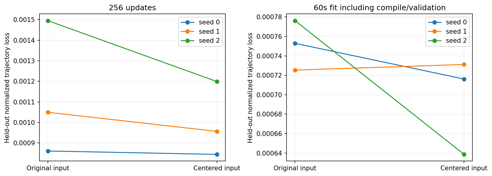
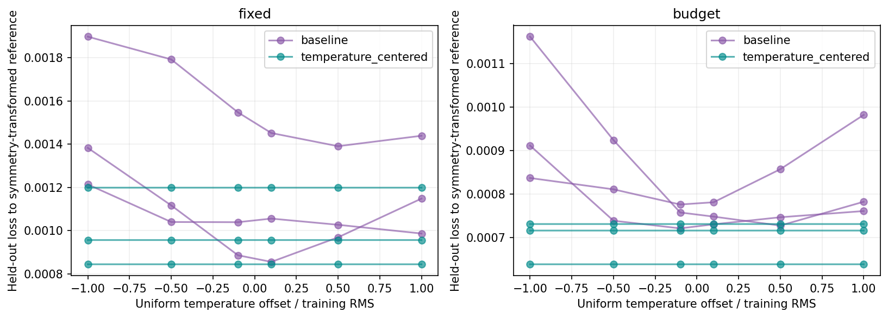
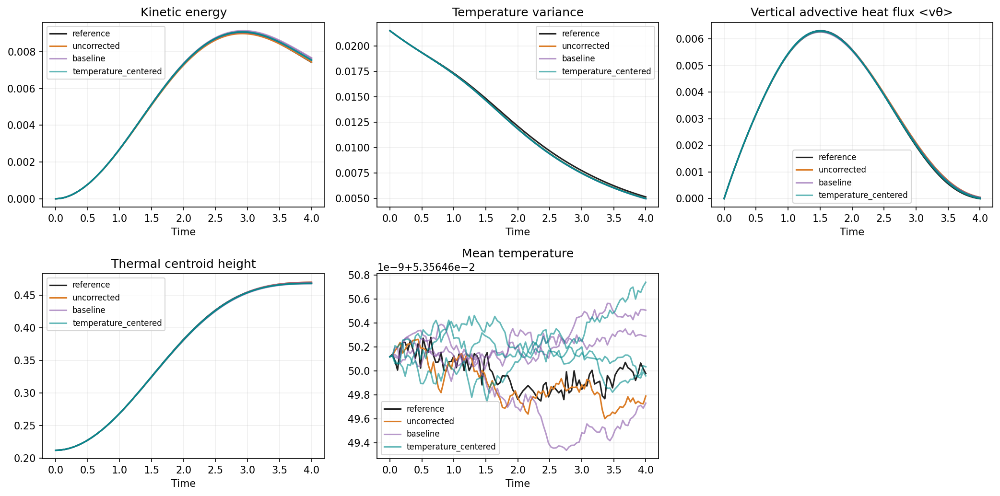
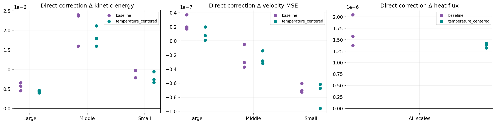
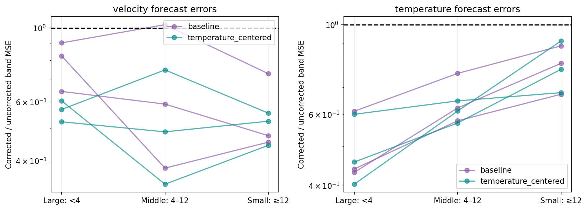

# Temperature symmetry and physical correction budgets

JAX-CFD, three paired model seeds; original versus centered temperature input. Velocity-only curl correction in both arms.

| Budget | Seed | Centered/original validation | Centered/original heldout |
|---|---:|---:|---:|
| fixed | 0 | 1.0101 | 0.9808 |
| fixed | 1 | 0.8379 | 0.9117 |
| fixed | 2 | 0.8416 | 0.8019 |
| budget | 0 | 0.9062 | 0.9513 |
| budget | 1 | 1.0851 | 1.0079 |
| budget | 2 | 0.8398 | 0.8229 |

Ratios below one favor centered inputs. Validation alone selects checkpoints; all offset evaluations are test-only.

Completed 12/12 cells; failures: 0. All missing/rejected cells remain in summary.json.

Budgets: fixed 256 updates with validation cadence64; matched60s includes full training compile and validation, excludes shared preparation/gates. Native RTX research, not exact CI. Dual gradient diagnostics retained equally. Persistent compilation cache disabled.

The research gate requires the same adjacent epsilon pair (.003/.001/.0003) to satisfy original5% AD/FD tolerance and5% slope agreement at both initial and exact synthetic nonzero parameters. Original fixed-epsilon failures remain recorded. No production gate or recipe changes.

DCT-II orthonormal bands describe closed-box spatial scales; these are not divergence-free hydrodynamic eigenmodes or cascade flux. Direct correction energy includes base–correction cross term and self energy. Parseval and energy identities are checked. Reference physics uses restricted fine-grid fields.

Offsets transform the admitted reference using physical symmetry. This is not a fresh shifted fine solver run; native coarse symmetry defects are recorded independently. One test IC and three model seeds do not establish broad generalization.

## Interpretation

Centering improves unshifted held-out loss in all three fixed-update pairs (1.9%, 8.8%, 19.8%; geometric mean reduction 10.5%). At matched 60s the changes are -4.9%, +0.8%, -17.7% (geometric mean reduction 7.6%); one seed worsens. This is three network initializations on one held-out trajectory, not three independently sampled test trajectories.

Uniform offsets are held out from all training and model selection. At offsets ±1 training-temperature RMS, the original CNN changes the held-out velocity by about 0.00087–0.00183 RMS in fixed-update runs; the centered model changes it by about 5e-9–1.1e-8. Centering therefore fixes the intended symmetry to numerical precision in this test. This confirms invariance, not accuracy on unrelated plume shapes.

Direct corrections add kinetic energy on average in every reported DCT band for both architectures. Middle/small-band local velocity error generally decreases; local large-band error increases slightly even while the complete corrected rollout has lower large-band error. Thus local correction effects and recurrent forecast effects must be distinguished. These are not energy-cascade or inverse-cascade measurements.

All three centered fixed-update models reduce velocity forecast error in all three DCT bands against their uncorrected baselines. The original seed-2 model slightly worsens the middle band despite reducing aggregate error. Physical temperature is unchanged bitwise by each correction; heat-flux and mixing changes occur through the subsequent velocity-driven transport. Maximum absolute mean-heat drift is below 8e-10 across these six fixed-update corrected trajectories, with no negative temperature undershoot.

Original fixed-epsilon admission failures are retained in each outcome. The same research-only convergence rule is applied to both architectures and all seeds. Passing this supplementary rule does not make the centered variant eligible under the unchanged public benchmark gate. The original centered-training rejection and diagnostic are retained separately.

The first CPU rendering attempt lacked the optional Matplotlib dependency and failed before analysis. The v2 renderer explicitly installs Matplotlib3.10.7; this did not rerun training or alter its data. Both Slurm receipts are retained.

[Protocol](PROTOCOL.json), [all scalar outcomes](summary.json), [raw per-run histories and checkpoints](raw), [prior gradient diagnostic](prior-centered-convergence-diagnostic.json), [Slurm accounting](sacct.txt), and [publication manifest](publication-manifest.json). Full fields and parameters remain on the cluster at the recorded paths. No benchmark source changes or CI dispatch.
